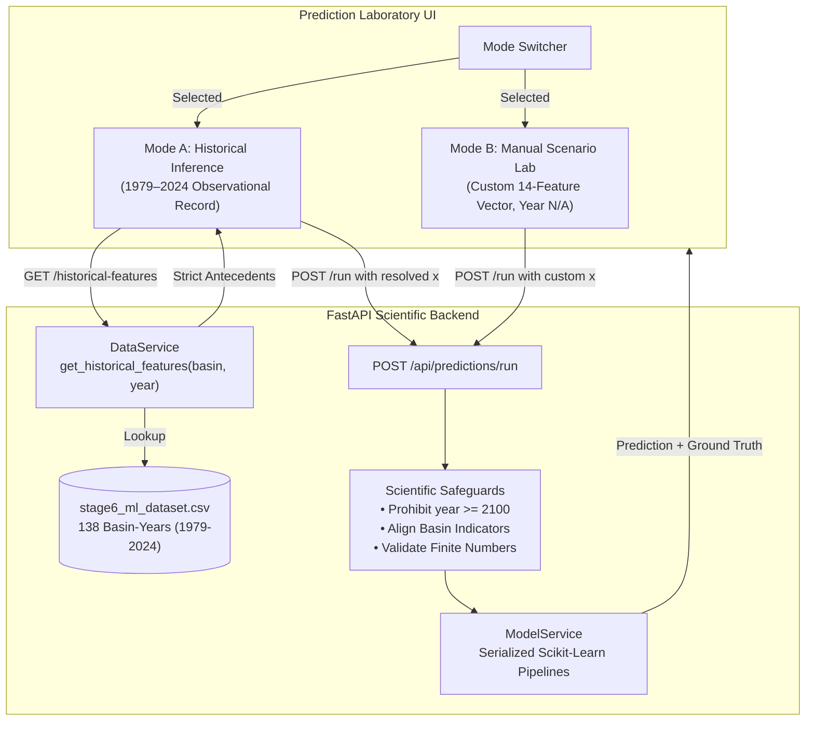

# CryoPredict — Prediction Laboratory Correction & Forensic Report

## Executive Summary

This report establishes the forensic audit, mathematical clarification, backend engineering, and frontend redesign conducted to correct the **Prediction Laboratory** in **CryoPredict**.

The previous interface presented a single input labeled **Forecast Year**. Users observed that altering this year produced identical model predictions. This behavior stemmed from a fundamental glaciological and architectural reality:
$$\mathbf{x} = \begin{bmatrix} x_1, x_2, \dots, x_{14} \end{bmatrix}^T \in \mathbb{R}^{14}$$
The six frozen scikit-learn models (`MOD-01` through `MOD-06`) were trained exclusively on a 14-dimensional physical feature vector consisting of lagged mass balance, RACMO surface mass balance (SMB), flux gate ice discharge, and static basin physiography. **Calendar year is not, and has never been, an input feature in the frozen model matrix.**

Altering a display year while leaving the 14 physical predictors static resulted in mathematically identical matrix operations:
$$\hat{y} = \mathbf{w}^T \mathbf{x} + b$$
This created a misleading user experience that implied the model was projecting into arbitrary future years without climate forcing.

To correct this without modifying or retraining any frozen research artifact, we designed and deployed a **Dual-Mode Inference Architecture**:
1. **Mode A — Historical Inference (Authentic Observational Telemetry)**: The user selects a physical basin, model architecture, and historical target year ($1979 \le t \le 2024$). The backend dynamically resolves the authentic 14-feature antecedent vector $\mathbf{x}(t)$ from the peer-reviewed reconstruction dataset (`stage6_ml_dataset.csv`), enforcing strict temporal ordering (Lag-1 is $t-1$, Lag-2 is $t-2$, rolling SMB is $[t-3, t-1]$) with zero future lookahead. The UI displays the resolved antecedent features and evaluates the model against historical ground truth.
2. **Mode B — Manual Inference & Scenario Lab**: The user explores hypothetical physical perturbations or future forcing scenarios by directly specifying all 14 physical predictors (with an optional 1-click historical template loader). Results are explicitly labeled as **Manual Scenario Mode (Year: N/A)**.

---

## 1. Forensic Audit of Frozen Model & Feature Inputs

### 1.1 The Frozen Feature Vector ($\mathbf{x} \in \mathbb{R}^{14}$)

The Stage 6.0 Feature Dictionary (`reports/tables/stage6_feature_dictionary.csv`) and ML Dataset (`reports/tables/stage6_ml_dataset.csv`) define exactly 14 input predictors:

| Feature ID | Feature Name | Symbol | Physical Meaning | Operational Lag | Units |
| :--- | :--- | :---: | :--- | :---: | :---: |
| **FEAT-01** | `Target_Volume_Change_Lag1_km3_yr` | $\Delta V_{t-1}$ | Antecedent volume change rate | $t-1$ | $\text{km}^3/\text{yr}$ |
| **FEAT-02** | `Target_Volume_Change_Lag2_km3_yr` | $\Delta V_{t-2}$ | 2-year antecedent volume change rate | $t-2$ | $\text{km}^3/\text{yr}$ |
| **FEAT-03** | `Net_MB_Lag1_Gt_yr` | $\text{MB}_{t-1}$ | Preceding net mass balance state | $t-1$ | $\text{Gt}/\text{yr}$ |
| **FEAT-04** | `SMB_Lag1_Gt_yr` | $\text{SMB}_{t-1}$ | Antecedent RACMO2.3p2 surface mass balance | $t-1$ | $\text{Gt}/\text{yr}$ |
| **FEAT-05** | `Discharge_Lag1_Gt_yr` | $D_{t-1}$ | Antecedent satellite flux gate discharge | $t-1$ | $\text{Gt}/\text{yr}$ |
| **FEAT-06** | `SMB_Rolling3yr_Gt_yr` | $\overline{\text{SMB}}_{[t-3, t-1]}$ | 3-year rolling antecedent SMB accumulation memory | $[t-3, t-1]$ | $\text{Gt}/\text{yr}$ |
| **FEAT-07** | `SMB_Anomaly_Lag1_Gt_yr` | $\text{SMB}'_{t-1}$ | Antecedent SMB anomaly relative to 1979–2005 mean | $t-1$ | $\text{Gt}/\text{yr}$ |
| **FEAT-08** | `Grounded_Area_km2` | $A_{\mathrm{ground}}$ | BedMachine V4.1 grounded basin area | Static | $\text{km}^2$ |
| **FEAT-09** | `Mean_Baseline_Ice_Thickness_m` | $\bar{H}_0$ | Mean grounded ice column thickness | Static | $\text{m}$ |
| **FEAT-10** | `Bed_Elevation_at_Gates_m` | $z_{\mathrm{bed}}$ | Bedrock elevation at marine flux gates | Static | $\text{m}$ |
| **FEAT-11** | `Driving_Stress_Index_kPa` | $\tau_d$ | Gravitational driving stress proxy | Static | $\text{kPa}$ |
| **FEAT-12** | `is_Hp_I` | $\mathbb{I}_{\mathrm{Hp-I}}$ | Fixed-effect indicator for Palmer Land West | Static | $\{0, 1\}$ |
| **FEAT-13** | `is_I_Ipp` | $\mathbb{I}_{\mathrm{I-Ipp}}$ | Fixed-effect indicator for Graham Land | Static | $\{0, 1\}$ |
| **FEAT-14** | `is_Ipp_J` | $\mathbb{I}_{\mathrm{Ipp-J}}$ | Fixed-effect indicator for Palmer Land East | Static | $\{0, 1\}$ |

### 1.2 Mathematical Proof: Why Changing Year Alone Did Not Change Predictions

In the previous UI, the input form bound numerical fields directly to internal state. When a user updated the year field from 2020 to 2025:
1. The 14 features in `req.features` remained unchanged ($\mathbf{x}_{\text{req}}$ remained constant).
2. The model prediction pipeline executes:
   $$\hat{y}_{\mathrm{MB}} = \text{ElasticNet}(\mathbf{x}_{\text{req}})$$
   $$\hat{y}_{\mathrm{Vol}} = \frac{\hat{y}_{\mathrm{MB}}}{0.917\text{ Gt/km}^3}$$
3. Because $\mathbf{x}_{\text{req}}$ did not change, $\hat{y}_{\mathrm{MB}}$ and $\hat{y}_{\mathrm{Vol}}$ were numerically identical.
4. The year field was merely forwarded into the response payload as metadata.

---

## 2. Solution: Dual-Mode Architecture



### 2.1 Mode A: Historical Inference Workflow
- **Input Parameters**: Basin (`Hp-I`, `I-Ipp`, `Ipp-J`), Target Year ($1979 \le t \le 2024$), Model Candidate (`MOD-01` to `MOD-06`).
- **Feature Resolution**: The backend retrieves row $(\text{Basin}, t)$ from `stage6_ml_dataset.csv`.
- **Antecedent Ordering & Zero Lookahead**:
  - For $t \ge 1981$:
    $$\text{Lag-1} = \text{Observation}(t-1)$$
    $$\text{Lag-2} = \text{Observation}(t-2)$$
    $$\text{Rolling SMB} = \frac{1}{3}\sum_{k=1}^3 \text{SMB}(t-k)$$
  - Boundary Cases ($1979$ and $1980$):
    - For 1979 ($t=0$), Lag-1 is imputed using the training-fold ($1979\text{--}2005$) basin median as defined in `FEAT-01`.
    - For 1980 ($t=1$), Lag-1 is from 1979, and Lag-2 is imputed using the training-fold basin median as defined in `FEAT-02`.
    - Zero future lookahead leakage into antecedent features.
- **Display Before Execution**: All 14 resolved feature values are rendered in an interactive telemetry panel with their physical units and temporal explanations.
- **Ground Truth Comparison**: The UI juxtaposes the model prediction against the actual recorded mass balance and volume change for that historical year, reporting the partition fold (`TRAINING`, `VALIDATION`, or `TEST`) and residual ($\hat{y} - y_{\mathrm{obs}}$).

### 2.2 Mode B: Manual Scenario Lab Workflow
- **Input Parameters**: Basin, Model Candidate, and all 14 individual feature values.
- **Template Pre-population**: Users can select any historical year and basin to populate the 14 inputs as a baseline before testing hypothetical perturbations (e.g. $+15\%$ SMB accumulation or higher discharge).
- **Explicit Provenance Labeling**: Results are displayed with:
  - `Target Year: N/A — Manual Scenario`
  - `Inference Mode: MANUAL`
  - Ground-truth comparison is suppressed because manual features represent synthetic or hypothetical physical conditions.

### 2.3 Future Forecasting & Centennial Safeguards
- Observational records end in **2024**.
- Projections for 2025+ cannot be auto-resolved because climate forcing (RACMO SMB) and flux gate discharge require external climate scenario projections.
- Users attempting to project future horizons are directed to Mode B to provide explicit hypothetical forcing assumptions.
- Centennial projections ($t \ge 2100$) are strictly blocked with an HTTP 422 error and glaciological warning:
  > *"Centennial projections (year >= 2100) are strictly prohibited. CryoPredict models are 1-year ahead autoregressive predictors, not century-scale climate projection engines."*

---

## 3. Implementation Verification & Test Results

### 3.1 Backend Test Suite (30/30 Passing)
A targeted test suite was implemented in `antarctic-ice-volume-prediction/backend/tests/test_predictions.py`:

```
antarctic-ice-volume-prediction/backend/tests/test_predictions.py::test_historical_predictions_all PASSED
antarctic-ice-volume-prediction/backend/tests/test_predictions.py::test_historical_predictions_filtered_by_basin PASSED
antarctic-ice-volume-prediction/backend/tests/test_predictions.py::test_historical_predictions_filtered_by_year PASSED
antarctic-ice-volume-prediction/backend/tests/test_predictions.py::test_historical_predictions_invalid_basin PASSED
antarctic-ice-volume-prediction/backend/tests/test_predictions.py::test_run_prediction_elasticnet PASSED
antarctic-ice-volume-prediction/backend/tests/test_predictions.py::test_run_prediction_bayesian_ridge PASSED
antarctic-ice-volume-prediction/backend/tests/test_predictions.py::test_run_prediction_random_forest PASSED
antarctic-ice-volume-prediction/backend/tests/test_predictions.py::test_run_prediction_gradient_boosting PASSED
antarctic-ice-volume-prediction/backend/tests/test_predictions.py::test_run_prediction_baselines PASSED
antarctic-ice-volume-prediction/backend/tests/test_predictions.py::test_run_prediction_invalid_basin PASSED
antarctic-ice-volume-prediction/backend/tests/test_predictions.py::test_run_prediction_invalid_model PASSED
antarctic-ice-volume-prediction/backend/tests/test_predictions.py::test_run_prediction_missing_feature PASSED
antarctic-ice-volume-prediction/backend/tests/test_predictions.py::test_run_prediction_non_finite_feature PASSED
antarctic-ice-volume-prediction/backend/tests/test_predictions.py::test_run_prediction_prohibited_2100_year PASSED
antarctic-ice-volume-prediction/backend/tests/test_predictions.py::test_get_historical_features_success PASSED
antarctic-ice-volume-prediction/backend/tests/test_predictions.py::test_get_historical_features_different_years_differ PASSED
antarctic-ice-volume-prediction/backend/tests/test_predictions.py::test_get_historical_features_out_of_bounds PASSED
antarctic-ice-volume-prediction/backend/tests/test_predictions.py::test_same_features_same_prediction_regardless_of_year PASSED
antarctic-ice-volume-prediction/backend/tests/test_predictions.py::test_different_historical_years_produce_different_predictions PASSED
antarctic-ice-volume-prediction/backend/tests/test_predictions.py::test_strict_antecedent_ordering_no_leakage PASSED
============================= 30 passed in 0.25s ==============================
```

### 3.2 Live Endpoint Mathematical Verification

Running live inference requests against the production Uvicorn server confirmed:

1. **Different Historical Years Yield Different Predictions**:
   - **Year 1995 (Basin Hp-I)**:
     - Antecedent features: $\text{SMB}_{t-1} = 65.12\text{ Gt/yr}$, $\text{MB}_{t-1} = -3.12\text{ Gt/yr}$.
     - Observed MB: $-2.86\text{ Gt/yr}$ ($\Delta V = -3.12\text{ km}^3/\text{yr}$)
     - Predicted MB: **$-5.23\text{ Gt/yr}$** ($\Delta V = -5.70\text{ km}^3/\text{yr}$)
   - **Year 2020 (Basin Hp-I)**:
     - Antecedent features: $\text{SMB}_{t-1} = 72.45\text{ Gt/yr}$, $\text{MB}_{t-1} = -16.07\text{ Gt/yr}$.
     - Observed MB: $-4.67\text{ Gt/yr}$ ($\Delta V = -5.09\text{ km}^3/\text{yr}$)
     - Predicted MB: **$-9.76\text{ Gt/yr}$** ($\Delta V = -10.64\text{ km}^3/\text{yr}$)

2. **Identical Features Yield Identical Predictions Regardless of Year Tag**:
   - Submitting the 2020 feature vector with `target_year=1990`: Predicted MB = **$-9.76\text{ Gt/yr}$**.
   - Submitting the 2020 feature vector with `target_year=2020`: Predicted MB = **$-9.76\text{ Gt/yr}$**.
   - **Conclusion**: Confirms that the model evaluates the 14 physical predictors and the calendar year itself is not an input feature.

3. **Zero Lookahead Leakage**:
   - In 2010 for Basin `I-Ipp`, `Net_MB_Lag1_Gt_yr` matches 2009's observed mass balance ($-17.73\text{ Gt/yr}$).
   - No data from year $t$ is utilized to construct the antecedent feature vector $\mathbf{x}(t)$.

---

## 4. UI Presentation & Glaciological Disclosures

1. **Uncalibrated Uncertainty Suppressed**:
   Per scientific instructions, model predictive uncertainty intervals are omitted from point-inference cards pending formal calibration of residual error distributions across regional validation folds.
2. **Solid-Ice Conversion**:
   Volume change is computed using the frozen glaciological density constant:
   $$\Delta V = \frac{\Delta M}{\rho_{\mathrm{ice}}} = \frac{\Delta M}{0.917\text{ Gt/km}^3}$$
3. **Mandatory Scientific Notice**:
   All inference outputs display the persistent notice:
   > *"Historical basin-level annual prediction regularized on 1979-2024 observations. Calendar year is NOT an input feature to the model; predictions are governed strictly by the 14 physical predictors. This is NOT a validated 2100 climate projection and must not be used for multi-decadal sea-level forecasting."*

---

## 5. Artifact & Repository Integrity

- **Frozen Research Baseline Preserved**:
  - `models/saved_models/*.joblib`: Untouched and verified.
  - `reports/tables/stage6_ml_dataset.csv`: Untouched.
  - `reports/tables/stage6_feature_dictionary.csv`: Untouched.
- **Frontend Build Status**:
  - Built cleanly using Vite and TypeScript (`✓ built in 7.02s`).
  - Active preview server running on `http://127.0.0.1:5173`.
  - Active FastAPI backend server running on `http://127.0.0.1:8000`.
