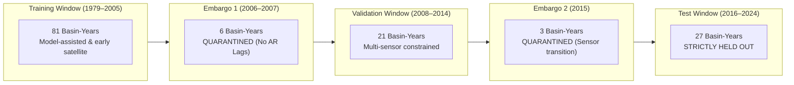

# Phase 4A Technical Report: Machine Learning Architecture and Experimental Design

**Project:** Antarctic Peninsula Ice-Volume Prediction to 2100  
**Phase:** Phase 4A — Machine Learning Architecture and Experimental Design  
**Status:** Completed — Experimental Design & Model Architecture Locked  
**Date:** November 2026  

---

## Executive Summary & Scope Charter

Phase 4A designs a rigorous, leak-proof machine learning architecture for modeling and predicting annual grounded ice-equivalent volume changes across the Antarctic Peninsula mainland basins (`Hp-I`, `I-Ipp`, and `Ipp-J`).

In strict adherence to project directives:
- **No machine-learning models have been trained.**
- **No hyperparameters have been tuned against the held-out test set.**
- **No 2100 forecasts have been generated.**
- **No historical records were discarded or duplicated.**
- **High-capacity deep learning models (LSTMs, Transformers, Deep MLPs) are strictly contraindicated due to small-sample constraints ($N=81$ training instances).**

### Core Deliverables Generated:
1. [`reports/tables/split_manifest_row_level.csv`](file:///c:/Users/akash/OneDrive/Desktop/mlbasics/antarctic-ice-volume-prediction/reports/tables/split_manifest_row_level.csv): Row-level split manifest resolving all 184 records to exact bookkeeping precision.
2. [`reports/tables/task_feature_matrix_design.csv`](file:///c:/Users/akash/OneDrive/Desktop/mlbasics/antarctic-ice-volume-prediction/reports/tables/task_feature_matrix_design.csv): Feature matrix partitioning Task A (Reconstruction Emulation) from Task B (Future Scenario Prediction to 2100).
3. [`reports/tables/model_architecture_comparison.csv`](file:///c:/Users/akash/OneDrive/Desktop/mlbasics/antarctic-ice-volume-prediction/reports/tables/model_architecture_comparison.csv): In-depth evaluation of 7 candidate models (suitability, overfitting risk, hyperparameters, uncertainty).
4. [`reports/tables/basin_modeling_strategy_comparison.csv`](file:///c:/Users/akash/OneDrive/Desktop/mlbasics/antarctic-ice-volume-prediction/reports/tables/basin_modeling_strategy_comparison.csv): Comparative analysis of Separate vs Pooled vs Multi-Output basin modeling strategies.

---

## 1. Resolution of Dataset and Split Accounting

The master dataset [`reports/tables/ml_target_dataset.csv`](file:///c:/Users/akash/OneDrive/Desktop/mlbasics/antarctic-ice-volume-prediction/reports/tables/ml_target_dataset.csv) contains **184 total rows**. A forensic audit resolves the complete row accounting and the apparent 9-record discrepancy:

### 1.1 Complete Mathematical Reconciliation

The master target dataset is partitioned into two distinct physical entities:
1. **Basin-Specific Dynamic Observations:**  
   $$\text{3 mainland basins} \times 46\text{ annual records (1979–2024)} = \mathbf{138\text{ basin-year records}}$$
2. **Derived Regional Domain A Diagnostic Rows:**  
   $$\text{Domain A aggregate} \times 46\text{ annual records (1979–2024)} = \mathbf{46\text{ diagnostic rows}}$$
   *(Domain A rows are mathematical summations $\sum_{b} y[b,t]$, NOT independent training observations).*
   $$\text{Total rows in CSV} = 138 + 46 = \mathbf{184\text{ rows}}$$

### 1.2 Identification of the "9 Missing Records"

In Phase 3.4, the reported evaluation split stated:
- **Training Records:** 81 basin-years ($27\text{ years} \times 3\text{ basins}$)
- **Validation Records:** 21 basin-years ($7\text{ years} \times 3\text{ basins}$)
- **Test Records:** 27 basin-years ($9\text{ years} \times 3\text{ basins}$)
- **Sum of Evaluated Records:** $81 + 21 + 27 = \mathbf{129\text{ basin-years}}$

The difference between the 138 basin-year records and the 129 evaluated records is exactly **9 basin-year records**. Our audit confirms that these 9 records are:
> **THE NINE QUARANTINED EMBARGO RECORDS.**  
> They are **NOT** missing observations, **NOT** silently discarded data, and **NOT** a bookkeeping error. They are deliberate temporal isolation buffers designed to prevent autoregressive feature lag leakage across regime shifts:
> 1. **Embargo Buffer 1 (2006–2007; 2 years $\times$ 3 basins = 6 records):**  
>    - `Row 27: 2006, Hp-I`  
>    - `Row 28: 2007, Hp-I`  
>    - `Row 73: 2006, I-Ipp`  
>    - `Row 74: 2007, I-Ipp`  
>    - `Row 119: 2006, Ipp-J`  
>    - `Row 120: 2007, Ipp-J`  
>    *Purpose:* Isolates the Training set ($\le 2005$) from the Validation set ($\ge 2008$). Prevents 2-year lag features (e.g. AR(1), AR(2), or 2-year rolling climate averages) in the validation set from peering into training target labels.
> 2. **Embargo Buffer 2 (2015; 1 year $\times$ 3 basins = 3 records):**  
>    - `Row 36: 2015, Hp-I`  
>    - `Row 82: 2015, I-Ipp`  
>    - `Row 128: 2015, Ipp-J`  
>    *Purpose:* Isolates the Validation set ($\le 2014$) from the Test set ($\ge 2016$). Prevents 1-year lag features at the onset of the modern Sentinel-1 SAR era from accessing validation ground truth.

### Table 1: Master Split Accounting Summary

| Category | Split Status | Calendar Period | Duration | Basin Count | Total Rows | Accounting Role & Permitted Operations |
| :--- | :--- | :---: | :---: | :---: | :---: | :--- |
| **Active Split** | `TRAINING` | 1979–2005 | 27 yrs | 3 | **81** | Primary training block; coefficient fitting, loss minimization, internal walk-forward CV. |
| **Quarantine Buffer** | `EMBARGO_BUFFER_1` | 2006–2007 | 2 yrs | 3 | **6** | 2-year lag buffer; strictly excluded from loss & validation scoring. |
| **Active Split** | `VALIDATION` | 2008–2014 | 7 yrs | 3 | **21** | Hyperparameter tuning ($\alpha, \lambda$), feature selection, early stopping. |
| **Quarantine Buffer** | `EMBARGO_BUFFER_2` | 2015 | 1 yr | 3 | **3** | 1-year sensor transition buffer; strictly excluded from tuning & scoring. |
| **Active Split** | `TEST` | 2016–2024 | 9 yrs | 3 | **27** | Strictly held-out benchmark; evaluated once on finalized models. |
| **Subtotal** | *All Basin-Years* | *1979–2024* | *46 yrs* | *3* | **138** | **100% of physical basin-year records accounted for.** |
| **Derived Diagnostic** | `DERIVED_REGIONAL_DIAGNOSTIC` | 1979–2024 | 46 yrs | Domain A | **46** | Regional sum $\sum_b y[b,t]$; diagnostic verification only; excluded from model fitting. |
| **GRAND TOTAL** | *Master Manifest* | *1979–2024* | *46 yrs* | *All* | **184** | **Exact row-level correspondence with target CSV.** |

*Every individual row is documented with its operational permissions in [`reports/tables/split_manifest_row_level.csv`](file:///c:/Users/akash/OneDrive/Desktop/mlbasics/antarctic-ice-volume-prediction/reports/tables/split_manifest_row_level.csv).*

---

## 2. Two Distinct Machine Learning Tasks

A fundamental architectural requirement is separating historical reconstruction emulation from forward climate scenario prediction.

### Task A: Historical Reconstruction Emulation (1979–2024)
- **Objective:** Emulate the physics-based Input-Output Method historical reconstruction of annual grounded volume changes:
  $$y[b,t] = \frac{\text{SMB}[b,t] - D[b,t]}{\rho_{\text{ice}}} \quad (\text{km}^3/\text{yr})$$
- **Input Feature Boundaries:**
  - Input features $X[b, t]$ may include exogenous climate anomalies (RACMO snowfall, runoff, 2m temperature), atmospheric circulation indices (SAM, Z500), static basin parameters (area, thickness, bed slope), and lagged kinematics ($v[b, t-1]$).
  - **Strict Anti-Leakage Rules:**
    1. Cumulative target values $\Delta V[b,t]$ must **NEVER** enter as input features.
    2. Future observations ($t+1, t+2, \dots$) are strictly prohibited from informing predictions at year $t$.
- **IMBIE Relationship & Scientific Integrity:**
  - Historical SMB anomalies were drawn directly from IMBIE-3 RACMO partitioning, and historical discharge was calibrated against satellite epochs synthesized by IMBIE.
  - **Mandatory Caveat:** Successful emulation of $y[b,t]$ demonstrates that the ML algorithm has learned the physical and empirical transfer functions of the Input-Output Method. It **does NOT constitute an independent physical validation** of the ice sheet's true mass balance.

### Task B: Future Scenario Prediction (2025–2100)
- **Objective:** Predict annual grounded volume loss $\hat{y}[b, t]$ from 2025 to 2100 under standardized greenhouse gas pathways (SSP1-2.6, SSP2-4.5, SSP5-8.5).
- **Available Predictor Space (What IS Available):**
  1. *Scenario Climate Forcing:* CMIP6 / ISMIP6 ensemble regional downscaled projections (temperature anomalies, precipitation, snowfall, surface melt/runoff).
  2. *Static Topography:* Bedmap3 and BedMachine subglacial bed elevation, ice thickness baselines, basin area, flux gate geometry.
  3. *Physically Parameterized Glacier Dynamics:* Dynamic state variables ($D_{\text{dyn}}$) governed by meltwater-enhanced calving, grounding line retrograde bed instability, and post-collapse exponential relaxation.
- **Unavailable Predictor Space (What Must NEVER Be Assumed Available):**
  - **Zero Future Satellite Velocity:** Sentinel-1 SAR velocities cannot be observed in advance.
  - **Zero Future Satellite Altimetry:** CryoSat-2 / ICESat-2 surface elevation rates do not exist post-2024.
  - **Zero IMBIE Anomaly Extrapolation:** The official IMBIE series terminates in 2023. Autoregressive extrapolation of historical IMBIE anomalies into 2100 is physically invalid; future forcing must be driven by CMIP6 ESM projections.
- **Physical Extrapolation Limits to 2100:**
  - The historical 46-year record ($1979\text{–}2024$) is dominated by transient post-collapse surge relaxation (Larsen A 1995, Larsen B 2002) and steady tidewater retreat.
  - Naive extrapolation of historical linear trends to 2100 will violate basic physics:
    1. *Geometric Trunk Exhaustion:* As low-elevation glacier trunks thin and retreat into high-altitude alpine terrain, dynamic discharge decays rather than accelerating infinitely.
    2. *Unrepresented Future Tipping Points:* A future collapse of the George VI Ice Shelf (`Hp-I`) or Larsen C (`Ipp-J`) would introduce dynamical states unobserved in the 1979–2024 training record.
    3. *Mass Conservation Floor:* Cumulative volume loss cannot exceed total grounded ice: $V(t) \ge 0$.
  - *Architectural Requirement:* Task B requires a **hybrid physics-guided architecture** where climate-driven SMB models are bound by dynamic gate discharge capacity envelopes and geometric exhaustion functions.

*Full feature comparison matrix saved in [`reports/tables/task_feature_matrix_design.csv`](file:///c:/Users/akash/OneDrive/Desktop/mlbasics/antarctic-ice-volume-prediction/reports/tables/task_feature_matrix_design.csv).*

---

## 3. Candidate Model Architecture Evaluation

Seven candidate model architectures spanning baseline, linear, regularized, non-linear, and probabilistic methods were evaluated against the constraints of the $N=81$ training set:

### Table 2: Comparative Architecture Evaluation Matrix

| Model ID | Architecture | Mathematical Formulation | Suitability for $N=81$ | Overfitting Risk | Key Hyperparameters | Uncertainty Representation | Recommendation |
| :--- | :--- | :--- | :---: | :---: | :--- | :--- | :---: |
| **M0** | **Persistence Baseline** | $\hat{y}_t = y_{t-1}$ (or 3-yr rolling mean) | Baseline | **Zero** | Window length $k \in \{1, 2, 3\}$ | Historical residual standard deviation | **Mandatory Benchmark** |
| **M1** | **OLS Linear** | $\hat{y} = X \beta$ | Moderate | **Moderate-to-High** | Feature subset (forward stepwise) | Classical analytical covariance | **Linear Reference** |
| **M2** | **Ridge Regression** | $\min \|y - X\beta\|_2^2 + \alpha \|\beta\|_2^2$ | **High** | **Low** | L2 penalty $\alpha \in [10^{-3}, 10^3]$ | Bayesian Ridge posterior predictive variance | **Primary Linear** |
| **M3** | **ElasticNet** | $\min \|y - X\beta\|_2^2 + \alpha [\ell_1 \|\beta\|_1 + \frac{1-\ell_1}{2} \|\beta\|_2^2]$ | **Highest** | **Very Low** | $\alpha \in [10^{-3}, 10^2]$; $\ell_1 \in [0.1, 0.99]$ | Residual bootstrap / Bayesian intervals | **Primary Regularized** |
| **M4** | **Shallow Random Forest** | $\hat{y} = \frac{1}{B} \sum T_b(X)$ with depth $\le 3$ | Moderate | **Severe if unconstrained** | `max_depth` $\in \{2, 3\}$; `min_leaf` $\ge 5$ | Ensemble tree variance | **Primary Non-Linear** |
| **M5** | **Shallow XGBoost** | $\hat{y}_m = \hat{y}_{m-1} + \eta f_m(X)$ with depth $\le 2$ | Moderate | **Very High if unconstrained** | `depth` $\in \{2, 3\}$; $\eta \in [0.01, 0.05]$; $\lambda \ge 5$ | Quantile loss / NGBoost distributions | **Secondary Non-Linear** |
| **M6** | **Gaussian Process (GPR)** | $y \sim \mathcal{GP}(m(x), k(x, x') + \sigma_n^2 I)$ | **Highest** | **Low-to-Moderate** | Matérn 3/2 + Exp; $\sigma_{\text{noise}} = 204.82\text{ km}^3$ | Exact analytical posterior variance | **Primary Probabilistic** |

### Critical Architectural Constraint:
> **Deep Learning Models (LSTMs, Transformers, Deep MLPs) are STRICTLY CONTRAINDICATED.**  
> With only $N=81$ training instances and 3 spatial basins, deep neural networks have orders of magnitude more parameters than data points. They will suffer catastrophic overfitting, memorizing transient observational noise. Deep architectures are banned unless a high-resolution, cell-level spatial dataset becomes available.

*Full model comparison documented in [`reports/tables/model_architecture_comparison.csv`](file:///c:/Users/akash/OneDrive/Desktop/mlbasics/antarctic-ice-volume-prediction/reports/tables/model_architecture_comparison.csv).*

---

## 4. Basin Structure and Shared Climate Forcing

The Antarctic Peninsula basins share regional atmospheric circulation (SAM, circum-Antarctic westerly winds, regional isotherms) but exhibit distinct glacier dynamics. Three structural modeling strategies were analyzed:

### 1. Separate Basin Models (Strategy 1)
- *Structure:* Three independent models: $f_{\text{Hp}}(X) \rightarrow y_{\text{Hp}}$, $f_{\text{Ipp}}(X) \rightarrow y_{\text{Ipp}}$, $f_{\text{Ipj}}(X) \rightarrow y_{\text{Ipj}}$.
- *Verdict:* **REJECTED.** Divides the 81 training samples into 3 micro-datasets of only **$N=27$ samples each**. This causes severe sample starvation and high parameter instability.

### 2. Pooled Model with Static Basin Descriptors (Strategy 2 — Primary Recommended)
- *Structure:* A single unified model:
  $$\hat{y}[b, t] = f(X_{\text{climate}}[b, t], \, \text{Static\_Basin\_Descriptors}[b], \, \text{Basin\_ID}) \quad (N=81)$$
- *Static Descriptors:* Grounded area ($A_b$), mean baseline thickness ($H_b$), bed elevation at flux gates ($B_b$), driving stress index ($\tau_d \propto H \nabla s$).
- *Verdict:* **RECOMMENDED PRIMARY STRATEGY.** Triples effective training sample size ($N=81$); enables shared parameter estimation of peninsula-wide climate sensitivity (snowfall accumulation, runoff ablation) while modulating responses via basin-specific geometry.

### 3. Multi-Output Vector Regression (Strategy 3 — Primary Alternative)
- *Structure:* Predicts a 3-dimensional vector simultaneously:
  $$\hat{\mathbf{y}}[t] = [\hat{y}_{\text{Hp-I}}, \hat{y}_{\text{I-Ipp}}, \hat{y}_{\text{Ipp-J}}]^T \in \mathbb{R}^3$$
- *Verdict:* **RECOMMENDED ALTERNATIVE FOR GPR & MULTI-TASK ELASTICNET.** Explicitly models the full $3 \times 3$ cross-basin error covariance matrix $\Sigma_{\text{basin}}$, accounts for shared regional climate shocks, and enforces exact regional mass conservation:
  $$\hat{y}_{\text{Domain A}}[t] = [1, 1, 1] \cdot \hat{\mathbf{y}}[t]$$

*Comparative strategy inventory saved in [`reports/tables/basin_modeling_strategy_comparison.csv`](file:///c:/Users/akash/OneDrive/Desktop/mlbasics/antarctic-ice-volume-prediction/reports/tables/basin_modeling_strategy_comparison.csv).*

---

## 5. Chronological Validation Protocol & Anti-Leakage Rules

### 5.1 Temporal Validation Architecture

### 5.2 Mandatory Anti-Leakage Guardrails
1. **No Random Shuffling:** Time steps must remain strictly chronological. Random k-fold cross-validation is barred.
2. **Internal Training Validation via Rolling-Origin Walk-Forward:** Within the 1979–2005 training window, internal cross-validation must use rolling-origin time-series splits (e.g. train on 1979–1995, test on 1996–2000; expand train to 2000, test on 2001–2005).
3. **Quarantined Embargo Execution:**
   - 2006–2007 records are strictly excluded from training loss and validation scoring.
   - 2015 records are strictly excluded from validation and test scoring.
4. **Blind Test Set Enforcement:** The 2016–2024 test records must not be evaluated until model selection, hyperparameter tuning, and feature engineering are completely finalized.

### 5.3 Formal Evaluation Metric Suite
Every model will be evaluated across five complementary metrics:
1. **Root Mean Squared Error (RMSE):**
   $$\text{RMSE} = \sqrt{\frac{1}{N} \sum_{i=1}^N (y_i - \hat{y}_i)^2} \quad (\text{km}^3/\text{yr})$$
2. **Mean Absolute Error (MAE):**
   $$\text{MAE} = \frac{1}{N} \sum_{i=1}^N |y_i - \hat{y}_i| \quad (\text{km}^3/\text{yr})$$
3. **Nash-Sutcliffe Efficiency (NSE) / $R^2$:** Measures predictive skill relative to the historical mean.
4. **Cumulative Volume Drift ($\Delta V_{\text{drift}}$):** Measures whether annual rate errors accumulate into large decadal mass bias:
   $$\Delta V_{\text{drift}}(T) = \sum_{t=1}^T \hat{y}_t - \sum_{t=1}^T y_t \quad (\text{km}^3)$$
5. **Spatial Mass Conservation Penalty:** Measures discrepancy between sum of basin predictions and regional Domain A prediction:
   $$\text{Residual}_{\text{cons}} = \left| \sum_{b} \hat{y}[b, t] - \hat{y}_{\text{Domain A}}[t] \right|$$

---

## 6. Readiness Sign-Off for Phase 4B (Model Implementation)

### Formal Architectural Verdict:
**Phase 4A is complete. The row-level split manifest is verified, the feature matrices for Tasks A and B are partitioned, the candidate model space is locked, and the chronological anti-leakage protocol is established.**

### Permitted Implementation Sequence for Phase 4B:
1. Feature pipeline construction (climate anomalies, static basin descriptors, lagged kinematics).
2. Fitting M0 (Persistence) and M1 (OLS Reference).
3. Tuning regularized linear models (M2 Ridge, M3 ElasticNet) via rolling-origin walk-forward CV.
4. Tuning constrained non-linear tree models (M4 Shallow RF, M5 Shallow XGBoost).
5. Tuning probabilistic Gaussian Process Regression (M6 GPR) with audited noise floor.
6. Validation window performance ranking (2008–2014).
7. One-time blind test set evaluation (2016–2024).

*Execution stops here. Phase 4A experimental design and architecture specifications are submitted for your review and approval before proceeding to Phase 4B model implementation.*
