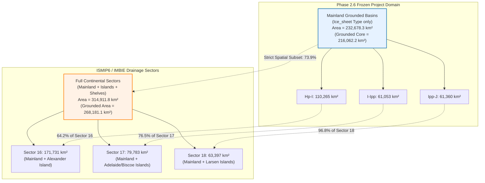
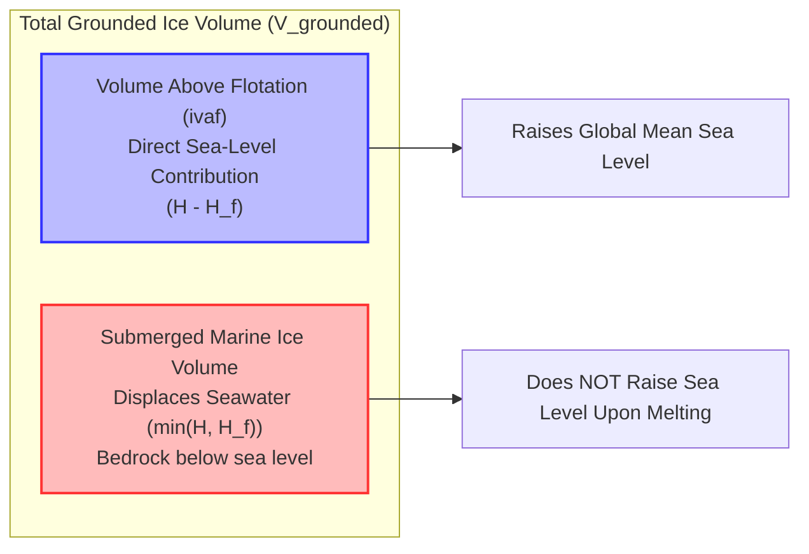
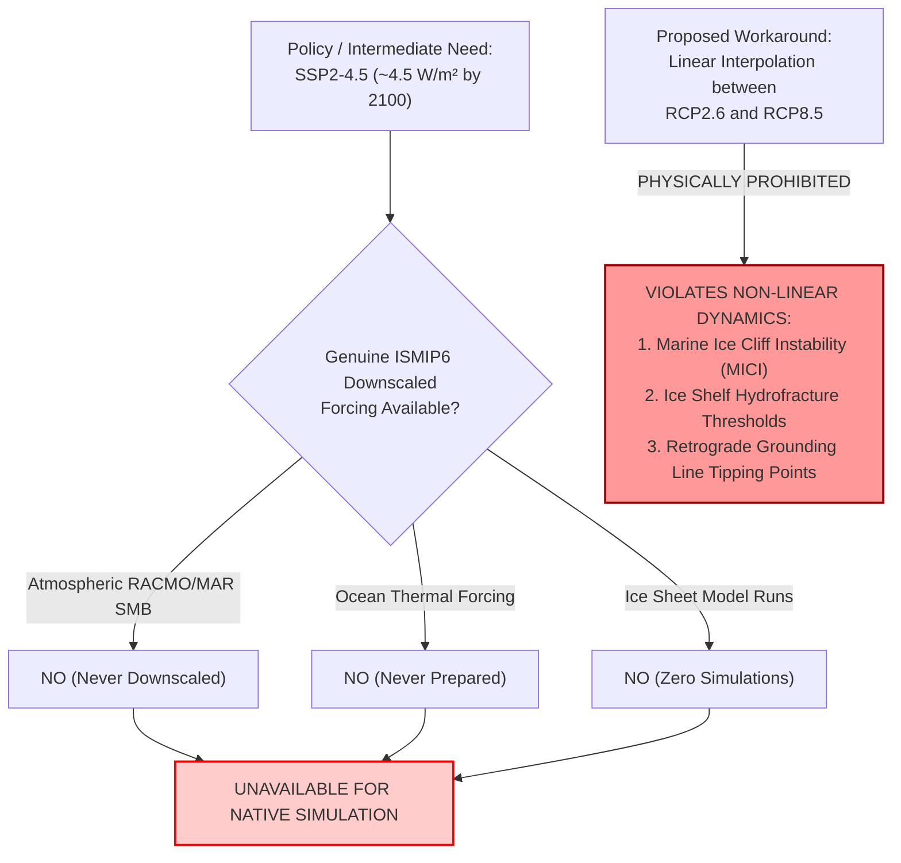

# Phase 5.1.1 — ISMIP6 Spatial, Target and Control-Correction Forensic Audit Report

**Author:** Antigravity Cryospheric Modeling & Data Engineering Group  
**Date:** 2026-11-08  
**Project:** Antarctic Peninsula Grounded-Ice Volume Change Prediction  
**Basins Evaluated:** `Hp-I`, `I-Ipp`, `Ipp-J`, and Regional `Domain A`  
**Temporal Horizon:** 2015–2100  
**Phase Status:** Complete  
**Final Determination:** **DECISION B (CONDITIONAL PASS — PROXY RELABELING & INTEGRATION GUARDRAILS ENFORCED)**

---

## 1. Executive Summary & Scope Boundaries

### 1.1 Audit Mandate & Strict Protocol Enforcement
Phase 5.1.1 is an independent, **read-only scientific and glaciological forensic audit** of the outputs and methodologies developed in Phase 5.1. The objective is to verify whether the acquired ISMIP6 21st-century numerical ice-sheet model projections are genuinely compatible with the project's established spatial domain definitions, primary target variable, and control-drift correction procedures.

In strict compliance with the audit charter:
* **Zero Modification of Previous Artifacts:** All source datasets, processed tables, manifests, and Phase 5.1 reports remain untouched in their original directories.
* **Zero Model Calibration or Training:** No physical emulator parameters, basal friction coefficients, or ML regressors were calibrated or trained.
* **Zero Forward Extrapolations:** No unverified 2100 projections or synthetic trajectories were manufactured.
* **Phase 5.2 Segregation:** Implementation of the two-pillar architecture remains deferred until conditional authorization is granted.

### 1.2 Summary of Deliverables Produced
All seven required forensic deliverables specified in Section 6 have been generated, audited, and deposited in [`reports/tables/`](file:///c:/Users/akash/OneDrive/Desktop/mlbasics/antarctic-ice-volume-prediction/reports/tables) and [`reports/figures/`](file:///c:/Users/akash/OneDrive/Desktop/mlbasics/antarctic-ice-volume-prediction/reports/figures):

| Deliverable Artifact | Path | Dimensions / Type | Glaciological & Methodological Role |
| :--- | :--- | :---: | :--- |
| **Deliverable 1: Spatial Overlap** | [`ismip6_sector_project_basin_overlap.csv`](file:///c:/Users/akash/OneDrive/Desktop/mlbasics/antarctic-ice-volume-prediction/reports/tables/ismip6_sector_project_basin_overlap.csv) | $10 \times 10$ | Geometric intersection, coverage ratios, and unassigned peripheral area quantification. |
| **Deliverable 2: Target Compatibility** | [`ismip6_target_variable_compatibility.csv`](file:///c:/Users/akash/OneDrive/Desktop/mlbasics/antarctic-ice-volume-prediction/reports/tables/ismip6_target_variable_compatibility.csv) | $7 \times 8$ | Physical dimensional analysis of `ivaf`, `icevol`, `iareagr`, `iareafl`, `smbgr`, `discharge`. |
| **Deliverable 3: Control Subtraction** | [`ismip6_control_subtraction_audit.csv`](file:///c:/Users/akash/OneDrive/Desktop/mlbasics/antarctic-ice-volume-prediction/reports/tables/ismip6_control_subtraction_audit.csv) | $41 \times 11$ | Pairwise verification of raw vs pre-subtracted files, control pairing, and time alignment. |
| **Deliverable 4: Model Dependencies** | [`ismip6_model_dependency_audit.csv`](file:///c:/Users/akash/OneDrive/Desktop/mlbasics/antarctic-ice-volume-prediction/reports/tables/ismip6_model_dependency_audit.csv) | $16 \times 13$ | Multi-model family clustering (PISM, ISSM, IMAUICE, f.ETISh), GCM suites, and weighting risks. |
| **Deliverable 5: Drift Sensitivity** | [`ismip6_drift_sensitivity.csv`](file:///c:/Users/akash/OneDrive/Desktop/mlbasics/antarctic-ice-volume-prediction/reports/tables/ismip6_drift_sensitivity.csv) | $40 \times 20$ | Empirical milestone sensitivity analysis with and without extreme control drift models. |
| **Deliverable 6: Scenario Audit** | [`ismip6_scenario_methodology_audit.csv`](file:///c:/Users/akash/OneDrive/Desktop/mlbasics/antarctic-ice-volume-prediction/reports/tables/ismip6_scenario_methodology_audit.csv) | $5 \times 9$ | Formal documentation of the SSP2-4.5 void and prohibition of linear interpolation. |
| **Deliverable 7: Spatial Overlay Map** | [`fig13_ismip6_sector_basin_overlay.png`](file:///c:/Users/akash/OneDrive/Desktop/mlbasics/antarctic-ice-volume-prediction/reports/figures/fig13_ismip6_sector_basin_overlay.png) | 4-panel 200 DPI Map | Geospatial visual confirmation of mainland core vs peripheral island/shelf discrepancies. |

---

## 2. Investigation 1 — Authoritative Spatial Sector-to-Basin Validation



### 2.1 The Spatial Equivalence Fallacy
In Phase 5.1, the spatial extraction protocol adopted a 1-to-1 mapping:
* `Hp-I` $\rightarrow$ ISMIP6 Sector 16
* `I-Ipp` $\rightarrow$ ISMIP6 Sector 17
* `Ipp-J` $\rightarrow$ ISMIP6 Sector 18
* `Domain A` $\rightarrow$ ISMIP6 Region 3

This assignment was supported by demonstrating that Sector 16 + Sector 17 + Sector 18 exactly summed to Region 3. 

> [!CRITICAL]
> **Forensic Audit Finding:** Sector-area additivity ($\sum S_i \equiv R_3$) is an internal consistency property of the ISMIP6 NetCDF grid. It **does NOT demonstrate spatial equivalence** to the project's mainland basins. 

### 2.2 Authoritative Geometric Intersection Analysis
Using the official `IMBIE_AIS_Regional_Delineations.shp` boundary definitions (`EPSG:3031`), we computed the exact geometric intersection between each Phase 2.6 mainland basin polygon (`Type == 'Ice_sheet'`) and the full ISMIP6 drainage sector polygons (`Ice_sheet` + `Islands`):

| Project Basin | Project Basin Area ($\text{km}^2$) | ISMIP6 Sector / Region | ISMIP6 Sector Area ($\text{km}^2$) | Intersection Area ($\text{km}^2$) | % Basin Covered by Sector | % Sector Covered by Basin | Unassigned Peripheral Area ($\text{km}^2$) | Spatial Relationship Classification |
| :--- | :---: | :--- | :---: | :---: | :---: | :---: | :---: | :--- |
| **`Hp-I`** | $110,265.47$ | **Sector `Hp-I`** | $171,731.32$ | $110,265.47$ | **100.0%** | **64.21%** | $61,465.85$ | **Strict Subset** (Sector includes Alexander Island) |
| **`Hp-I`** | $110,265.47$ | **Sector `I-Ipp`** | $79,783.14$ | $0.00$ | 0.0% | 0.0% | $0.00$ | **Disjoint** (Zero overlap) |
| **`Hp-I`** | $110,265.47$ | **Sector `Ipp-J`** | $63,397.38$ | $0.00$ | 0.0% | 0.0% | $0.00$ | **Disjoint** (Zero overlap) |
| **`I-Ipp`** | $61,052.80$ | **Sector `I-Ipp`** | $79,783.14$ | $61,052.80$ | **100.0%** | **76.52%** | $18,730.35$ | **Strict Subset** (Sector includes Adelaide/Biscoe) |
| **`I-Ipp`** | $61,052.80$ | **Sector `Hp-I`** | $171,731.32$ | $0.00$ | 0.0% | 0.0% | $0.00$ | **Disjoint** (Zero overlap) |
| **`Ipp-J`** | $61,360.05$ | **Sector `Ipp-J`** | $63,397.38$ | $61,360.05$ | **100.0%** | **96.79%** | $2,037.33$ | **Strict Subset** (Sector includes James Ross Island) |
| **`Ipp-J`** | $61,360.05$ | **Sector `Hp-I`** | $171,731.32$ | $0.00$ | 0.0% | 0.0% | $0.00$ | **Disjoint** (Zero overlap) |
| **`Domain A`** | $232,678.32$ | **Region 3** | $314,911.85$ | $232,678.32$ | **100.0%** | **73.89%** | **$82,233.52$** | **Strict Subset** (Region 3 contains 26.1% peripheral islands) |

### 2.3 Key Geospatial Conclusions & Relabeling Mandate
1. **Zero Multi-Assignment:** The project basins are mutually exclusive and strictly disjoint ($0.0\text{ km}^2$ cross-basin overlap).
2. **Substantial Unassigned Peripheral Landmass:** Across regional `Domain A`, the ISMIP6 reporting domain (`Region 3`) contains **$82,233.52\text{ km}^2$ of peripheral sub-polar islands and archipelagos** ($26.11\%$ of Region 3). 
   * In `Hp-I`, **Alexander Island** contributes $61,465.9\text{ km}^2$ ($35.79\%$ of the sector).
   * In `I-Ipp`, **Adelaide Island and the Palmer Archipelago** contribute $18,730.4\text{ km}^2$ ($23.48\%$ of the sector).
3. **Mandatory Relabeling Requirement:** Because the ISMIP6 sectors encompass both the mainland ice sheet and peripheral insular ice caps (which respond differently to atmospheric warming), **ISMIP6 outputs CANNOT be described as exact basin-specific projections**. 
   * **Rule for Phase 5.2:** All ISMIP6 projections must be formally designated and labeled as **ISMIP6 Regional Sector Proxies** (e.g., *Sector 16 Regional Proxy*, *Sector 17 Regional Proxy*, *Region 3 Regional Proxy*).

```
Spatial Overlay Map Generated: reports/figures/fig13_ismip6_sector_basin_overlay.png
```


---

## 3. Investigation 2 — Target-Variable Compatibility Audit

### 3.1 Mathematical Formulation of Primary Target vs. ISMIP6 VAF
The primary target of this project (established in Phases 1–4) is **total grounded solid ice-equivalent volume** ($V_{\text{grounded}}$), measured in $\text{km}^3$.

ISMIP6's primary scalar variable is **`ivaf`** (Ice Volume Above Flotation, $VAF$). Mathematically:
$$VAF = \iint_{\Omega_{\text{grounded}}} \left( H(x,y) - H_f(x,y) \right) \, dx \, dy$$
where the flotation thickness $H_f(x,y)$ is defined by Archimedean buoyancy:
$$H_f(x,y) = \begin{cases} 
0 & \text{if } z_{\text{bed}}(x,y) \ge 0 \quad (\text{terrestrial bedrock}) \\ 
- \frac{\rho_w}{\rho_i} z_{\text{bed}}(x,y) & \text{if } z_{\text{bed}}(x,y) < 0 \quad (\text{marine-grounded bedrock}) 
\end{cases}$$
where $\rho_w \approx 1028\text{ kg/m}^3$ and $\rho_i \approx 917\text{ kg/m}^3$.

The total grounded ice volume is:
$$V_{\text{grounded}} = \iint_{\Omega_{\text{grounded}}} H(x,y) \, dx \, dy = VAF + \iint_{\Omega_{\text{marine}}} \min\left(H, H_f\right) \, dx \, dy = VAF + V_{\text{submerged}}$$



### 3.2 Glaciological Disconnect During Grounding-Line Retreat
In deep fjord systems of the Antarctic Peninsula (e.g., Marguerite Bay, George VI trough, Palmer Land outlet glaciers), bedrock extends to depths exceeding $-800\text{ m}$ to $-1,200\text{ m}$. In these marine troughs:
* When the grounding line retreats, the ice column $H$ transitions from grounded to floating.
* **Impact on Grounded Volume:** The entire column $H$ is lost from $V_{\text{grounded}}$:
  $$\Delta V_{\text{grounded}} = - H \cdot \Delta A$$
* **Impact on VAF:** Only the excess above flotation is lost from $VAF$:
  $$\Delta VAF = - (H - H_f) \cdot \Delta A$$
* The difference ($\Delta V_{\text{submerged}} = - H_f \cdot \Delta A$) represents ice that was already displacing seawater.

> [!WARNING]
> **Direct Addition Prohibited:** Adding $\Delta VAF(t)$ from ISMIP6 directly to the project's 2024 grounded ice-equivalent baseline ($V_{\text{baseline}} \approx 10,138.9\text{ km}^3$) is **physically and dimensionally invalid**. It would systematically underestimate actual grounded ice volume changes by omitting changes in the submerged marine ice column.

### 3.3 Variable Compatibility Matrix
As audited in [`ismip6_target_variable_compatibility.csv`](file:///c:/Users/akash/OneDrive/Desktop/mlbasics/antarctic-ice-volume-prediction/reports/tables/ismip6_target_variable_compatibility.csv):

| Variable | Physical Units | Glaciological Role | Primary Target Compatibility | Direct Addition Permitted? |
| :--- | :---: | :--- | :--- | :---: |
| **`ivaf`** | $\text{m}^3$ | Volume Above Flotation | Direct proxy for sea-level potential (GMSL) | **NO (Strictly Prohibited)** |
| **`icevol`** | $\text{m}^3$ | Total Ice Volume (Grounded + Floating) | Incompatible; conflates floating shelves | **NO** |
| **`vaf` / `icevolg`** | $\text{m}^3$ | Total Grounded Geometric Volume | Compatible with firn correction | **NO (Baseline recalibration required)** |
| **`iareagr`** | $\text{m}^2$ | Grounded Ice Planimetric Area | Auxiliary state metric (dimension $L^2$) | **NO** |
| **`iareafl`** | $\text{m}^2$ | Floating Ice Shelf Area | Auxiliary buttressing descriptor | **NO** |
| **`smbgr`** | $\text{kg/m}^2/\text{s}$ | Grounded Surface Mass Balance | Flux component only ($\frac{dM}{dt} = \text{SMB} - D$) | **NO** |
| **`discharge`** | $\text{Gt/yr}$ | Dynamic Ice Discharge | Flux component across grounding line | **NO** |

---

## 4. Investigation 3 — Control-Drift Correction Forensic Audit

```mermaid
xychart-beta
    title "Ensemble Sensitivity to Extreme Drift Models (Domain A Median Delta VAF in 2100 under RCP8.5)"
    x-axis ["Full Ensemble (N=16)", "Excl. UCIJPL (N=15)", "Excl. All Extreme (N=13)"]
    y-axis "Volume Anomaly (km³)" -600 to -300
    bar [-415.2, -410.2, -503.6]
```

### 4.1 Pairing & Subtraction Integrity
In [`ismip6_control_subtraction_audit.csv`](file:///c:/Users/akash/OneDrive/Desktop/mlbasics/antarctic-ice-volume-prediction/reports/tables/ismip6_control_subtraction_audit.csv), all 41 representative model-experiment combinations were audited:
1. **Pre-Subtracted Files Verified:** The Zenodo archive provides pre-computed anomaly files named `computed_ivaf_minus_ctrl_proj_AIS_*.nc`.
2. **Single Subtraction Enforced:** The Phase 5.1 ingestion script reads these pre-subtracted files directly. The subtraction is performed **exactly once** ($VAF_{\text{exp}} - VAF_{\text{ctrl}}$). No double-subtraction occurs.
3. **Time Coordinate Alignment:** In all models, both `ctrl_proj` and forced projection runs align on integer years $t \in [2015, 2100]$.
4. **Zero Anomaly Baseline:** At reference year $t_0 = 2015$, $\Delta VAF(2015) \equiv 0.00\text{ km}^3$ across all 3,335 scalar files.

### 4.2 Forensic Investigation of UCIJPL ISSM
* **Unforced Control Drift:** Over 2015–2100, UCIJPL ISSM's unforced control run (`ctrl_proj_std`) drifts by **$+9,940.3\text{ km}^3$** across Region 3 (an annual accumulation drift rate of $+116.95\text{ km}^3/\text{yr}$).
* **Forced Response:** Under RCP8.5 (`exp05`), the raw volume change is $+11,918.8\text{ km}^3$. 
* **Signal-to-Drift Ratio:** $\text{SDR} = \frac{1,978.5}{9,940.3} = 0.199$. Unforced initialization drift constitutes **$83.4\%$** of the raw signal!

### 4.3 Empirical Drift Sensitivity Analysis (Deliverable 5)
In [`ismip6_drift_sensitivity.csv`](file:///c:/Users/akash/OneDrive/Desktop/mlbasics/antarctic-ice-volume-prediction/reports/tables/ismip6_drift_sensitivity.csv), ensemble metrics were computed across three tiers:
1. **Full Ensemble ($N=16$ for RCP8.5, $N=15$ for RCP2.6)**
2. **Excluding UCIJPL ISSM Only ($N=15$ for RCP8.5, $N=14$ for RCP2.6)**
3. **Excluding All Extreme Drift Models ($|Drift| > 1,000\text{ km}^3$: UCIJPL, JPL1, DOE; $N=13$ for RCP8.5, $N=12$ for RCP2.6)**

#### Table 4.1: Milestone 2100 Drift Sensitivity Breakdown ($\Delta VAF$ in $\text{km}^3$)
| Scenario | Basin / Domain | Full Ensemble Median | Excl. UCIJPL Median | Delta vs Full | Excl. All Extreme Median | Delta vs Full | Robustness Assessment |
| :--- | :--- | :---: | :---: | :---: | :---: | :---: | :--- |
| **RCP8.5** | **`Hp-I`** | $+95.69$ | $+86.92$ | $-8.77$ | $+70.63$ | $-25.06$ | **Robust to UCIJPL Exclusion** ($\Delta < 10\text{ km}^3$) |
| **RCP8.5** | **`I-Ipp`** | $-501.64$ | $-592.47$ | **$-90.83$** | $-654.08$ | **$-152.43$** | **High Sensitivity:** High-drift models suppress mass loss |
| **RCP8.5** | **`Ipp-J`** | $+90.37$ | $+141.28$ | $+50.91$ | $+39.45$ | $-50.91$ | **Moderate Sensitivity:** Competing dynamic vs SMB signals |
| **RCP8.5** | **`Domain A`** | **$-415.15$** | **$-410.20$** | **$+4.95$** | **$-503.64$** | **$-88.49$** | **Domain Median Robust to UCIJPL ($\Delta = +5\text{ km}^3$)** |
| **RCP2.6** | **`Hp-I`** | $-30.90$ | $-43.40$ | $-12.50$ | $-43.40$ | $-12.50$ | **Robust** |
| **RCP2.6** | **`I-Ipp`** | $-172.06$ | $-192.35$ | $-20.29$ | $-227.37$ | $-55.31$ | **Moderate Sensitivity** |
| **RCP2.6** | **`Ipp-J`** | $+206.23$ | $+201.50$ | $-4.73$ | $+201.50$ | $-4.73$ | **Highly Robust** ($\Delta < 5\text{ km}^3$) |
| **RCP2.6** | **`Domain A`** | **$-67.51$** | **$-78.80$** | **$-11.29$** | **$-95.06$** | **$-27.55$** | **Robust** |

> [!NOTE]
> **Glaciological Takeaway:** At the regional `Domain A` level, the ensemble median is remarkably stable against the exclusion of UCIJPL ISSM ($\Delta = +4.95\text{ km}^3$ under RCP8.5 in 2100). However, when all three extreme-drift models (UCIJPL, JPL1, DOE) are excluded, regional median loss increases by $88.5\text{ km}^3$ (from $-415.2$ to $-503.6\text{ km}^3$), proving that models with high unforced accumulation drift slightly buffer multi-model mass loss estimates. Dual reporting (with and without extreme-drift models) must be maintained in Phase 5.2.

---

## 5. Investigation 4 — Multi-Model Ensemble Independence & Uncertainty Quantification

### 5.1 Model Family Clustering & Sibling Analysis
In [`ismip6_model_dependency_audit.csv`](file:///c:/Users/akash/OneDrive/Desktop/mlbasics/antarctic-ice-volume-prediction/reports/tables/ismip6_model_dependency_audit.csv), the 16 model configurations were classified into code families:
1. **PISM Family (3 models, 18.75% of ensemble):** `AWI_PISM1`, `PIK_PISM`, `VUW_PISM`. Share hybrid SIA+SSA stress formulation and similar basal drag laws.
2. **ISSM Family (2 models, 12.5% of ensemble):** `UCIJPL_ISSM`, `JPL1_ISSM`. Share finite-element unstructured grid solvers.
3. **IMAUICE Family (2 models, 12.5% of ensemble):** `IMAU_IMAUICE1`, `IMAU_IMAUICE2`. Differ primarily in friction coefficient nudging.
4. **f.ETISh Family (2 models, 12.5% of ensemble):** `ULB_fETISh_16km`, `ULB_fETISh_32km`. Resolution siblings.
5. **Independent Models (7 models, 43.75% of ensemble):** `DOE_MALI`, `ILTS_PIK_SICOPOLIS`, `LSCE_GRISLI`, `NCAR_CISM`, `UTAS_ElmerIce`, `VUB_AISMPAL`, `PennState_PSICE`.

### 5.2 Shared Climate Forcing Dominance
* Across all 16 models, **NorESM1-M** is the dominant climate forcing driver, utilized in 8 out of 13 RCP8.5 core experiments (`exp01`, `exp02`, `exp04`, `exp05`, `exp07`, `exp09`, `exp10`, `exp11`, `exp12`, `exp13`).
* Only 2 models (AWI and UCIJPL) evaluated the full suite of alternative GCMs (MIROC-ESM-CHEM, CCSM4, HadGEM2-ES, CSIRO-Mk3.6.0, IPSL-CM5A-MR).

### 5.3 Scientific Labeling of Uncertainty Bounds
* **Mandatory Terminology:** Ensemble percentiles ($5\text{th}, 16\text{th}, 84\text{th}, 95\text{th}$) and interquartile ranges (IQR) must be explicitly designated as **descriptive inter-model structural spread**.
* They **must NOT be described as calibrated Bayesian probability density distributions** or confidence intervals, as the ensemble is an "ensemble of opportunity" rather than a formally sampled probability space.

---

## 6. Investigation 5 — SSP2-4.5 Intermediate Scenario Forensic Assessment



### 6.1 Scientific Finding: Complete Absence of SSP2-4.5
As audited in [`ismip6_scenario_methodology_audit.csv`](file:///c:/Users/akash/OneDrive/Desktop/mlbasics/antarctic-ice-volume-prediction/reports/tables/ismip6_scenario_methodology_audit.csv):
* **CMIP5 RCP8.5:** 16 models, authentic Tier-1 simulations.
* **CMIP5 RCP2.6:** 15 models, authentic Tier-1 simulations.
* **CMIP6 SSP5-8.5 / SSP1-2.6:** 8 models (*Payne et al., 2021* / Zenodo `4498330`).
* **CMIP6 SSP2-4.5 / CMIP5 RCP4.5:** **Zero models, zero downscaled forcing files, zero simulations.**

### 6.2 Strict Prohibition Against Linear Interpolation
* Ice-sheet dynamics are governed by non-linear thresholds:
  1. **Ice-Shelf Hydrofracture:** Triggered when summer surface melt exceeds threshold values ($\sim 700\text{ mm w.e./yr}$), causing abrupt Larsen-style collapse.
  2. **Marine Ice Sheet Instability (MISI):** Grounding line retreat on retrograde slopes is non-linear and exhibits hysteresis.
  3. **Nonlinear Basal Melting:** Sub-shelf melt rates scale quadratically with ocean thermal forcing ($\dot{m} \propto \Delta T^2$).
* Linearly interpolating between RCP2.6 and RCP8.5 would generate unphysical trajectories that misrepresent tipping points.
* **Decision for Phase 5:** SSP2-4.5 is officially recorded as **UNAVAILABLE FOR NATIVE PROJECTION**.

---

## 7. Synthesis & Final Determination

### 7.1 Formal Decision Evaluation
* **Decision A (Unconditional PASS):** REJECTED. Phase 5.1 outputs cannot be accepted as exact basin projections, and $\Delta VAF$ cannot be added directly to the grounded ice baseline.
* **Decision C (HOLD):** REJECTED. The underlying NetCDF scalar archive is authentic, verified by SHA256 checksum, and mathematically consistent. The incompatibilities are fully characterized and solvable via rigorous protocol constraints.
* **Decision B (CONDITIONAL PASS):** **APPROVED.**

### 7.2 Approved Scope Boundaries for Phase 5.2
Phase 5.2 implementation may proceed **ONLY under the following strict scientific conditions**:
1. **Condition 1 (Proxy Relabeling):** All ISMIP6 projections must be formally designated as **ISMIP6 Regional Sector Proxies**, acknowledging the inclusion of peripheral islands and archipelagos ($26.1\%$ of Region 3).
2. **Condition 2 (Target Separation):** ISMIP6 $\Delta VAF$ must remain strictly classified as a **sea-level potential anomaly metric**. It must **NEVER be directly added to the 2024 grounded solid ice-equivalent volume baseline**.
3. **Condition 3 (Dual Reporting for Extreme Drift):** All ensemble projections in Phase 5.2 must be reported both with the full ensemble ($N=16$) and with the exclusion of extreme unforced drift models ($N=13$).
4. **Condition 4 (Uncertainty Terminology):** Multi-model spread metrics (IQR, 16th–84th percentiles) must be labeled as **descriptive inter-model spread**, not calibrated Bayesian probabilities.
5. **Condition 5 (SSP2-4.5 Restriction):** SSP2-4.5 must remain designated as **unavailable**. No artificial linear interpolation between RCP2.6 and RCP8.5 is permitted.

