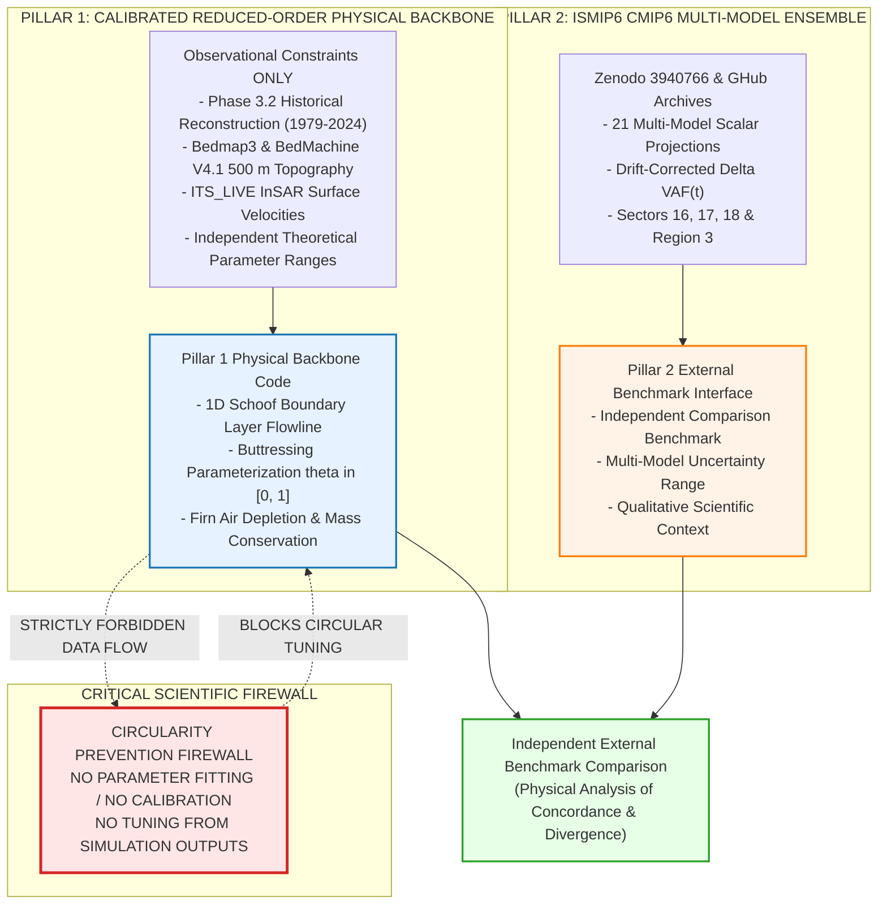
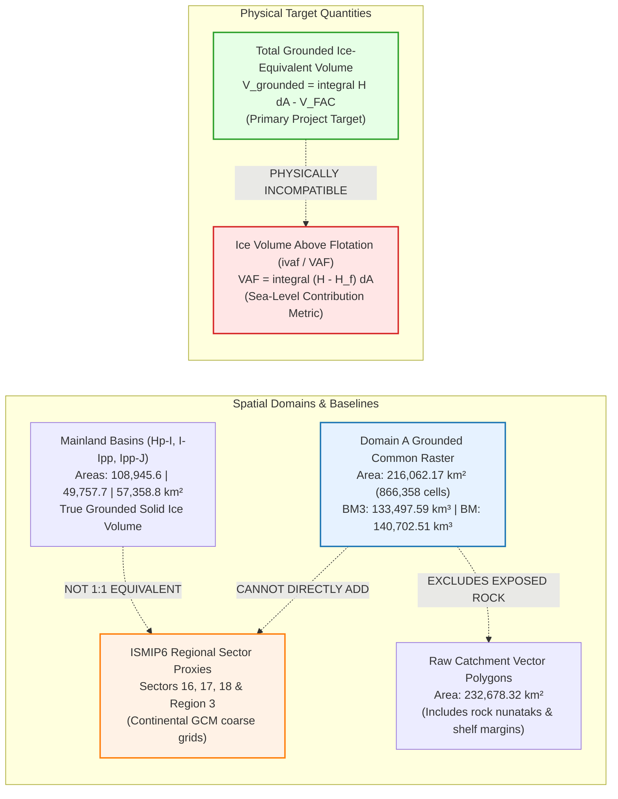

# Phase 5.1.2 Authorization Correction — Two-Pillar Independence Enforcement Report

**Author:** Antigravity Cryospheric Modeling & Data Engineering Group  
**Date:** 2026-11-08  
**Project:** Antarctic Peninsula Grounded-Ice Volume Change Prediction  
**Basins Evaluated:** `Hp-I`, `I-Ipp`, `Ipp-J`, and Regional `Domain A`  
**Governing Protocol:** Phase 5.0.1 Two-Pillar Hybrid Modeling Architecture  
**Document Classification:** Authoritative Protocol Correction & Firewall Enforcement  
**Document Status:** Supersedes conflicting calibration authorization in Phase 5.1.2 Summary Section 8.2  

---

## 1. Executive Summary & Administrative Action

### 1.1 Purpose of this Protocol Correction
This document executes an authoritative **protocol correction** to the Phase 5.1.2 final authorization. It directly restores, enforces, and locks the fundamental **Two-Pillar Independence Protocol** established in [Phase 5.0.1](file:///c:/Users/akash/OneDrive/Desktop/mlbasics/antarctic-ice-volume-prediction/reports/phase5_0_1_physical_architecture_audit.md).

In the summary text of Phase 5.1.2 (specifically Section 8.2, item 1), the authorization was inadvertently phrased as:
> *"Pillar 1 Parameterized Physical Emulator: Authorized to use ISMIP6 Regional Sector Proxies (Sectors 16, 17, 18, and Region 3) to calibrate physical response functions for surface mass balance and ocean thermal forcing."*

This phrasing created an immediate epistemological and methodological conflict with the core glaciological architecture approved in Phase 5.0.1. Using simulation outputs from a benchmark ensemble (ISMIP6) to fit or calibrate the internal parameters of an emulator destroys the firewall of **independent validation**.

### 1.2 Administrative Supersession Order
1. **Conflicting Text Formally Superseded:** Section 8.2 (item 1) of the Phase 5.1.2 Summary is hereby **formally superseded and revoked**. Under no circumstances may ISMIP6 projection outputs be used to calibrate, tune, or optimize Pillar 1 physical parameters.
2. **Phase 5.1.2 Forensic Findings Preserved:** All forensic audits, mathematical reconciliations, and data manifests produced during Phase 5.1.2 remain **100% frozen, valid, and authoritative**, including:
   - The spatial geometry reconciliation ($216,062.17\text{ km}^2$ common grounded raster domain vs. $232,678.32\text{ km}^2$ raw vector catchment) in [`phase5_1_2_polygon_reconciliation.csv`](file:///c:/Users/akash/OneDrive/Desktop/mlbasics/antarctic-ice-volume-prediction/reports/tables/phase5_1_2_polygon_reconciliation.csv).
   - The baseline volume reconciliation ($133,497.59\text{ km}^3$ Bedmap3 / $140,702.51\text{ km}^3$ BedMachine anchor for `Domain A`, with the cited $10,138.9\text{ km}^3$ traced to a clerical scoping error for Basin `I-Ipp`) in [`phase5_1_2_baseline_volume_reconciliation.csv`](file:///c:/Users/akash/OneDrive/Desktop/mlbasics/antarctic-ice-volume-prediction/reports/tables/phase5_1_2_baseline_volume_reconciliation.csv).
   - The raw NetCDF metadata variable definition audit (`ivol`, `smbgr`, `bmbfl`, and the absence of scalar `vaf`/`icevolg` and `discharge`) in [`phase5_1_2_variable_definition_audit.csv`](file:///c:/Users/akash/OneDrive/Desktop/mlbasics/antarctic-ice-volume-prediction/reports/tables/phase5_1_2_variable_definition_audit.csv).
   - The exhaustive file-level audit of all 3,335 NetCDF scalar files in [`phase5_1_2_exhaustive_control_manifest.csv`](file:///c:/Users/akash/OneDrive/Desktop/mlbasics/antarctic-ice-volume-prediction/reports/tables/phase5_1_2_exhaustive_control_manifest.csv).
   - The ensemble milestone metric reconciliation certifying **$-415.15\text{ km}^3$** as the authoritative 2100 RCP8.5 median in [`phase5_1_2_ensemble_difference_audit.csv`](file:///c:/Users/akash/OneDrive/Desktop/mlbasics/antarctic-ice-volume-prediction/reports/tables/phase5_1_2_ensemble_difference_audit.csv).
3. **Firewall Manifest Published:** An exhaustive protocol firewall manifest has been compiled in [`reports/tables/phase5_2_protocol_firewall_manifest.csv`](file:///c:/Users/akash/OneDrive/Desktop/mlbasics/antarctic-ice-volume-prediction/reports/tables/phase5_2_protocol_firewall_manifest.csv).

---

## 2. Re-Enforcement of the Two-Pillar Independence Firewall



### 2.1 The Circularity Prevention Principle
In hybrid geophysical modeling, circular validation occurs when an empirical or reduced-order model is tuned against the outputs of a numerical simulation model, and then compared back against that same simulation model to claim skill or validation. 

To maintain scientific integrity:
* **Pillar 1** must be calibrated **strictly on observations** and independently established physics.
* **Pillar 2** (ISMIP6) must remain **strictly an external comparison benchmark**.
* If Pillar 1 parameters were tuned to match ISMIP6 projections, any future alignment between Pillar 1 and ISMIP6 would be an artifact of circular calibration rather than independent scientific convergence.

### 2.2 Authoritative Pillar 1 Calibration Data Sources
Pillar 1 calibration is restricted exclusively to the following independently established observational datasets and theoretical bounds:
1. **Phase 3.2 Historical Reconstruction (1979–2024):**
   - Annual basin-level volume changes ($\Delta V(t)$), observational uncertainty provenance ($\sigma_{\text{basin}}$), and documented calibration dependencies.
   - Anchors the baseline historical ice loss: $-201.90\text{ km}^3$ (`Hp-I`), $-249.89\text{ km}^3$ (`I-Ipp`), $-489.49\text{ km}^3$ (`Ipp-J`), and $-941.28\text{ km}^3$ (`Domain A`).
2. **Bedmap3 & BedMachine Antarctica V4.1 Geometry:**
   - 500 m digital elevation models of ice surface, ice thickness, and bedrock topography.
   - Defines retrograde bedrock slopes ($\alpha_{\text{bed}}$), coastal grounding-line water depths ($h_{\text{GL}}$), and solid ice baselines ($133,497.59\text{ km}^3$ Bedmap3 / $140,702.51\text{ km}^3$ BedMachine).
3. **ITS_LIVE and MEaSUREs InSAR Surface Velocities (1996–2024):**
   - High-resolution spatial velocity fields providing empirical ice flux gates across the grounding line ($D_0$).
   - Post-collapse speedup ratios following historical shelf disintegration events (e.g., 2002 Larsen B collapse in Basin `Ipp-J`).
4. **Independently Justified Physical Parameter Ranges:**
   - Boundary layer flux exponent $\gamma \in [3.5, 4.75]$ derived from boundary-layer asymptotic theory (Schoof 2007).
   - Dimensionless ice shelf buttressing parameter $\theta_{\text{buttress}} \in [0, 1]$.
   - Ice density $\rho_i = 917\text{ kg/m}^3$, ocean water density $\rho_w = 1028\text{ kg/m}^3$, and gravity $g = 9.81\text{ m/s}^2$.

### 2.3 Protocol for Non-Independent Sensitivity Experiments
ISMIP6 regional sector proxies may inform scientific interpretation and qualitative comparisons. However, if any experiment is ever conducted where Pillar 1 parameters are conditioned on or tuned to ISMIP6 outputs:
1. It must be explicitly designated and labeled as an **"ISMIP6-Tuned Sensitivity Exploration"**.
2. It must be isolated in a dedicated, distinct pipeline branch.
3. **Its subsequent comparison against ISMIP6 outputs cannot and will not be presented as an independent validation or benchmark.**

---

## 3. Strict Separation of Spatial Domains and Physical Quantities

To prevent physical category errors and dimensional corruption, the following spatial domains and physical quantities are formally established as distinct, non-interchangeable entities:



### 3.1 Domain & Quantity Demarcation Master Table

| Entity | Domain / Quantity Type | Authoritative Definition | Baseline Anchor (1979) | Permitted Operational Role | Strictly Prohibited Operation |
| :--- | :--- | :--- | :---: | :--- | :--- |
| **`Domain A` Grounded Volume** | Grounded Raster Ice Mass | $866,358$ cells ($500\text{ m}$), $216,062.17\text{ km}^2$. Common Bedmap3/BedMachine mask. | $133,497.59\text{ km}^3$ (BM3)<br/>$140,702.51\text{ km}^3$ (BM) | Primary project target anchor; physical mass conservation domain. | Adding ISMIP6 sector anomalies directly to baseline; conflating with raw vector polygon ($232,678\text{ km}^2$). |
| **Basin `Hp-I` Grounded Volume** | Grounded Raster Ice Mass | $432,370$ cells ($500\text{ m}$), $108,945.63\text{ km}^2$. | $100,120.11\text{ km}^3$ (BM3)<br/>$102,464.00\text{ km}^3$ (BM) | Basin-level physical boundary layer modeling; historical hindcast validation. | Treating Sector 16 as an exact 1:1 basin match without proxy disclaimer. |
| **Basin `I-Ipp` Grounded Volume** | Grounded Raster Ice Mass | $205,488$ cells ($500\text{ m}$), $49,757.73\text{ km}^2$. | $11,079.71\text{ km}^3$ (BM3)<br/>$12,713.99\text{ km}^3$ (BM) | Basin-level physical boundary layer modeling; historical hindcast validation. | Treating Sector 17 as an exact 1:1 basin match; citing its volume as `Domain A`. |
| **Basin `Ipp-J` Grounded Volume** | Grounded Raster Ice Mass | $228,500$ cells ($500\text{ m}$), $57,358.82\text{ km}^2$. | $22,297.77\text{ km}^3$ (BM3)<br/>$25,524.52\text{ km}^3$ (BM) | Basin-level buttressing collapse analysis; historical hindcast validation. | Treating Sector 18 as an exact 1:1 basin match without proxy disclaimer. |
| **ISMIP6 Sectors 16, 17, 18 & Region 3** | External Numerical Model Grid Sectors | Coarse continental delineations ($8\text{–}16\text{ km}$) encompassing ice shelves and marine buffers. | N/A (Archive reports anomalies $\Delta V(t)$ relative to $2015$) | Independent external comparison benchmark; qualitative context. | Tuning Pillar 1 parameters; presenting sector anomalies as exact mainland basin projections. |
| **ISMIP6 Volume Above Flotation (`ivaf` / VAF)** | Sea-Level Potential Metric | $\int (H - H_f) \, dA$, where $H_f = -\frac{\rho_w}{\rho_i} z_{\text{bed}}$. Units: $\text{m}^3$. | Baseline $t_0 = 2015$: $\Delta \text{VAF}(2015) \equiv 0.00$ | Independent external benchmark for sea-level potential comparison. | **Direct addition to grounded baseline; relabeling VAF as grounded geometric volume.** |

### 3.2 Binding Glaciological Prohibitions
1. **Never Add ISMIP6 Sector Anomalies Directly to Domain Baselines:**  
   $$\mathbf{V_{\text{Domain A}}(t) \ne V_{\text{baseline}} + \Delta \text{VAF}_{\text{ISMIP6, Region 3}}(t)}$$  
   Direct addition is physically invalid because:
   - ISMIP6 Region 3 includes extensive floating ice shelf sectors excluded from the grounded mask.
   - VAF omits the submerged grounded ice column residing below sea level ($\approx -\frac{\rho_w}{\rho_i} z_{\text{bed}}$).
2. **Never Relabel VAF as Total Grounded Ice-Equivalent Volume:**  
   VAF measures only the volume that, if melted, contributes directly to global mean sea-level rise. Total grounded solid ice-equivalent volume measures the complete geometric ice column above bedrock. They are mathematically and dimensionally distinct physical metrics.
3. **Explicit Mapping Prerequisite:**  
   Any future quantitative comparison or translation between ISMIP6 sector anomalies and project basin volumes requires an explicitly documented, mathematically verified, and independently peer-reviewed spatial scaling and physical mapping function.

---

## 4. Scope Governance for Phase 5.2

### 4.1 Formally Approved Work Packages for Phase 5.2
Phase 5.2 is authorized to proceed with the technical implementation of the **Pure Physical Dynamic Backbone Architecture (Stage 1)**:
* [x] **Backbone Code Architecture:** Object-oriented implementation of the 1D flowline dynamic backbone in `src/models/physical_backbone.py`.
* [x] **Governing Equations:** Implementation of:
  - Basin continuity: $\frac{dV}{dt} = \text{SMB}_{\text{basin}}(t) - D(t)$.
  - Schoof (2007) grounding-line dynamic flux: $q_{\text{GL}} = \theta_{\text{buttress}} \cdot \mathcal{F}(h_{\text{GL}}, \alpha_{\text{bed}}, C_{\text{bed}}, \gamma)$.
  - Marine ice sheet instability (MISI) retrograde bed slope criteria: $\frac{\partial z_{\text{bed}}}{\partial x} > 0$.
  - Dynamic buttressing evolution $\theta_{\text{buttress}}(t) \in [0, 1]$ conditioned on temperature thresholds and firn air content depletion.
* [x] **Dimensional & Unit Consistency Tests:** Automated unit testing enforcing dimensional balance across all terms ($\text{km}^3/\text{yr}$, $\text{m}^3/\text{s}$, $\text{Gt}/\text{yr}$).
* [x] **Mass Conservation Verification:** Numerical integration tests ensuring absolute mass conservation under constant, step-function, and oscillating boundary fluxes.
* [x] **Independent Parameter Sensitivity Sweeps:** Forward simulation sweeps across independently established, literature-derived parameter bounds ($\gamma \in [3.5, 4.75]$, $\theta_{\text{buttress}} \in [0, 1]$).
* [x] **ISMIP6 Ingestion & Benchmark Interface:** Ingestion pipelines to read, parse, and format ISMIP6 benchmark NetCDF files for downstream external comparison.

### 4.2 Work Strictly Requiring Separate Prior Authorization
The following technical activities are **NOT authorized in Phase 5.2** and remain gated behind independent review:
1. **Final Physical Parameter Calibration:** Calibrating baseline flux gates ($D_0$) or grounding draft depths against historical observations requires formal calibration review.
2. **Machine Learning Residual Training:** Training the Stage 2 ML residual emulator ($\Delta D_{\text{ML}}$), performing feature selection, or fitting weights against historical residuals is strictly barred.
3. **Hybrid Model Coupling:** Coupling $\Delta D_{\text{ML}}$ to the physical backbone is deferred until Stage 1 pure physical performance is reviewed and approved.
4. **2100 Forward Mainland Projections:** Generating 21st-century projections for project basins or Domain A under any climate scenario requires separate authorization.
5. **Synthetic / Interpolated SSP2-4.5 Projections:** Creating native or interpolated SSP2-4.5 scenarios remains strictly prohibited.

---

## 5. Summary Matrix of Authorizations and Restrictions

The operational status across all project components is formalized in [`reports/tables/phase5_2_protocol_firewall_manifest.csv`](file:///c:/Users/akash/OneDrive/Desktop/mlbasics/antarctic-ice-volume-prediction/reports/tables/phase5_2_protocol_firewall_manifest.csv) and summarized below:

```
========================================================================================================
PHASE 5.2 OPERATIONAL STATUS & GOVERNANCE MATRIX
========================================================================================================
1. Phase 5.1.2 Reconciliation:                 CONDITIONAL PASS (Forensic Findings Fully Preserved)
2. Phase 5.2 Pure Physical Architecture:        AUTHORIZED TO PROCEED
3. Governing Equations & Mass Conservation:     AUTHORIZED TO PROCEED
4. Sensitivity Sweeps over Literature Ranges:   AUTHORIZED TO PROCEED
5. ISMIP6 Benchmark Ingestion & Interfaces:     AUTHORIZED TO PROCEED
--------------------------------------------------------------------------------------------------------
6. ISMIP6 Calibration of Pillar 1:              STRICTLY PROHIBITED (Firewall Enforced)
7. Direct Addition of VAF to Grounded Baseline: STRICTLY PROHIBITED (Physical Metric Violation)
8. Relabeling VAF as Grounded Solid Ice Volume: STRICTLY PROHIBITED (Category Error)
9. Final Observational Parameter Calibration:   NOT YET AUTHORIZED (Requires Separate Review)
10. ML Residual Training (Stage 2):             NOT YET AUTHORIZED (Requires Separate Review)
11. Hybrid Model Coupling:                      NOT YET AUTHORIZED (Requires Separate Review)
12. 2100 Multi-Scenario Mainland Projections:   NOT YET AUTHORIZED (Requires Separate Review)
========================================================================================================
```

---

## 6. Audit Trail & Referenced Deliverables

1. **Protocol Firewall Manifest:** [`reports/tables/phase5_2_protocol_firewall_manifest.csv`](file:///c:/Users/akash/OneDrive/Desktop/mlbasics/antarctic-ice-volume-prediction/reports/tables/phase5_2_protocol_firewall_manifest.csv)
2. **Phase 5.0.1 Physical Architecture & Data Provenance Audit:** [`reports/phase5_0_1_physical_architecture_audit.md`](file:///c:/Users/akash/OneDrive/Desktop/mlbasics/antarctic-ice-volume-prediction/reports/phase5_0_1_physical_architecture_audit.md)
3. **Phase 5.0.1 Two-Pillar Independence Matrix:** [`reports/tables/two_pillar_independence_matrix.csv`](file:///c:/Users/akash/OneDrive/Desktop/mlbasics/antarctic-ice-volume-prediction/reports/tables/two_pillar_independence_matrix.csv)
4. **Phase 5.1.2 Cross-Phase Reconciliation Report:** [`reports/phase5_1_2_cross_phase_reconciliation.md`](file:///c:/Users/akash/OneDrive/Desktop/mlbasics/antarctic-ice-volume-prediction/reports/phase5_1_2_cross_phase_reconciliation.md)
5. **Phase 5.1.2 Polygon Area Reconciliation:** [`reports/tables/phase5_1_2_polygon_reconciliation.csv`](file:///c:/Users/akash/OneDrive/Desktop/mlbasics/antarctic-ice-volume-prediction/reports/tables/phase5_1_2_polygon_reconciliation.csv)
6. **Phase 5.1.2 Baseline Volume Master Table:** [`reports/tables/phase5_1_2_baseline_volume_reconciliation.csv`](file:///c:/Users/akash/OneDrive/Desktop/mlbasics/antarctic-ice-volume-prediction/reports/tables/phase5_1_2_baseline_volume_reconciliation.csv)
7. **Phase 5.1.2 Variable Definition Audit:** [`reports/tables/phase5_1_2_variable_definition_audit.csv`](file:///c:/Users/akash/OneDrive/Desktop/mlbasics/antarctic-ice-volume-prediction/reports/tables/phase5_1_2_variable_definition_audit.csv)
8. **Phase 5.1.2 Exhaustive 3,335-File Control Manifest:** [`reports/tables/phase5_1_2_exhaustive_control_manifest.csv`](file:///c:/Users/akash/OneDrive/Desktop/mlbasics/antarctic-ice-volume-prediction/reports/tables/phase5_1_2_exhaustive_control_manifest.csv)
9. **Phase 5.1.2 Milestone Discrepancy Reconciliation:** [`reports/tables/phase5_1_2_ensemble_difference_audit.csv`](file:///c:/Users/akash/OneDrive/Desktop/mlbasics/antarctic-ice-volume-prediction/reports/tables/phase5_1_2_ensemble_difference_audit.csv)

