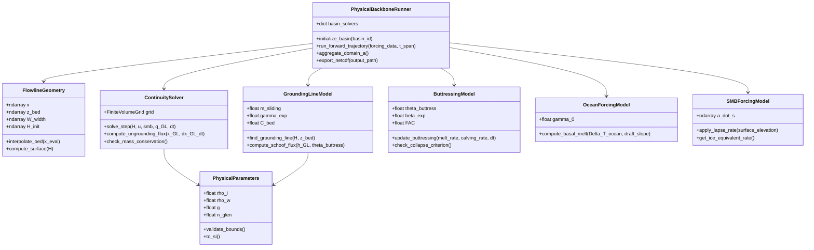
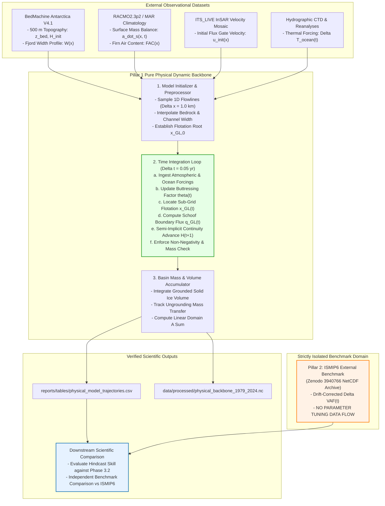

# Phase 5.2.1 — Software and Data Flow Architecture Specification

**Author:** Antigravity Cryospheric Modeling & Systems Architecture Group  
**Date:** 2026-11-08  
**Project:** Antarctic Peninsula Grounded-Ice Volume Change Prediction  
**Basins Evaluated:** `Hp-I`, `I-Ipp`, `Ipp-J`, and Regional `Domain A`  
**Phase Status:** Complete Architecture Specification (Pre-Implementation Only)  

---

## 1. Executive Summary & Design Principles

This document specifies the software architecture, class design, data contracts, and execution pipelines for the **Phase 5.2 Pure Physical Dynamic Backbone (Pillar 1)**.

The software architecture is engineered around four core design principles:
1. **Modularity & Single Responsibility:** Each physical process (continuity, grounding line flux, buttressing, basal melting) is encapsulated in an independent, testable Python class.
2. **Strict Two-Pillar Software Firewall:** Physical backbone modeling code (`src/models/`) is structurally and computationally isolated from external ISMIP6 benchmark extraction code (`src/evaluation/`).
3. **Machine Learning Residual Decoupling:** Stage 1 physical solvers operate standalone with zero dependencies on machine learning packages (`scikit-learn`, `torch`, `xgboost`).
4. **Reproducible Data Contracts:** All input geometries, forcings, and output state vectors are governed by strict schema validation, cryptographic integrity, and dimensionally balanced units.

---

## 2. System Architecture & Class Hierarchy



---

## 3. Package Structure and Module Responsibilities

The physical model codebase is organized under `antarctic-ice-volume-prediction/src/models/`:

```
src/models/
├── __init__.py
├── physical_parameters.py   # Registry of universal physical constants, unit conversions, and bounds
├── continuity.py            # 1D finite-volume width-integrated continuity operator & ungrounding tracking
├── grounding_line.py        # Schoof (2007) asymptotic boundary-layer flux & subgrid flotation tracking
├── buttressing.py           # Dynamic buttressing evolution, firn air content buffer, and collapse logic
├── ocean_forcing.py         # Sub-shelf thermal driving and Jourdain non-local basal melt parameterization
├── smb_forcing.py           # Surface mass balance ingestion, elevation lapse-rate adjustment, and FAC
├── numerical_solver.py      # Adaptive semi-implicit time integrator, Courant checker, and flux limiter
└── physical_backbone.py     # High-level Master Basin Orchestrator and Domain A accounting integrator
```

### Module Functional Responsibilities

| Module Name | Core Class | Primary Method | Primary Input | Primary Output |
| :--- | :--- | :--- | :--- | :--- |
| `physical_parameters.py` | `PhysicalParameters` | `validate_parameter_bounds()` | Parameter dictionary | Validated SI constants |
| `continuity.py` | `ContinuitySolver` | `advance_thickness()` | $H(x)^t, \bar{u}, \dot{a}_s, q_{\text{GL}}, \Delta t$ | $H(x)^{t+1}$, $M_{\text{unground}}$ |
| `grounding_line.py` | `GroundingLineModel` | `compute_boundary_flux()` | $H(x), z_b(x), \theta_{\text{buttress}}$ | $x_{\text{GL}}, h_{\text{GL}}, q_{\text{GL}}$ |
| `buttressing.py` | `ButtressingModel` | `evolve_buttressing()` | $\bar{\dot{m}}_b, \text{FAC}, \Delta t$ | $\theta_{\text{buttress}}(t) \in [0, 1]$ |
| `ocean_forcing.py` | `OceanForcingModel` | `compute_basal_melt()` | $\Delta T_{\text{ocean}}, \alpha_{\text{draft}}$ | $\dot{m}_b(x)$ ($\text{m/yr}$) |
| `smb_forcing.py` | `SMBForcingModel` | `get_accumulation_flux()` | RCM $\dot{a}_s$, elevation $s$ | $\dot{a}_{\text{ice}}(x)$ ($\text{m/yr}$) |
| `numerical_solver.py` | `NumericalSolver` | `solve_tridiagonal()` | Stencil matrices $A, b$ | Updated state array $H^{t+1}$ |
| `physical_backbone.py` | `PhysicalBackbone` | `run_forward()` | Basin ID, forcing timeseries | Trajectory DataFrame / NetCDF |

---

## 4. End-to-End Data Flow Pipeline



---

## 5. Input and Output Data Contracts

### 5.1 Input Data Contracts

```json
{
  "basin_configuration": {
    "basin_id": "Hp-I | I-Ipp | Ipp-J",
    "grid_spacing_m": 1000.0,
    "flowline_length_m": 250000.0,
    "time_step_yr": 0.05,
    "rho_ice_kg_m3": 917.0,
    "rho_water_kg_m3": 1028.0,
    "gravity_m_s2": 9.81
  },
  "topographic_arrays": {
    "x_coords_m": "ndarray[float64, (N,)]",
    "bed_elevation_m": "ndarray[float64, (N,)] (EPSG:3031, relative to geoid)",
    "channel_width_m": "ndarray[float64, (N,)] (positive float64)",
    "initial_ice_thickness_m": "ndarray[float64, (N,)] (non-negative float64)"
  },
  "boundary_forcing_timeseries": {
    "time_years": "ndarray[float64, (T,)]",
    "smb_flux_density_kg_m2_s": "ndarray[float64, (T, N)]",
    "ocean_thermal_forcing_K": "ndarray[float64, (T,)]",
    "firn_air_content_m": "ndarray[float64, (T, N)]"
  }
}
```

### 5.2 Output Data Contract & Diagnostic Schema
At every reporting interval (annual: $\Delta t_{\text{report}} = 1.0\text{ yr}$), the model exports:
* **`year`:** Simulation year ($1979\text{–}2024$ in hindcast).
* **`basin_id`:** `Hp-I`, `I-Ipp`, `Ipp-J`, or `Domain A`.
* **`grounded_volume_km3`:** Total solid ice-equivalent grounded volume ($V_g$).
* **`cumulative_volume_loss_km3`:** $\Delta V_g(t) = V_g(t) - V_g(1979)$.
* **`grounding_line_position_km`:** Distance $x_{\text{GL}}$ from divide.
* **`grounding_line_flux_Gt_yr`:** Advective discharge $D_{\text{GL}}$.
* **`ungrounding_mass_loss_Gt_yr`:** Boundary transfer rate $M_{\text{ungrounding}}$.
* **`surface_mass_balance_Gt_yr`:** Integrated accumulation $\text{SMB}_g$.
* **`buttressing_factor`:** Dimensionless $\theta_{\text{buttress}}(t) \in [0, 1]$.
* **`mass_conservation_error_Gt`:** Strict residual discrepancy $\epsilon_{\text{mass}}$.

---

## 6. Circularity Prevention and Architectural Firewalls

```
========================================================================================================
SOFTWARE ARCHITECTURE FIREWALL SPECIFICATIONS
========================================================================================================
1. Package Isolation:    src/models/ MUST NOT import any module from src/evaluation/benchmark_ingestion.py.
2. Parameter Quarantine: src/models/physical_parameters.py MUST NOT contain any default parameter
                         fitted or derived from ISMIP6 multi-model runs.
3. No Machine Learning:  src/models/ MUST NOT import sklearn, torch, xgboost, lightgbm, or scipy.optimize.
4. Independent Testing:  Unit test suites in tests/test_physical_backbone.py MUST run with zero network
                         calls and zero access to ISMIP6 NetCDF files.
========================================================================================================
```

