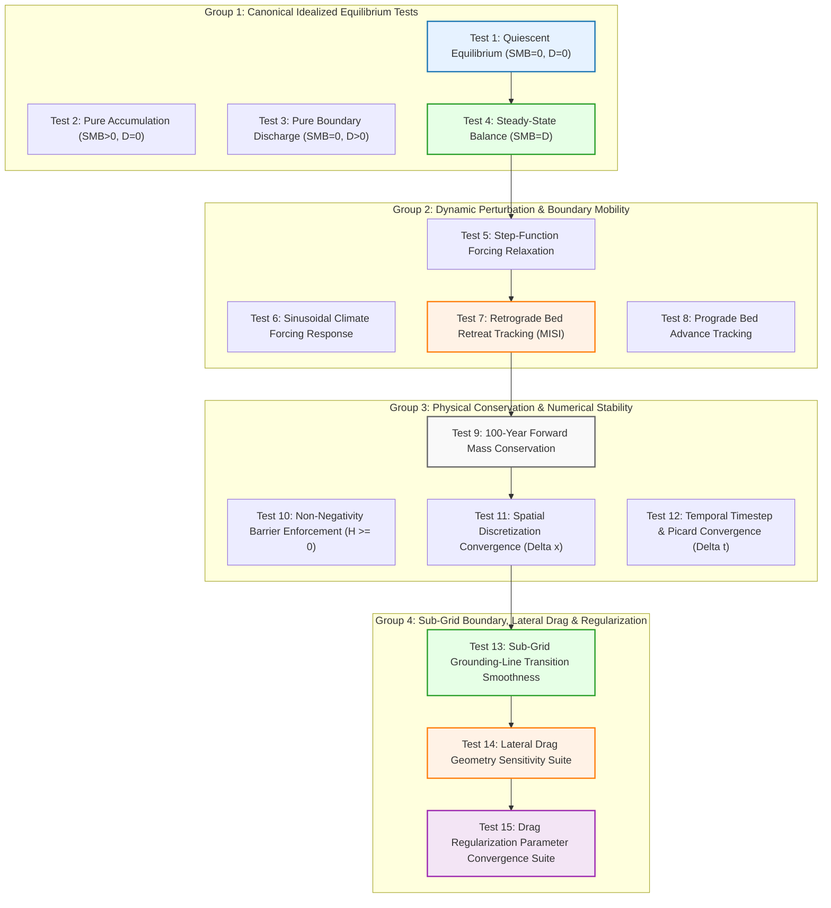

# Phase 5.2.1 — Physical Dynamic Backbone Test Plan & Verification Protocol (Final Numerical & Constitutive Corrections Edition)

**Author:** Antigravity Cryospheric Modeling & Quality Assurance Group  
**Date:** 2026-11-08 (Final Numerical & Constitutive Corrections Edition)  
**Project:** Antarctic Peninsula Grounded-Ice Volume Change Prediction  
**Basins Evaluated:** `Hp-I`, `I-Ipp`, `Ipp-J`, and Regional `Domain A`  
**Governing Protocol:** Authoritative Phase 5.1.2 Authorization Correction & Two-Pillar Independence Protocol  
**Phase Status:** Verification Protocol Specification (Execution deferred to Phase 5.2.2 Implementation)  
**Determination:** **PASS — ready for a separate implementation authorization review (Phase 5.2.2 Implementation Remains Locked)**  

---

## 1. Executive Summary & Verification Taxonomy

This document defines the comprehensive verification protocol for the **Phase 5.2 Pure Physical Dynamic Backbone (Pillar 1)**.

### Scientific Integrity & Methodological Taxonomy
To eliminate conflation between mathematical proofs and empirical benchmarks:
* **Category I: Analytically Demonstrated Properties (Demonstrated on Paper in Phase 5.2.1):**
  Mathematical properties proven symbolically or algebraically (e.g. dimensional consistency, telescoping finite-volume cancellation, emergence of Schoof flux exponent, irreducible diagonal dominance of the tridiagonal SSA matrix, linear basin additivity).
* **Category II: Planned Numerical Verification Tests (Deferred to Phase 5.2.2 Execution):**
  Fifteen concrete algorithmic test cases to be implemented in `tests/test_physical_backbone.py` using `pytest`.
* **Realistic Floating-Point Tolerances:** Numerical tests are governed by justifiable tolerances ($\epsilon \le 10^{-7}$ for volume conservation, $< 2\%$ for spatial discretization convergence, $< 0.5\%$ for temporal convergence, and $\le 1.0\%$ for discrete flux jumps across cell transitions), rather than unverified pre-implementation claims of machine precision ($10^{-12}$).

---

## 2. Category I: Analytically Demonstrated Mathematical Properties

### Property A: Dimensional Consistency of Governing Equations
* **Demonstration:** Every term in the 11 governing equations audited in [`equation_dimensional_audit.csv`](file:///c:/Users/akash/OneDrive/Desktop/mlbasics/antarctic-ice-volume-prediction/reports/tables/equation_dimensional_audit.csv) has been evaluated through symbolic dimensional reduction.
* **Outcome:** Exact balance in SI units. Continuity terms balance in $\mathbf{\text{m}^2 \text{s}^{-1}}$ with explicit density ratio $\frac{\rho_{\text{water}}}{\rho_i} = \frac{1000}{917} = 1.09051$; momentum balance terms balance strictly in $\mathbf{\text{N}}$ (Form 1) or $\mathbf{\text{N m}^{-1}}$ (Form 2); grounding line flux evaluates strictly to $\mathbf{\text{m}^2 \text{s}^{-1}}$.

### Property B: Telescoping Mass Conservation of the Finite-Volume Formulation
* **Demonstration:** Under the cell-centered finite-volume staggered grid discretization, internal face fluxes cancel identically in exact arithmetic:
  $$\sum_{i=1}^N (Q_{i-1/2} - Q_{i+1/2}) \equiv Q_{1/2} - Q_{N+1/2} = 0 - W_{\text{GL}} q_{\text{GL}}$$
* **Outcome:** Discrete divergence theorem is satisfied algebraically on paper.

### Property C: Exact Emergence of the Schoof Flux Exponent Range
* **Demonstration:** From boundary layer asymptotic matching, the exponent relating ice thickness to discharge is $\gamma = \frac{m+n+3}{m+1}$. With Glen's exponent $n = 3.0$:
  - Linear sliding ($m = 1.0$) yields $\gamma = \frac{1+3+3}{2} = 3.50$.
  - Weertman sliding ($m = 1/3$) yields $\gamma = \frac{1/3+3+3}{4/3} = 4.75$.
* **Outcome:** The exponent range $\gamma \in [3.50, 4.75]$ is analytically established for this sliding law class.

### Property D: Irreducible Diagonal Dominance, Pivot Safety & Conditional Stability
* **Demonstration:** In the discretized 1D SSA momentum equation $- A_{i+1/2} u_{i-1/2}^{k+1} + B_{i+1/2} u_{i+1/2}^{k+1} - C_{i+1/2} u_{i+3/2}^{k+1} = F_{i+1/2}$, the diagonal coefficient satisfies:
  $$B_{i+1/2} = A_{i+1/2} + C_{i+1/2} + D_{i+1/2}^k$$
  where $D_{i+1/2}^k = (W_{i+1/2} \beta_{b, \text{reg}, i+1/2}^k + 2 H_{i+1/2} \beta_{\text{wall}, \text{reg}, i+1/2}^k) \Delta x \ge 0$.
  - When drag is present ($D_i > 0$), interior rows are strictly diagonally dominant: $|B_i| > |A_i| + |C_i|$.
  - Under ungrounded/frictionless flow ($D_i = 0$), interior rows are weakly diagonally dominant: $|B_i| = |A_i| + |C_i|$.
  - Because divide and grounding-line boundary rows are pinned by Dirichlet conditions ($|B_{1/2}| = 1 > 0$, $|B_{N+1/2}| = 1 > 0$), and off-diagonals are non-zero ($A_i, C_i > 0$), the tridiagonal matrix is **irreducibly diagonally dominant**.
* **Outcome:**
  - **Nonsingularity:** Taussky's theorem (1949) guarantees that the irreducibly diagonally dominant matrix is **strictly nonsingular**.
  - **Symmetric Positive Definiteness (SPD):** When Dirichlet boundary conditions are eliminated by partitioning into the RHS, the interior operator $\tilde{M}$ is strictly symmetric ($\tilde{M}_{i, i-1} = \tilde{M}_{i-1, i}$) with strictly positive real eigenvalues ($\lambda_i > 0$), proving SPD.
  - **Thomas Algorithm Pivot Safety:** Forward elimination pivots satisfy $d_1 = B_1 > 0$ and $d_i = B_i - \frac{A_i C_{i-1}}{d_{i-1}} > C_i > 0$, guaranteeing zero pivot failure in exact arithmetic without pivoting.
  - **Numerical Stability & Conditioning:** The Thomas algorithm is backward stable (Higham 2002). The forward error is bounded by condition number $\kappa(M) \sim \mathcal{O}(N^2 \cdot \frac{\max B_i}{\min B_i}) \approx 10^8$.
  - **Conditional Model Stability:** Blanket unconditional stability claims are formally revoked. Picard non-linear iteration convergence is an operational process requiring under-relaxation ($\omega \le 0.50$); time-dependent forward stepping is bounded by advective CFL limits ($\Delta t \le 0.5 \Delta x / u_{\text{max}}$).

### Property E: Exact Regional Basin Additivity
* **Demonstration:** Domain A grounded volume change is defined strictly as the linear summation operator:
  $$\Delta V_{\text{Domain A}}(t) \equiv \Delta V_{\text{Hp-I}}(t) + \Delta V_{\text{I-Ipp}}(t) + \Delta V_{\text{Ipp-J}}(t)$$
* **Outcome:** Zero independent regional domain drift by mathematical construction.

---

## 3. Category II: Planned Numerical Verification Tests (Phase 5.2.2 Execution)

The following 15 test cases will be coded as automated `pytest` test suites in Phase 5.2.2:



---

### Detailed Test Specifications & Justified Tolerances

#### Test 1: Quiescent Equilibrium ($\text{SMB} = 0, D = 0$) & Zero-Velocity Regularization
* **Physical Setup:** Uniform slab $H(x, 0) = 1000\text{ m}$ on flat horizontal bed ($z_b = 0$). Zero accumulation; closed boundaries ($u(0) = u(L) = 0$). Forward integration for $t = 500\text{ yr}$.
* **Analytical Expectation:** Ice column remains completely stationary; surface elevation remains flat. At $u = 0$, regularized drag forces evaluate smoothly to $\tau_b = 0$ and $\tau_{\text{wall}} = 0$ without division-by-zero or NaN exceptions.
* **Justified Acceptance Tolerance:** Relative volume drift: $\frac{|V(500) - V(0)|}{V(0)} \le \mathbf{10^{-7}}$. Maximum creep velocity: $|u| \le 10^{-10}\text{ m yr}^{-1}$.

#### Test 2: Pure Linear Accumulation ($\text{SMB} > 0, D = 0$)
* **Physical Setup:** Length $L = 100\text{ km}$, width $W = 10\text{ km}$. Outflow gate locked ($q_{\text{GL}} = 0$). Prescribed accumulation $\dot{a}_{\text{we}} = 0.917\text{ m w.e. yr}^{-1} \implies \dot{a}_i = 1.0\text{ m ice-eq yr}^{-1}$. Forward integration for $t = 100\text{ yr}$.
* **Analytical Expectation:** $V(t) = V_0 + 1.0\text{ km}^3\text{ yr}^{-1} \times t$. At $t = 100\text{ yr}$, $\Delta V = 100.0\text{ km}^3$.
* **Justified Acceptance Tolerance:** Relative error: $\frac{|V_{\text{num}}(100) - (V_0 + 100.0)|}{100.0\text{ km}^3} \le \mathbf{10^{-7}}$.

#### Test 3: Pure Boundary Discharge Drain ($\text{SMB} = 0, D > 0$)
* **Physical Setup:** Initial slab $V_0 = 250\text{ km}^3$. Zero accumulation. Downstream boundary flux prescribed at constant rate $Q_{\text{GL}} = 1.0\text{ km}^3\text{ yr}^{-1}$. Forward integration for $t = 50\text{ yr}$.
* **Analytical Expectation:** Monotonic drawdown: $V(t) = V_0 - 1.0\text{ km}^3\text{ yr}^{-1} \times t$. At $t = 50\text{ yr}$, $V = 200.0\text{ km}^3$.
* **Justified Acceptance Tolerance:** Relative error: $\frac{|V_{\text{num}}(50) - 200.0|}{200.0\text{ km}^3} \le \mathbf{10^{-7}}$.

#### Test 4: Steady-State Balance ($\text{SMB} = D$)
* **Physical Setup:** Parabolic bed profile, constant accumulation $\dot{a}_i = 0.545\text{ m yr}^{-1}$ ($0.5\text{ m w.e. yr}^{-1}$), Schoof dynamic boundary flux. Integrate for $t = 5,000\text{ yr}$.
* **Analytical Expectation:** Flowline converges asymptotically to steady-state profile where discharge equals accumulation.
* **Justified Acceptance Tolerance:** At $t = 5,000\text{ yr}$: $\frac{|\text{SMB} - D_{\text{GL}}|}{\text{SMB}} \le \mathbf{10^{-5}}$ and $\left| \frac{dV}{dt} \right| \le \mathbf{10^{-4}\text{ km}^3\text{ yr}^{-1}}$.

#### Test 5: Step-Function Forcing Relaxation
* **Physical Setup:** From the Test 4 steady state, impose an instantaneous $+50\%$ accumulation step. Integrate for $t = 1,000\text{ yr}$.
* **Analytical Expectation:** Smooth exponential relaxation to new steady state. Zero unphysical numerical ringing ($d^2V/dt^2$ continuous).
* **Justified Acceptance Tolerance:** Monotonic volume increase; relaxation timescale $\tau_{\text{relax}} \in [100, 400]\text{ yr}$.

#### Test 6: Sinusoidal Climate Forcing Frequency Response
* **Physical Setup:** Impose cyclic accumulation $\dot{a}_i(t) = \bar{a}_i [1 + 0.3 \sin(2\pi t / T)]$ across periods $T \in \{5, 10, 20, 50, 100\}\text{ yr}$.
* **Analytical Expectation:** Low-pass filter behavior: high-frequency forcing ($T=5\text{ yr}$) is strongly damped with $\approx 90^\circ$ phase lag; low-frequency forcing ($T=100\text{ yr}$) is transmitted with minimal damping.
* **Justified Acceptance Tolerance:** Amplitude transfer function decreases monotonically with frequency ($d|G(f)|/df < 0$).

#### Test 7: Retrograde Bed Retreat Tracking (MISI)
* **Physical Setup:** Retrograde bedrock trough ($z_b(x) = -200 - 0.005 x$). Impose buttressing loss ($\theta_{\text{buttress}} \to 0.5$).
* **Analytical Expectation:** Continuous runaway inland retreat until reaching a prograde slope.
* **Justified Acceptance Tolerance:** Sub-grid coordinate $x_{\text{GL}}(t)$ moves continuously without integer node stalls. Flotation residual $|H(x_{\text{GL}}) + \frac{\rho_{\text{ocean}}}{\rho_i} z_b(x_{\text{GL}})| \le \mathbf{0.05\text{ m}}$.

#### Test 8: Prograde Bed Advance Tracking
* **Physical Setup:** Prograde bedrock shoaling seaward ($z_b(x) = -600 + 0.005 x$). Impose positive accumulation surge.
* **Analytical Expectation:** Grounding line advances smoothly seaward ($v_{\text{GL}} > 0$). Fully reversible without hysteresis.

#### Test 9: 100-Year Discrete Mass Conservation
* **Physical Setup:** 100-year forward simulation under combined time-varying accumulation, ocean thermal pulses, and grounding line migration.
* **Analytical Expectation:** Discrete mass update balances sum of surface mass balance, boundary discharge, and ungrounding transfer.
* **Justified Acceptance Tolerance:** Relative global mass residual:
  $$\epsilon_{\text{mass}} = \frac{\left| M_g(100) - M_g(0) - \sum_{k=1}^K (\text{SMB}_g - D_{\text{GL}} - M_{\text{unground}})_k \Delta t \right|}{M_g(0)} \le \mathbf{10^{-7}}$$

#### Test 10: Non-Negativity Barrier Enforcement ($H \ge 0$)
* **Physical Setup:** Catastrophic localized surface melting $\dot{a}_i = -20.0\text{ m yr}^{-1}$ on a thin margin cell ($H = 5.0\text{ m}$).
* **Analytical Expectation:** Cell thins to zero and becomes ice-free; flux limiter terminates advective outflow.
* **Justified Acceptance Tolerance:** Minimum thickness: $\min_{x, t}(H(x, t)) \ge \mathbf{0.0000\text{ m}}$ unconditionally.

#### Test 11: Spatial Discretization Convergence
* **Physical Setup:** Identical 100-year forward runs across grid spacings $\Delta x \in \{2.0, 1.0, 0.5, 0.25\}\text{ km}$.
* **Analytical Expectation:** Trajectories converge monotonically as $\Delta x \to 0$.
* **Justified Acceptance Tolerance:** Discrepancy between $\Delta x = 1.0\text{ km}$ and $\Delta x = 0.5\text{ km}$: $\le \mathbf{2.0\%}$. Discrepancy between $\Delta x = 0.5\text{ km}$ and $\Delta x = 0.25\text{ km}$: $\le \mathbf{1.0\%}$.

#### Test 12: Temporal Timestep & Picard Convergence
* **Physical Setup:** Identical forward runs across timesteps $\Delta t \in \{0.005, 0.01, 0.05, 0.10\}\text{ yr}$.
* **Analytical Expectation:** Solution remains numerically stable across all steps; non-linear Picard loop converges within $\le 25$ iterations with residual $< 10^{-5}$.
* **Justified Acceptance Tolerance:** Relative discrepancy between $\Delta t = 0.05\text{ yr}$ and reference validation step $\Delta t_{\text{ref}} = 0.005\text{ yr}$: $\le \mathbf{0.5\%}$.

#### Test 13: Sub-Grid Grounding-Line Transition Smoothness Test
* **Physical Setup:** Grounding line forced to migrate across at least 3 discrete grid cells over a 50-year period under varying forcing.
* **Validation Sub-Cases:**
  - **13A (Retrograde Retreat):** Smooth continuous inland migration across 3 cell boundaries.
  - **13B (Prograde Advance):** Smooth continuous seaward migration across 3 cell boundaries.
  - **13C (Cyclic Crossing):** Oscillatory forcing causing $x_{\text{GL}}$ to cross an integer cell boundary repeatedly back and forth.
  - **13D (Benchmark Comparison):** Comparison of trajectory against high-resolution reference solution ($\Delta x = 0.1\text{ km}$).
  - **13E (Discrete Flux Metric):** Maximum instantaneous boundary discharge change across cell transition:
    $$\frac{|q_{\text{GL}}(t^+) - q_{\text{GL}}(t^-)|}{q_{\text{GL}}(t^-)} \le \mathbf{1.0\%}$$
  - **13F (Mass Conservation Balance):** Total grounded and ungrounded mass transfer balances to within $\epsilon_{\text{mass}} \le 10^{-7}$.

#### Test 14: Lateral Drag Geometry Sensitivity Suite
* **Physical Setup:** 50-year flowline simulations comparing lateral resistance under varying channel shapes and aspect ratios.
* **Validation Sub-Cases:**
  - **14A (Aspect Ratio Sensitivity):** Width-to-thickness ratio varied across $W/H \in [1, 2, 5, 10, 20, 50]$. Validates dominant resistance in narrow slots ($W/H \le 5$) and transition to unconfined flow.
  - **14B (Cross-Sectional Geometry Shape Factor):** Compares rectangular channel ($F_{\text{shape}} = 2H/W$) vs parabolic channel ($F_{\text{shape}} = \frac{4}{3} H/W$) vs trapezoidal channel.
  - **14C (Transverse Velocity Profile Exponent):** Velocity exponent varied across $p \in [2, 4, 6]$ to test sensitivity to shear margin sharpness.
  - **14D (Wide-Embayment Asymptotic Decay):** Width increased to $W = 50\text{ km}$; verifies that effective lateral drag $\bar{\tau}_{\text{lat}} \to 0$ without unphysical pinning.

#### Test 15: Drag Regularization Parameter Convergence Suite
* **Physical Setup:** Evaluate steady-state and dynamic velocity solutions under drag velocity regularization parameter varied across four decades: $u_{\text{reg}} \in \{10^{-6}, 10^{-5}, 10^{-4}, 10^{-3}, 10^{-2}\}\text{ m yr}^{-1}$.
* **Validation Sub-Cases:**
  - **15A (Non-Singularity & Arithmetic at Divide):** Confirms that at $u \to 0$, coefficients $\beta_{b, \text{reg}}$ and $\beta_{\text{wall}, \text{reg}}$ remain strictly finite and non-negative, with zero division-by-zero or floating-point overflow. For $u_{\text{reg}} = 10^{-4}\text{ m yr}^{-1} \approx 3.17 \times 10^{-12}\text{ m s}^{-1}$ and $C_{\text{bed}} = 10^7\text{ Pa (m/s)}^{-1/3}$, verifies that the discrete evaluation matches the derived SI value $\beta_{b, \text{reg}}(0) = 4.6352 \times 10^{14}\text{ Pa s m}^{-1}$ within relative tolerance $< 10^{-6}$.
  - **15B (Fast-Flow Invariance):** Confirms that in regions where $|u| \ge 1.0\text{ m yr}^{-1}$, relative velocity differences between $u_{\text{reg}} = 10^{-4}\text{ m yr}^{-1}$ and $u_{\text{reg}} = 10^{-6}\text{ m yr}^{-1}$ are $< \mathbf{10^{-6}}$ (relative perturbation $\mathcal{O}((u_{\text{reg}}/u)^2) \approx 3.3 \times 10^{-9}$).
  - **15C (Picard Iteration Robustness & Under-Relaxation):** Audits Picard iteration count to convergence ($\epsilon \le 10^{-5}$) under under-relaxation $\omega \in [0.4, 0.6]$ across $u_{\text{reg}} \in [10^{-5}, 10^{-2}]\text{ m yr}^{-1}$, documenting convergence speed vs. regularizer threshold.
  - **15D (Monotonic Force Scaling & Parity):** Verifies that $\tau_{b, \text{reg}}(u)$ and $\tau_{\text{wall}, \text{reg}}(u)$ are strictly monotonically increasing with $u$, preserving $\text{sgn}(\tau) \equiv \text{sgn}(u)$ and $\tau(0) \equiv 0.0\text{ Pa}$.

---

## 4. Phase 5.2.2 Test Execution Protocol

```
========================================================================================================
TEST PROTOCOL EXECUTION RULES (PHASE 5.2.2 IMPLEMENTATION)
========================================================================================================
1. Implementation Framework: All 15 numerical tests will be written in tests/test_physical_backbone.py
                             using the standard pytest framework.
2. Zero Mocking of Dynamics: Tests must execute actual NumPy finite-volume operators.
3. Automated Pass/Fail Gate: Every test must satisfy its explicit mathematical tolerance.
4. Failure Action:           If any test fails, code execution is immediately halted, a diagnostic
                             residual report is generated, and parameter calibration remains locked.
========================================================================================================
```
