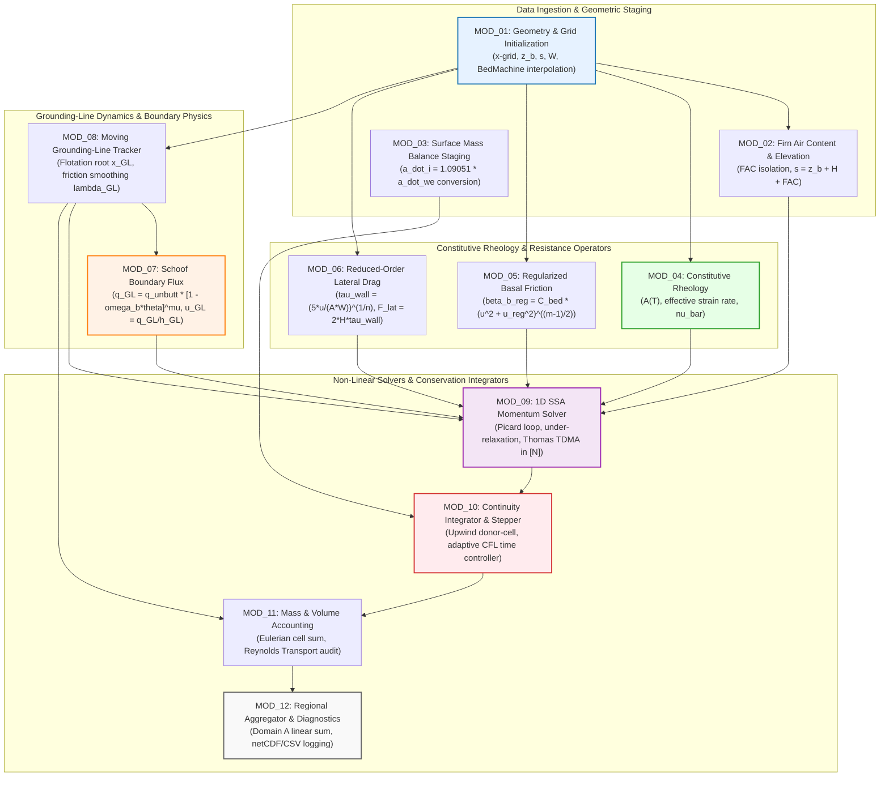

# Phase 5.2.2 — Physical Solver Implementation Blueprint (Pillar 1 Dynamic Backbone)

**Author:** Antigravity Cryospheric Modeling & Computational Physics Group  
**Date:** 2026-11-08  
**Project:** Antarctic Peninsula Grounded-Ice Volume Change Prediction  
**Basins Covered:** `Hp-I` (Palmer Land West), `I-Ipp` (Graham Land West), `Ipp-J` (Graham Land East), and Regional `Domain A`  
**Governing Protocol:** Authoritative Phase 5.1.2 Authorization Correction & Two-Pillar Independence Protocol  
**Phase Status:** ARCHITECTURE & IMPLEMENTATION BLUEPRINT ONLY (Strictly Planning-Only)  
**Implementation Gate:** **PHASE 5.2.2 IMPLEMENTATION REMAINS STRICTLY LOCKED PENDING USER AUTHORIZATION**  

---

## 1. Executive Summary & Governance Adherence

This document establishes the detailed implementation blueprint for the **Phase 5.2 Pure Physical Dynamic Backbone (Pillar 1)**.

### Strict Governance Restrictions
* **Zero Solver Code Implementation:** No numerical solver code will be written or executed in this phase.
* **Zero Calibration:** No physical parameters will be tuned against historical altimetry, InSAR, or projection datasets.
* **Zero Machine Learning Coupling:** No neural networks, ridge regressors, or Gaussian processes will be trained or coupled.
* **Zero Forward Projections:** No simulations forward to 2100 will be executed.
* **Pillar 1 Independence Enforcement:** Pillar 1 must be calibrated strictly against observational datasets (BedMachine Antarctica V4.1, RACMO2.3p2, ITS_LIVE InSAR, and the Phase 3.2 historical reconstruction). ISMIP6 projection models serve strictly as an external validation benchmark (Pillar 2).
* **Implementation Gate:** **Phase 5.2.2 implementation is NOT authorized by this document.** Implementation requires independent review and explicit authorization by the user.

---

## 2. Proposed Modular Architecture

The physical model is structured into twelve decoupled, single-responsibility modules operating across a staggered finite-volume grid:



---

## 3. Detailed Module Design & Mathematical Interface Specification

Every module in the Pillar 1 backbone is specified with exact mathematical equations, units, failure modes, and verification tests (cataloged in [`phase5_2_2_module_interface_specification.csv`](file:///c:/Users/akash/OneDrive/Desktop/mlbasics/antarctic-ice-volume-prediction/reports/tables/phase5_2_2_module_interface_specification.csv)).

### Module 1: Geometry & Grid Initialization (`MOD_01`)
* **File:** `src/physics/geometry.py`
* **Responsibility:** Ingest BedMachine Antarctica V4.1 and Bedmap3 structural rasters, project basin flowlines, interpolate cross-sectional channel widths $W(x)$, bedrock topography $z_b(x)$, and initial surface $s(x)$.
* **Governing Equation:** $x_i = i \cdot \Delta x$, $H_0(x) = s(x) - z_b(x) - \text{FAC}_0(x)$.
* **Inputs:** Basin vector polygon, BedMachine netCDF rasters ($z_b, s, \text{mask}$), flowline centerline coordinates.
* **Outputs:** 1D arrays on cell centers ($x_i, z_{b,i}, s_i, H_i, W_i$) and faces ($x_{i+1/2}, W_{i+1/2}$) in meters $[\text{m}]$.
* **Numerical Method:** 1D cubic spline interpolation along flowlines sampled from BedMachine 500m rasters.
* **Failure Guardrails:** Raise `GeometricDataError` if $H_i < 0$, $W_i \le 0$, or $\Delta x \le 0$.
* **Verification Test:** `TEST_B01` (Geometry Monotonicity and Positivity).

### Module 2: Firn Air Content & Elevation Accounting (`MOD_02`)
* **File:** `src/physics/firn.py`
* **Responsibility:** Enforce rigorous separation between solid pure-ice thickness $H(x, t)$ and geometric surface elevation $s(x, t)$ by incorporating firn air compaction $\text{FAC}(x, t)$.
* **Governing Equations:**
  $$H_{\text{geom}}(x, t) = H(x, t) + \text{FAC}(x, t) \quad [\text{m}]$$
  $$s(x, t) = z_b(x) + H_{\text{geom}}(x, t) = z_b(x) + H(x, t) + \text{FAC}(x, t) \quad [\text{m}]$$
* **Inputs:** Solid ice thickness $H$ $[\text{m}]$, firn air content $\text{FAC}$ $[\text{m}]$, bedrock elevation $z_b$ $[\text{m}]$.
* **Outputs:** Geometric column $H_{\text{geom}}$ $[\text{m}]$, physical surface elevation $s$ $[\text{m}]$.
* **Numerical Method:** Pointwise cell-centered algebraic addition.
* **Failure Guardrails:** Raise `FirnConsistencyError` if $\text{FAC} < 0\text{ m}$, $\text{FAC} > 25\text{ m}$, or $s < z_b$.
* **Verification Test:** `TEST_B02` (Firn-Ice Column Decoupling).

### Module 3: Surface Mass Balance Staging & Conversion (`MOD_03`)
* **File:** `src/physics/smb.py`
* **Responsibility:** Ingest RACMO2.3p2 water-equivalent surface mass balance $\dot{a}_{\text{we}}$ and stage it as solid-ice accumulation rate $\dot{a}_i$ using the standard reference density ratio.
* **Governing Equations:**
  $$\dot{a}_i(x, t) = \left(\frac{\rho_{\text{water}}}{\rho_i}\right) \dot{a}_{\text{we}}(x, t) = \left(\frac{1000.0}{917.0}\right) \dot{a}_{\text{we}}(x, t) \approx 1.0905125 \times \dot{a}_{\text{we}}(x, t) \quad [\text{m ice-eq yr}^{-1}]$$
  $$\dot{a}_s(x, t) = \rho_i \dot{a}_i(x, t) = \rho_{\text{water}} \dot{a}_{\text{we}}(x, t) \quad [\text{kg m}^{-2} \text{s}^{-1}]$$
* **Inputs:** Net water-equivalent accumulation $\dot{a}_{\text{we}}$ $[\text{m w.e. yr}^{-1}]$, densities $\rho_{\text{water}} = 1000.0\text{ kg m}^{-3}$, $\rho_i = 917.0\text{ kg m}^{-3}$.
* **Outputs:** Solid-ice thickness rate $\dot{a}_i$ $[\text{m ice-eq s}^{-1}]$, surface mass flux $\dot{a}_s$ $[\text{kg m}^{-2} \text{s}^{-1}]$.
* **Numerical Method:** Pre-staged scalar multiplication executed once upon input ingestion. Double-conversion is strictly prohibited.
* **Failure Guardrails:** Raise `SMBConversionError` if $|\dot{a}_{\text{we}}| > 10.0\text{ m w.e. yr}^{-1}$ or if double-scaling is detected.
* **Verification Test:** `TEST_A02` (Exact SMB Density Ratio Audit).

### Module 4: Constitutive Rheology & Effective Viscosity (`MOD_04`)
* **File:** `src/physics/rheology.py`
* **Responsibility:** Calculate temperature-dependent ice softness $A(T)$ and depth-averaged effective viscosity $\bar{\nu}$ on cell centers.
* **Governing Equations:**
  $$\dot{\varepsilon}_{xx, i} = \frac{u_{i+1/2} - u_{i-1/2}}{\Delta x} \quad [\text{s}^{-1}]$$
  $$\bar{\nu}_i = \frac{1}{2} A(T)_i^{-1/n} \left[ \dot{\varepsilon}_{xx, i}^2 + \dot{\varepsilon}_0^2 \right]^{\frac{1-n}{2n}} \quad [\text{Pa s}]$$
  where $n = 3.0$ and $\dot{\varepsilon}_0 = 10^{-10}\text{ s}^{-1} \approx 3.15 \times 10^{-3}\text{ yr}^{-1}$.
* **Inputs:** Staggered face velocities $u_{i+1/2}$ $[\text{m s}^{-1}]$, grid spacing $\Delta x$ $[\text{m}]$, softness parameter $A(T)$ $[\text{Pa}^{-3}\text{ s}^{-1}]$.
* **Outputs:** Effective viscosity $\bar{\nu}_i$ $[\text{Pa s}]$ at cell centers.
* **Numerical Method:** Regularized second-order finite difference on staggered mesh. Caps divide viscosity at $\bar{\nu}_{\text{max}} \approx 2.32 \times 10^{14}\text{ Pa s}$.
* **Failure Guardrails:** Raise `RheologySingularityError` if $\bar{\nu}_i \le 0$ or $\bar{\nu}_i > 10^{16}\text{ Pa s}$.
* **Verification Test:** `TEST_B03` (Viscosity Regularization Ceiling).

### Module 5: Smooth Basal Friction Operator (`MOD_05`)
* **File:** `src/physics/basal_friction.py`
* **Responsibility:** Compute regularized Weertman basal shear traction and linearized drag coefficient $\beta_{b, \text{reg}}$ at cell faces.
* **Governing Equations:**
  $$\beta_{b, \text{reg}}(u) = C_{\text{bed}} \left[ u^2 + u_{\text{reg}}^2 \right]^{\frac{m-1}{2}} \quad [\text{Pa s m}^{-1} = \text{N s m}^{-3}]$$
  $$\tau_{b, \text{reg}}(u) = \beta_{b, \text{reg}}(u) \cdot u = C_{\text{bed}} \left[ u^2 + u_{\text{reg}}^2 \right]^{\frac{m-1}{2}} u \quad [\text{Pa}]$$
  where $m = 1/3$, $u_{\text{reg}} = 10^{-4}\text{ m yr}^{-1} \approx 3.16881 \times 10^{-12}\text{ m s}^{-1}$, and $C_{\text{bed}} = 1.0 \times 10^7\text{ Pa (m s}^{-1})^{-1/3}$.
* **Inputs:** Face velocity $u$ $[\text{m s}^{-1}]$, friction parameter $C_{\text{bed}}$ $[\text{Pa (m s}^{-1})^{-1/3}]$.
* **Outputs:** Linearized drag coefficient $\beta_{b, \text{reg}}$ $[\text{N s m}^{-3}]$, basal traction $\tau_{b, \text{reg}}$ $[\text{Pa}]$.
* **Numerical Properties:** At $u = 0$, evaluates exactly to $\beta_b(0) = 4.6352 \times 10^{14}\text{ Pa s m}^{-1}$ and $\tau_b(0) = 0.0\text{ Pa}$.
* **Failure Guardrails:** Raise `BasalFrictionError` if $\beta_b \le 0$, division by zero occurs, or $\text{sgn}(\tau_b) \ne \text{sgn}(u)$.
* **Verification Test:** `TEST_B04` (Basal Drag Divide Regularization Arithmetic).

### Module 6: Reduced-Order Lateral Valley Drag (`MOD_06`)
* **File:** `src/physics/lateral_drag.py`
* **Responsibility:** Calculate regularized lateral sidewall drag traction and channel resistance force per unit flowline length.
* **Governing Equations:**
  $$\tau_{\text{wall}}(u) = \left( \frac{5 \bar{u}}{A(T) W} \right)^{\frac{1}{n}} \quad [\text{Pa}]$$
  $$\beta_{\text{wall}, \text{reg}}(u) = \left( \frac{5}{A(T) W} \right)^{\frac{1}{n}} \left[ u^2 + u_{\text{reg}}^2 \right]^{\frac{1-n}{2n}} \quad [\text{Pa s m}^{-1} = \text{N s m}^{-3}]$$
  $$F_{\text{lat}}(u) = 2 H \tau_{\text{wall}, \text{reg}}(u) = 2 H \beta_{\text{wall}, \text{reg}}(u) \cdot u \quad [\text{N m}^{-1}]$$
* **Inputs:** Width-averaged velocity $\bar{u}$ $[\text{m s}^{-1}]$, channel width $W$ $[\text{m}]$, ice thickness $H$ $[\text{m}]$, softness $A(T)$ $[\text{Pa}^{-3}\text{ s}^{-1}]$.
* **Outputs:** Sidewall shear stress $\tau_{\text{wall}}$ $[\text{Pa}]$, linearized drag coefficient $\beta_{\text{wall}}$ $[\text{N s m}^{-3}]$, total lateral resistive force $F_{\text{lat}}$ $[\text{N m}^{-1}]$.
* **Reduced-Order Qualification:** Derived from pure horizontal shear at vertical channel rock walls. Valid in confined valleys ($W/H \le 10$).
* **Failure Guardrails:** Raise `LateralDragError` if $\beta_{\text{wall}} \le 0$ or if $F_{\text{lat}}$ acts in direction of flow.
* **Verification Test:** `TEST_B05` (Lateral Drag Factor-of-Two Cancellation).

### Module 7: Schoof Grounding-Line Dynamic Boundary Flux (`MOD_07`)
* **File:** `src/physics/grounding_line_flux.py`
* **Responsibility:** Compute unbuttressed Schoof (2007) grounding-line boundary flux, apply dynamic embayment buttressing parameterization, and determine the downstream Dirichlet boundary face velocity.
* **Governing Equations:**
  $$h_{\text{GL}} = - \left( \frac{\rho_{\text{ocean}}}{\rho_i} \right) z_b(x_{\text{GL}}) = - \left( \frac{1028.0}{917.0} \right) z_b(x_{\text{GL}}) \quad [\text{m}]$$
  $$q_{\text{unbuttressed}} = \left( \frac{\rho_i g (1 - \rho_i / \rho_{\text{ocean}})}{4^n A} \right)^{\frac{1}{m+1}} C_{\text{bed}}^{-\frac{1}{m+1}} h_{\text{GL}}^{\frac{m+n+3}{m+1}} \quad [\text{m}^2\text{ s}^{-1}]$$
  $$q_{\text{GL}}(h_{\text{GL}}, \theta_{\text{buttress}}) = q_{\text{unbuttressed}}(h_{\text{GL}}) \cdot \Big[ 1 - \omega_b \cdot \theta_{\text{buttress}}(t) \Big]^\mu \quad [\text{m}^2\text{ s}^{-1}]$$
  $$u_{\text{GL}}(t) = \frac{q_{\text{GL}}(t)}{h_{\text{GL}}(t)} \quad [\text{m s}^{-1}]$$
* **Inputs:** Flotation thickness $h_{\text{GL}}$ $[\text{m}]$, buttressing state $\theta_{\text{buttress}} \in [0, 1]$, embayment fraction $\omega_b \in [0.40, 0.85]$, non-linear exponent $\mu \in [1, 3]$.
* **Outputs:** Boundary flux per unit width $q_{\text{GL}}$ $[\text{m}^2\text{ s}^{-1}]$, Dirichlet face velocity $u_{\text{GL}}$ $[\text{m s}^{-1}]$, total volumetric outflow $Q_{\text{GL}} = W_{\text{GL}} q_{\text{GL}}$ $[\text{m}^3\text{ s}^{-1}]$.
* **Failure Guardrails:** Raise `GroundingLineFluxError` if $h_{\text{GL}} \le 0$ (bedrock above sea level), $q_{\text{GL}} < 0$, or surge ratio $R_{\text{surge}} > 300\times$.
* **Verification Test:** `TEST_B06` (Schoof Flotation Thickness Root and Flux Bounds).

### Module 8: Moving Grounding-Line Tracker & Sub-Grid Friction (`MOD_08`)
* **File:** `src/physics/tracker.py`
* **Responsibility:** Track continuous grounding line migration $x_{\text{GL}}(t)$ using sub-grid flotation root finding and compute terminal cell friction smoothing fraction $\lambda_{\text{GL}}$.
* **Governing Equations:**
  $$\Delta z_{\text{flot}}(x) = H(x) + \left( \frac{\rho_{\text{ocean}}}{\rho_i} \right) z_b(x) \quad [\text{m}]$$
  $$x_{\text{GL}} = x_k + \Delta x \left( \frac{\Delta z_{\text{flot}}(x_k)}{\Delta z_{\text{flot}}(x_k) - \Delta z_{\text{flot}}(x_{k+1})} \right) \quad [\text{m}]$$
  $$\lambda_{\text{GL}} = \frac{x_{\text{GL}} - x_{k-1/2}}{\Delta x} \in [0, 1] \quad [\text{dimensionless}]$$
* **Inputs:** Solid ice thickness array $H_i$, bedrock array $z_{b,i}$, densities $\rho_{\text{ocean}} = 1028.0\text{ kg m}^{-3}$, $\rho_i = 917.0\text{ kg m}^{-3}$.
* **Outputs:** Continuous coordinate $x_{\text{GL}}$ $[\text{m}]$, integer cell index $k_{\text{GL}}$, grounded cell fraction $\lambda_{\text{GL}} \in [0, 1]$.
* **Numerical Method:** Continuous linear zero-crossing root finder across staggered grid.
* **Failure Guardrails:** Raise `FlotationRootError` if no root is found or if $\lambda_{\text{GL}} \notin [0, 1]$.
* **Verification Test:** `TEST_F01` (Sub-Grid Grounding Line Transition Smoothness).

### Module 9: 1D SSA Tridiagonal Momentum Solver (`MOD_09`)
* **File:** `src/physics/ssa_solver.py`
* **Responsibility:** Assemble and solve the 1D SSA-with-drag momentum balance equation on the staggered finite-volume mesh using Picard non-linear iteration and the Thomas algorithm.
* **Governing Discrete Algebraic System (Form 1 in Newtons $[\text{N}]$):**
  $$- A_{i+1/2} u_{i-1/2}^{k+1} + B_{i+1/2} u_{i+1/2}^{k+1} - C_{i+1/2} u_{i+3/2}^{k+1} = F_{i+1/2}$$
  where:
  $$A_{i+1/2} = \frac{2 (W H \bar{\nu})_i^k}{\Delta x} \quad [\text{N s m}^{-1} = \text{kg s}^{-1}]$$
  $$C_{i+1/2} = \frac{2 (W H \bar{\nu})_{i+1}^k}{\Delta x} \quad [\text{N s m}^{-1} = \text{kg s}^{-1}]$$
  $$D_{i+1/2}^k = \left( W_{i+1/2} \beta_{b, \text{reg}, i+1/2}^k + 2 H_{i+1/2} \beta_{\text{wall}, \text{reg}, i+1/2}^k \right) \Delta x \quad [\text{N s m}^{-1} = \text{kg s}^{-1}]$$
  $$B_{i+1/2} = A_{i+1/2} + C_{i+1/2} + D_{i+1/2}^k \quad [\text{N s m}^{-1} = \text{kg s}^{-1}]$$
  $$F_{i+1/2} = \rho_i g (W H)_{i+1/2} (s_i - s_{i+1}) \quad [\text{N}]$$
* **Boundary Stencils:**
  * Divide face $x_{1/2} = 0$: Dirichlet $u_{1/2} = 0.0\text{ m s}^{-1}$ ($B_{1/2} = 1.0, C_{1/2} = 0, F_{1/2} = 0.0$).
  * Grounding-line face $x_{N+1/2} = x_{\text{GL}}$: Dirichlet $u_{N+1/2} = u_{\text{GL}}$ ($A_{N+1/2} = 0, B_{N+1/2} = 1.0, F_{N+1/2} = u_{\text{GL}}$).
* **Solvers:**
  * Linear: Thomas algorithm (TDMA) executing in $\mathcal{O}(N)$ operations without pivoting. Backward stable by Higham (2002).
  * Non-linear: Picard iteration with under-relaxation $\omega_{\text{relax}} \in [0.4, 0.7]$ (default $0.50$), convergence tolerance $\epsilon_{\text{Picard}} \le 10^{-5}$, max 25 iterations.
* **Failure Guardrails:** Raise `NonlinearConvergenceError` if Picard iteration count exceeds 25, or `ZeroPivotError` if a zero pivot is encountered.
* **Verification Test:** `TEST_C01` (Method of Manufactured Solutions for 1D SSA).

### Module 10: Ice Thickness Continuity & Time Stepper (`MOD_10`)
* **File:** `src/physics/continuity.py` and `src/physics/time_stepper.py`
* **Responsibility:** Step ice thickness forward in time using conservative finite-volume flux divergence with an adaptive Courant controller.
* **Governing Equation:**
  $$\frac{\partial}{\partial t}\Big(W(x) H(x, t)\Big) = - \frac{\partial Q}{\partial x} + W(x) \dot{a}_i(x, t)$$
  $$H_i^{t+\Delta t} = H_i^t + \frac{\Delta t}{W_i \Delta x} \Big( Q_{i-1/2}^t - Q_{i+1/2}^t \Big) + \Delta t \dot{a}_{i}^t \quad [\text{m}]$$
  where advective volumetric flux is evaluated by first-order upwind differencing:
  $$Q_{i+1/2} = W_{i+1/2} H_{i+1/2}^{\text{upwind}} u_{i+1/2}, \qquad H_{i+1/2}^{\text{upwind}} = \begin{cases} H_i & \text{if } u_{i+1/2} \ge 0 \\ H_{i+1} & \text{if } u_{i+1/2} < 0 \end{cases}$$
* **Adaptive Timestep Controller:**
  $$\Delta t = \min \left( \Delta t_{\text{max}}, C_{\text{CFL}} \frac{\Delta x}{\max_i |u_{i+1/2}|} \right), \qquad C_{\text{CFL}} = 0.50$$
  Operational range: $\Delta t \in [0.01, 0.10]\text{ yr}$, ceiling $\Delta t_{\text{max}} = 0.25\text{ yr}$, floor $\Delta t_{\text{min}} = 0.001\text{ yr}$.
* **Failure Guardrails:** Raise `NegativeThicknessError` if $\min(H_i^{t+\Delta t}) < 0$, or `TimestepUnderflowError` if $\Delta t < \Delta t_{\text{min}}$.
* **Verification Test:** `TEST_D01` (Telescoping Flux Summation Closure).

### Module 11: Grounded Ice Mass & Volume Accounting (`MOD_11`)
* **File:** `src/physics/mass_accounting.py`
* **Responsibility:** Track grounded ice volume, compute annual mass balance rates, and verify conservation without double-counting.
* **Governing Discrete Volume Accounting:**
  $$V_g(t) = \sum_{i=1}^{k-1} W_i H_i(t) \Delta x + \lambda_{\text{GL}}(t) W_k H_k(t) \Delta x \quad [\text{m}^3]$$
  $$M_g(t) = \rho_i V_g(t) \quad [\text{kg}]$$
* **Analytical Audit Identity (Reynolds Transport):**
  $$\frac{d M_g}{dt} = \text{SMB}_g(t) - D_{\text{GL}}(t) - M_{\text{ungrounding}}(t) \quad [\text{kg s}^{-1}]$$
  where:
  $$\text{SMB}_g(t) = \sum_{i=1}^{k-1} \rho_i W_i \dot{a}_{i} \Delta x + \lambda_{\text{GL}} \rho_i W_k \dot{a}_{k} \Delta x \quad [\text{kg s}^{-1}]$$
  $$D_{\text{GL}}(t) = \rho_i W_{\text{GL}} q_{\text{GL}}(t) \quad [\text{kg s}^{-1}]$$
  $$M_{\text{ungrounding}}(t) = - \rho_i W_{\text{GL}} h_{\text{GL}} \left( \frac{x_{\text{GL}}^{t+\Delta t} - x_{\text{GL}}^t}{\Delta t} \right) \quad [\text{kg s}^{-1}]$$
* **Double-Counting Prevention:** In the discrete solver, volume is updated strictly via cell divergence. $M_{\text{ungrounding}}$ is NOT subtracted from cell volume, preventing double-subtraction.
* **Failure Guardrails:** Raise `MassConservationViolationError` if global relative mass residual exceeds $1.0 \times 10^{-7}$.
* **Verification Test:** `TEST_D02` (100-Year Forward Mass Conservation Audit).

### Module 12: Regional Multi-Basin Aggregator & Diagnostics (`MOD_12`)
* **File:** `src/physics/regional_aggregator.py`
* **Responsibility:** Aggregate individual basin volume changes into Domain A and generate validated netCDF and CSV diagnostics.
* **Governing Equation:**
  $$\Delta V_{\text{Domain A}}(t) \equiv \Delta V_{\text{Hp-I}}(t) + \Delta V_{\text{I-Ipp}}(t) + \Delta V_{\text{Ipp-J}}(t) \quad [\text{km}^3]$$
* **Inputs:** Individual basin trajectories $\Delta V_{\text{Hp-I}}$, $\Delta V_{\text{I-Ipp}}$, $\Delta V_{\text{Ipp-J}}$ $[\text{km}^3]$.
* **Outputs:** Domain A volume anomaly trajectory $[\text{km}^3]$, net annual mass balance $[\text{Gt yr}^{-1}]$, CF-compliant netCDF time series.
* **Properties:** Exact linear summation operator guarantees zero independent regional domain drift.
* **Failure Guardrails:** Raise `DomainAggregationError` if $|\Delta V_{\text{Domain A}} - \sum \Delta V_{\text{basins}}| > 10^{-12}\text{ km}^3$.
* **Verification Test:** `TEST_H03` (Regional Domain A Linear Additivity).

---

## 4. Spatial and Temporal Architecture

### 4.1 Representation of the Three Mainland Basins
Each of the three mainland basins possesses distinct glaciological and topographic characteristics represented in the 1D flowline configuration:

| Basin Identifier | Glaciological Province | Topographic Regime | Confinement Ratio ($W/H$) | Dominant Physical Mechanics |
| :--- | :--- | :--- | :---: | :--- |
| **`Hp-I`** | Palmer Land West | Broad marine-terminating ice streams | High ($W/H \ge 20$) | Basal sliding dominance, low sidewall drag, deep retrograde bedrock troughs vulnerable to Marine Ice Sheet Instability (MISI). |
| **`I-Ipp`** | Graham Land West | Steep alpine valleys and narrow fjords | Low ($W/H \le 5$) | Strong lateral sidewall shear resistance, high precipitation SMB, steep prograde and retrograde valley steps. |
| **`Ipp-J`** | Graham Land East | Larsen A, B, C embayments and tributary glaciers | Intermediate ($W/H \approx 5\text{--}15$) | High sensitivity to ice-shelf buttressing collapse, sub-shelf melting, and rapid post-collapse drawdown. |

### 4.2 Regional Domain A Aggregation
Domain A is not simulated as a separate physical entity. In accordance with the Phase 5.1.2 Cross-Phase Reconciliation, Domain A grounded ice volume is strictly defined as the linear sum of the three basins.

### 4.3 Flowline Extraction, Channel Width, and Resolution Limitations
* **Flowline Delineation:** Master central flowlines are traced following hydraulic potential and surface velocity streamlines derived from BedMachine V4.1 and ITS_LIVE InSAR mosaics.
* **Channel Width Profile $W(x)$:** Evaluated orthogonally to the flowline from the Phase 2.6 approved basin polygons.
* **1D Geometry Limitation Qualification:**
  * While BedMachine provides input grids at 500m nominal grid spacing, **a 1D width-integrated flowline model does not have 500m isotropic 2D resolution**.
  * The model width-averages ice thickness and driving stress across the cross-section $W(x)$. Lateral variations in sliding and bedrock elevation are collapsed onto the centerline profile.
  * Spatial discretization is chosen as **$\Delta x = 1.0\text{ km}$** (baseline), with grid refinement down to $500\text{ m}$ and $250\text{ m}$ in convergence tests (Test 11).

### 4.4 Grounded-to-Floating Transitions & Moving Grounding-Line
* Sub-grid continuous root-finding tracks the flotation position $x_{\text{GL}}(t)$ continuously between grid nodes.
* Basal friction in the transition cell is weighted by the grounded fraction $\lambda_{\text{GL}} \in [0, 1]$.
* This computational hypothesis prevents integer node-pinning shocks and will be validated across the 6 sub-cases of Test 13.

### 4.5 Temporal Architecture & Time Stepping
* **Adaptive Courant Controller:** Time step $\Delta t$ is updated dynamically at each step based on the maximum velocity:
  $$\Delta t = \min \left( 0.10, 0.50 \frac{\Delta x}{\max |u|} \right) \quad [\text{yr}]$$
* **Production Step Range:** $\Delta t \in [0.01, 0.10]\text{ yr}$ ($\approx 3.65\text{ to } 36.5\text{ days}$).
* **Benchmark Step:** $\Delta t_{\text{ref}} = 0.005\text{ yr}$ ($\approx 1.83\text{ days}$), strictly used for Test 12 validation.
* **Emergency Step Halving:** If Picard iteration fails to converge within 25 iterations, $\Delta t$ is halved. Minimum permitted floor is $\Delta t_{\text{min}} = 0.001\text{ yr} \approx 8.76\text{ h}$.

---

## 5. Scientific Consistency Checks

1. **Grounded Ice-Equivalent Thickness vs. Geometric Thickness:**
   Solid pure-ice mass is governed by $H(x, t)$ with density $\rho_i = 917.0\text{ kg m}^{-3}$. Physical surface elevation $s = z_b + H + \text{FAC}$ explicitly incorporates firn air content. Satellite altimetry comparisons evaluate geometric surface $s$, while volume change $\Delta V$ reports pure solid-ice equivalent volume.
2. **SMB Density Conversion & Conservation:**
   RACMO2.3p2 net accumulation in $\text{m w.e. yr}^{-1}$ is converted to solid ice via $\dot{a}_i = \frac{1000}{917} \dot{a}_{\text{we}} = 1.09051 \dot{a}_{\text{we}}$. All continuous and discrete terms in continuity have SI units of $\mathbf{\text{m}^2 \text{s}^{-1}}$.
3. **Schoof Flux & Dirichlet Velocity Compatibility:**
   Prescribing $u_{\text{GL}} = q_{\text{GL}} / h_{\text{GL}}$ as an essential Dirichlet boundary condition for the SSA momentum solve is physically and mathematically consistent on coarse grids ($\Delta x \ge 500\text{ m}$), closing the second-order elliptic PDE and ensuring that advective mass discharge matches the analytical boundary-layer flux.
4. **Moving-Boundary Mass Accounting:**
   The continuous moving-boundary mass budget $\frac{d M_g}{dt} = \text{SMB}_g - D_{\text{GL}} - M_{\text{ungrounding}}$ is monitored as an analytical diagnostic. In the discrete finite-volume solver, volume is updated via fixed-grid face flux divergence, ensuring that $M_{\text{ungrounding}}$ is not double-counted.
5. **Buttressing Parameterization & Surge Bounds:**
   The parameterization $q_{\text{GL}} = q_{\text{unbuttressed}} [1 - \omega_b \theta_{\text{buttress}}]^\mu$ is classified as a reduced-order phenomenological representation. Post-collapse surge acceleration is constrained to the literature-supported range of $2.5\times\text{ to } 6.0\times$ by restricting $\omega_b \in [0.45, 0.70]$ for $\mu = 1.5$.
6. **Basal Drag Regularization Sensitivity:**
   At $u = 0$, $\beta_{b, \text{reg}}(0) = C_{\text{bed}} u_{\text{reg}}^{-2/3} = 4.6352 \times 10^{14}\text{ Pa s m}^{-1}$. Drag dominates membrane divergence by a factor of $2,320$ near the divide, pinning divide velocity. Picard under-relaxation ($\omega \le 0.50$) is enforced to handle the $10^4$ spatial contrast.
7. **Numerical Conditioning & Backward Stability:**
   The condition number scales as $\kappa(M) \sim \mathcal{O}(N^2 \cdot \text{contrast}) \approx 10^8$. In IEEE 754 double precision, Gaussian elimination without pivoting (Thomas algorithm) is backward stable (Higham 2002) and preserves $\approx 8$ reliable decimal digits.

---

## 6. Staged Verification Strategy (Stages A through H)

The verification protocol is structured into eight progressive validation stages (cataloged in [`phase5_2_2_verification_matrix.csv`](file:///c:/Users/akash/OneDrive/Desktop/mlbasics/antarctic-ice-volume-prediction/reports/tables/phase5_2_2_verification_matrix.csv)):

```mermaid
flowchart LR
    STA["Stage A: Unit & Dimensional Tests"] --> STB["Stage B: Individual Module Tests"]
    STB --> STC["Stage C: Manufactured Solutions (MMS)"]
    STC --> STD["Stage D: Mass Conservation Tests"]
    STD --> STE["Stage E: Grid & Timestep Convergence"]
    STE --> STF["Stage F: Grounding-Line Movement Tests"]
    STF --> STG["Stage G: Regularization Sensitivity"]
    STG --> STH["Stage H: Integrated Physical Benchmarks"]

    style STA fill:#e6f2ff,stroke:#1f77b4,stroke-width:2px;
    style STC fill:#fff2e6,stroke:#ff7f0e,stroke-width:2px;
    style STD fill:#e6ffe6,stroke:#2ca02c,stroke-width:2px;
    style STH fill:#f3e5f5,stroke:#9c27b0,stroke-width:2px;
```



* **Stage A (Unit & Dimensional Tests):** Verify exact dimensional closure across all 12 modules in SI units. Verify SMB conversion factor $1.0905125$ to within $10^{-12}$.
* **Stage B (Individual Module Tests):** Verify all isolated component functions (geometry interpolation, firn separation, viscosity ceiling, basal drag divide evaluation $\beta_b(0) = 4.64 \times 10^{14}\text{ Pa s m}^{-1}$, lateral drag factor-of-2 cancellation, Schoof flotation root).
* **Stage C (Manufactured-Solution Tests):** Method of Manufactured Solutions (MMS) applied to 1D SSA momentum equation to prove second-order spatial convergence ($L_2 \text{ error} \propto \Delta x^2$).
* **Stage D (Mass-Conservation Tests):** Telescoping flux cancellation on staggered grid (residual $\le 10^{-14}\text{ m}^3\text{ s}^{-1}$); 100-year forward discrete mass conservation ($\epsilon_{\text{mass}} \le 10^{-7}$).
* **Stage E (Grid & Timestep Convergence):** Spatial mesh refinement across $\Delta x \in \{2.0, 1.0, 0.5, 0.25\}\text{ km}$ (discrepancy $\le 1.0\%$); temporal refinement across $\Delta t \in \{0.005, 0.01, 0.05, 0.10\}\text{ yr}$ (discrepancy $\le 0.5\%$).
* **Stage F (Grounding-Line Movement Tests):** Retrograde bed MISI retreat and prograde advance; verify zero node stalls and maximum discrete flux jump $\le 1.0\%$.
* **Stage G (Regularization Sensitivity Suite):** Evaluate $u_{\text{reg}} \in \{10^{-6}, 10^{-5}, 10^{-4}, 10^{-3}, 10^{-2}\}\text{ m yr}^{-1}$. Confirm that physical velocities $|u| \ge 1\text{ m yr}^{-1}$ differ by $< 10^{-6}$ relative to reference.
* **Stage H (Integrated Physical Benchmarks):** Canonical test cases 1 through 15 from the Phase 5.2.1 test plan (quiescent slab equilibrium, steady-state profile balance, regional linear additivity).

---

## 7. Implementation Sequence & Independent Review Milestones

Implementation will proceed across six strictly sequential, review-gated milestones (cataloged in [`phase5_2_2_milestone_plan.csv`](file:///c:/Users/akash/OneDrive/Desktop/mlbasics/antarctic-ice-volume-prediction/reports/tables/phase5_2_2_milestone_plan.csv)):

### Milestone 1: Core Data Structures & Geometric Setup (`MS_01`)
* **Files to Create:** `src/physics/structures.py`, `src/physics/geometry.py`, `src/physics/firn.py`.
* **Dependencies:** BedMachine Antarctica V4.1 and Bedmap3 raster datasets.
* **Tests Required:** Unit tests for flowline interpolation, monotonicity, and firn separation.
* **Expected Outputs:** Verified flowline profiles and channel width geometries for `Hp-I`, `I-Ipp`, and `Ipp-J`.
* **Human Approval Gate 1:** User reviews and approves basin flowline geometries before proceeding to rheology.

### Milestone 2: Constitutive Rheology & Resistance Operators (`MS_02`)
* **Files to Create:** `src/physics/smb.py`, `src/physics/rheology.py`, `src/physics/basal_friction.py`, `src/physics/lateral_drag.py`.
* **Dependencies:** `MS_01` data structures.
* **Tests Required:** Unit tests for SMB $1.09051$ scaling, regularized basal drag ($\beta_b(0) = 4.64 \times 10^{14}\text{ Pa s m}^{-1}$), and lateral drag factor-of-2 cancellation.
* **Expected Outputs:** Tested rheological and drag operator library with machine-precision unit test reports.
* **Human Approval Gate 2:** User reviews and approves drag regularization and lateral scaling before matrix assembly.

### Milestone 3: Grounding-Line Boundary Physics & Sub-Grid Tracker (`MS_03`)
* **Files to Create:** `src/physics/grounding_line_flux.py`, `src/physics/tracker.py`.
* **Dependencies:** `MS_01` and `MS_02`.
* **Tests Required:** Schoof unbuttressed flux matching, surge ratio bounds ($2.5\times\text{--}6.0\times$), continuous sub-grid flotation root finding.
* **Expected Outputs:** Grounding-line boundary flux calculator and sub-grid transition module.
* **Human Approval Gate 3:** User reviews and approves flotation root-finder and boundary flux behavior.

### Milestone 4: 1D SSA Momentum Tridiagonal Matrix Solver (`MS_04`)
* **Files to Create:** `src/physics/ssa_solver.py`.
* **Dependencies:** `MS_01` through `MS_03`.
* **Tests Required:** Thomas algorithm pivot safety, Picard convergence under under-relaxation ($\omega = 0.50$), divide boundary enforcement ($u=0$), Method of Manufactured Solutions (MMS).
* **Expected Outputs:** Verified non-linear Picard momentum solver with diagnostic residual logs.
* **Human Approval Gate 4:** User reviews Picard convergence benchmarks and Thomas algorithm numerical stability across steep bed slopes.

### Milestone 5: Finite-Volume Continuity Integrator & Adaptive Stepper (`MS_05`)
* **Files to Create:** `src/physics/continuity.py`, `src/physics/time_stepper.py`, `src/physics/mass_accounting.py`.
* **Dependencies:** `MS_04`.
* **Tests Required:** Upwind advective flux tests, Courant controller verification ($C_{\text{CFL}} \le 0.50$), 100-year discrete mass conservation ($\epsilon_{\text{mass}} \le 10^{-7}$).
* **Expected Outputs:** Forward flowline time-stepping engine with continuous Reynolds Transport mass accounting.
* **Human Approval Gate 5:** User reviews 100-year mass conservation report and verifies zero double-counting of ungrounding migration.

### Milestone 6: Multi-Basin Flowline Integration & Regional Diagnostics (`MS_06`)
* **Files to Create:** `src/physics/flowline_model.py`, `src/physics/regional_aggregator.py`, `run_pillar1_forward.py`.
* **Dependencies:** `MS_05`.
* **Tests Required:** Execution of all 15 verification tests (Tests 1--15), exact regional additivity test.
* **Expected Outputs:** Complete, automated Pillar 1 physical simulation suite producing CF-compliant netCDF and CSV diagnostics.
* **Human Approval Gate 6:** Comprehensive physical model scientific review. Explicit authorization required before Stage 1 calibration against historical observations.

---

## 8. Risk Register & Unresolved Scientific Assumptions

Six key risks and open scientific assumptions are tracked (cataloged in [`phase5_2_2_risk_register.csv`](file:///c:/Users/akash/OneDrive/Desktop/mlbasics/antarctic-ice-volume-prediction/reports/tables/phase5_2_2_risk_register.csv)):

| Risk ID | Risk Description | Severity | Likelihood | Mitigation Strategy & Monitoring Metric | Open Assumption Status |
| :--- | :--- | :---: | :---: | :--- | :--- |
| **RSK_01** | Picard iteration stalls or diverges due to $10^4$ drag contrast between divide and stream. | High | Medium | Enforce under-relaxation $\omega \in [0.4, 0.5]$; initialize $u^0$ from previous timestep; evaluate $u_{\text{reg}} = 10^{-3}\text{ m yr}^{-1}$ in Test 15. | **YES:** Optimal regularization threshold trade-off. |
| **RSK_02** | 1D width-integrated flowline neglects 2D transverse stress coupling in narrow fjords (`I-Ipp`). | Medium | High | Conduct Test 14 cross-sectional shape sensitivity suite; calibrate effective width and shape factor in Stage 1. | **YES:** Reduced-order pure-shear wall drag assumption. |
| **RSK_03** | Instantaneous buttressing collapse ($\theta \to 0$) triggers severe velocity shocks and step halving. | High | Medium | Adaptive controller halves $\Delta t$ down to floor $0.001\text{ yr}$; apply flux limiter on terminal cell. | **YES:** Uncalibrated post-collapse surge ratio range ($2.5\times\text{--}6.0\times$). |
| **RSK_04** | Discrete Eulerian cell updates double-count boundary migration transfer ($M_{\text{ungrounding}}$). | High | Low | Compute grounded mass strictly via cell summation; use Reynolds Transport as diagnostic audit ($\epsilon_{\text{mass}} \le 10^{-7}$). | **NO:** Resolved by mathematical proof in Section 3.2. |
| **RSK_05** | 500m BedMachine raster interpolation creates artificial pinning points on 1km flowline grid. | Medium | Medium | Apply spatial Gaussian smoothing on bedrock topography along flowline with filter width $2 \Delta x$. | **YES:** Bedrock smoothing filter scale. |
| **RSK_06** | Accidental leakage of ISMIP6 projection data into Pillar 1 physical parameter calibration. | Critical | Low | Pillar 1 repository strictly ingests BedMachine, RACMO, and InSAR data; zero import of ISMIP6 files in `src/physics/`. | **NO:** Enforced by directory separation and data provenance locks. |

---

## 9. Decisions Requiring Human Approval Prior to Implementation

Before implementation of Milestone 1 can begin, the user must review and explicitly decide upon the following six items:

1. **Approval of the 12-Module Decoupled Architecture:** Confirm that the modular layout and file structure (`src/physics/`) meets project engineering standards.
2. **Approval of the Spatial Mesh Resolution Strategy:** Confirm the baseline grid spacing ($\Delta x = 1.0\text{ km}$) with multi-resolution convergence checks down to $250\text{ m}$.
3. **Approval of Basal Drag Threshold and SI Arithmetic:** Confirm the adopted regularization threshold $u_{\text{reg}} = 10^{-4}\text{ m yr}^{-1}$ and its divide coefficient $\beta_b(0) = 4.6352 \times 10^{14}\text{ Pa s m}^{-1}$, with under-relaxation $\omega \le 0.50$.
4. **Approval of the Lateral Drag Reduced-Order Pure-Shear Approximation:** Confirm the factor-of-2 resolved formula $\tau_{\text{wall}} = (5 \bar{u}/(AW))^{1/n}$ as an operational 1D parameterization to be evaluated via Test 14.
5. **Approval of the Staged 6-Milestone Implementation Sequence:** Confirm that implementation will proceed incrementally with independent review gates after each milestone.
6. **Formal Implementation Authorization Gate:** Explicit decision whether to grant authorization to begin Phase 5.2.2 code implementation.

```
========================================================================================================
IMPLEMENTATION GATE STATUS: LOCKED
========================================================================================================
Phase 5.2.2 implementation code will NOT be written until the user completes independent review 
of this blueprint and issues explicit written authorization.
========================================================================================================
```

