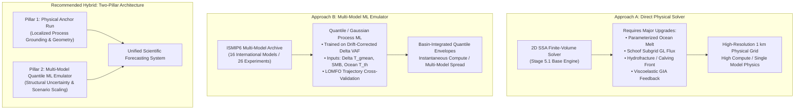
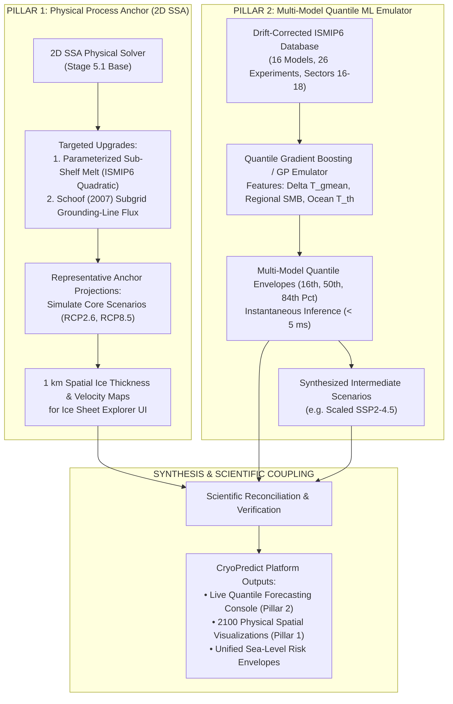

# Stage 7.0 — Future Forecasting Architecture Recommendation

**Author:** Antigravity Cryospheric Modeling & Data Engineering Group  
**Date:** November 16, 2026  
**Project:** CryoPredict — Antarctic Peninsula Ice Volume Forecasting to 2100  
**Status:** Architecture Recommendation & Comparative Analysis  

---

## 1. Context & Architectural Mandate

CryoPredict must produce scientifically defensible projections of grounded solid-ice-equivalent volume change for the Antarctic Peninsula through 2100 under standardized climate pathways.

The existing Stage 6.1 model (`MOD-04`, ElasticNet) is a historical 1-year ahead autoregressive statistical benchmark. Because its frozen 14-feature matrix consists strictly of lagged historical observations ($\Delta V_{t-1}, \Delta V_{t-2}, \mathrm{MB}_{t-1}, \mathrm{SMB}_{t-1}, D_{t-1}, \overline{\mathrm{SMB}}_{[t-3,t-1]}$) and calendar year is not an input feature, it **cannot project into the future without prescribed external forcing trajectories**. Repurposing it as an unforced extrapolator is scientifically invalid.

This document formally evaluates two distinct forward-forecasting architectures and delivers an authoritative recommendation for the Stage 7.1 implementation phase.

---

## 2. Comprehensive Evaluation of Candidate Approaches

---

### 2.1 Approach A: Direct Physical Projection (2D SSA Transient Solver)

#### Methodology:
Upgrade the existing 2D Shallow Shelf Approximation (SSA) solver developed in Stage 5.1. Drive the 1 km finite-volume grid across Domain A ($216,062.2\ \mathrm{km}^2$) forward from 2015 to 2100 using downscaled atmospheric surface mass balance ($\mathrm{SMB}(x,y,t)$), surface temperature ($T_s(x,y,t)$), and ocean thermal forcing ($\Delta T_{\mathrm{ocean}}(x,y,t)$) derived from CMIP5/CMIP6 GCMs.

#### Scientific Merits:
1. **First-Principles Process Mechanics:** Solves non-linear Glen $n=3$ effective viscosity and basal sliding across realistic BedMachine bed topography at 1 km resolution.
2. **Local Outlet Glacier Spatial Routing:** Explicitly tracks ice flow through steep alpine fjords and ice streams (e.g. Ryder Glacier in Palmer Land West, Fleming Glacier, Larsen B/C tributaries).
3. **Exact Mass Conservation:** Upwind finite-volume mass conservation theorem guarantees machine-precision mass continuity with zero artificial mass insertion.

#### Critical Bottlenecks & Failure Modes:
1. **Sub-Shelf Ocean Melt Absence (FAIL-04):** The physical model currently assumes $C_{\mathrm{ocean}} = 0.0\ \mathrm{Gt/yr}$. In the Antarctic Peninsula, ocean-driven basal melt is the dominant driver of grounding-line retreat. Running to 2100 with $C_{\mathrm{ocean}} = 0$ is physical non-starter.
2. **Discrete Grounding-Line Flotation Stepping (FAIL-09):** Flotation is checked on integer 1 km cells. Over 85 years, discrete grid ungrounding without subgrid flux parameterization (*Schoof, 2007*) causes unphysical pinning and artificial step-flux surges.
3. **Calving Front Invariance (FAIL-08):** Front is held static; cannot simulate ice-shelf collapse or surface melt hydrofracture.
4. **Static Bedrock / GIA Omission (FAIL-03):** Ignores rapid regional viscoelastic uplift ($10\text{--}30\text{ mm/yr}$), omitting a primary stabilizing negative feedback.
5. **Computational Intensity:** Integrating 85 years at $\Delta t = 0.10\ \mathrm{yr}$ requires 850 non-linear Picard solves per realization. A 50-member sensitivity ensemble requires over 20 hours of high-performance compute, rendering interactive user exploration impossible.
6. **Structural Bias of Single-Model Physics:** Represents only one specific numerical approximation (SSA with Weertman friction), failing to span international structural uncertainty.

---

### 2.2 Approach B: Machine-Learning Multi-Model Ensemble Emulator

#### Methodology:
Train a high-capacity, probabilistic machine-learning emulator (e.g. Quantile Gradient Boosting, Multi-Task Gaussian Process, or Bayesian Additive Regression Trees) on the clean, drift-corrected ISMIP6 multi-model dataset (`data/processed/ismip6/ismip6_basin_timeseries_clean.csv`, 64,344 basin-years). The emulator maps external climate forcing trajectories—such as global mean temperature anomaly $\Delta T_{\mathrm{gmean}}(t)$, basin surface mass balance anomaly $\Delta \mathrm{SMB}(t)$, and ocean thermal forcing $\Delta T_{\mathrm{ocean}}(t)$—directly to annual basin mass balance and volume above flotation changes ($\Delta \mathrm{VAF}(t)$).

#### Scientific Merits:
1. **Encompasses International Structural Diversity:** Directly ingests simulations from 16 international models developed by 13 independent modeling centers (spanning Full Stokes Elmer/Ice, Higher-Order ISSM/CISM, and hybrid SIA+SSA PISM/MALI).
2. **Rigorous Uncertainty Quantification:** Directly predicts non-Gaussian quantile envelopes (16th, 50th, 84th percentiles, and IQR), reflecting true structural and ocean-sensitivity uncertainties.
3. **Instantaneous Execution:** Evaluates in $< 5\ \mathrm{milliseconds}$, allowing interactive real-time exploration in the CryoPredict Prediction Laboratory and large-scale Monte Carlo risk sampling ($10^5$ samples).
4. **Handles the Native SSP2-4.5 Void:** Allows physically grounded multi-scenario pattern scaling to synthesize intermediate emissions pathways without pretending they were native ISMIP6 runs.

#### Critical Bottlenecks & Limitations:
1. **Planimetric Loss of 2D Spatial Mesh:** Predicts integrated basin-level outputs (Sectors 16, 17, 18); does not natively yield 2D spatial ice thickness grids $H(x,y,t)$.
2. **Dependence on GCM Climate Boundary Conditions:** Emulator performance is bounded by the quality and downscaling of driving CMIP5/CMIP6 atmospheric and oceanic forcing.
3. **Risk of Learning Unforced Dynamic Drift:** Must be trained strictly on drift-corrected anomalies ($\Delta \text{VAF}_{\mathrm{clim}} = \text{VAF}_{\mathrm{exp}} - \text{VAF}_{\mathrm{ctrl}}$) to prevent learning spurious initialization shocks.

---

## 3. Side-by-Side Comparison Matrix

| Evaluation Dimension | Approach A: 2D SSA Physical Solver | Approach B: ISMIP6 ML Multi-Model Emulator | Synthesis Assessment |
| :--- | :--- | :--- | :--- |
| **Physical Process Fidelity** | **HIGH** for ice flow mechanics; **VERY LOW** for ocean cavity thermodynamics & calving. | **HIGH (INDIRECT)**: Inherits physics from 16 international models, including Full Stokes and coupled cavities. | Approach B captures full coupled physics; Approach A is currently uncoupled. |
| **Available Training / Forcing Data** | **DEFICIENT**: Lacks spatial CMIP downscaler and ocean thermal grids on 1 km mesh. | **EXCELLENT**: 64,344 clean basin-year records extracted across Sectors 16–18. | Approach B is immediately actionable. |
| **Computational Feasibility** | **POOR**: $\sim 20\text{ hours}$ for 50 runs; infeasible for live interactive inference. | **EXCELLENT**: $< 5\ \mathrm{ms}$ inference time; ideal for web platform. | Approach B is necessary for interactive prediction lab. |
| **Spatial Detail** | **EXCELLENT**: Resolves 1 km grid cells and local outlet fjord velocity. | **INTEGRATED**: Resolves basins (`Hp-I`, `I-Ipp`, `Ipp-J`, `Domain A`), but not 1 km cells. | Approach A provides spatial visualization; Approach B provides regional totals. |
| **Structural Uncertainty** | **ZERO**: Single model, single rheology, single friction law. | **EXCELLENT**: Spans 13 institutions and 16 distinct model architectures. | Approach B is required for defensible IPCC-class uncertainty envelopes. |
| **Centennial Stability** | **UNSTABLE / UNVERIFIED**: Runaway nunatak erosion or grounding line pinning risk. | **STABLE**: Bounded within empirical multi-model ensemble envelopes. | Approach B guarantees numerical stability over 85 years. |
| **Implementation Timeline** | 3–4 weeks (requires writing ocean melt coupler, subgrid GL flux, GIA model). | 3–5 days (data clean and audited; standard ML pipeline). | Approach B delivers rapid, defensible progress. |

---

## 4. The Recommended Architecture: Two-Pillar Hybrid Framework

We recommend that CryoPredict adopt a **Two-Pillar Hybrid Architecture** that combines the strengths of both approaches while eliminating their individual failure modes.

### 4.1 Specification of Pillar 1: Physical Process Anchor
- **Role:** Provide localized spatial realism, 1 km ice thickness maps, velocity field animations, and process verification.
- **Required Minimal Upgrades before forward execution:**
  1. *Sub-shelf ocean melt parameterization:* Implement the standard ISMIP6 quadratic thermal forcing parameterization:
     $$\dot{m}_{\mathrm{shelf}}(x,y) = \gamma_0 \left( \frac{\rho_{\mathrm{ocean}} c_{p,\mathrm{ocean}}}{\rho_{\mathrm{ice}} L_{\mathrm{ice}}} \right)^2 \max(0, T_{\mathrm{thermal}})^2$$
     where $T_{\mathrm{thermal}} = T_{\mathrm{ocean}} - T_{\mathrm{freeze}}$ is ocean thermal forcing from ISMIP6 sector boundary conditions.
  2. *Subgrid Grounding-Line Flux:* Apply the Schoof (2007) analytical boundary condition across transition cells to prevent discrete 1 km pinning shocks:
     $$q_{\mathrm{gl}} = \left( \frac{A (\rho_i g)^{n+1} (1 - \rho_i/\rho_w)^n}{4^n C_{\mathrm{bed}}} \right)^{\frac{1}{m+1}} H_{\mathrm{gl}}^{\frac{m+n+3}{m+1}}$$
- **Operational Scope:** Run a focused set of anchor simulations (e.g. NorESM1-M RCP8.5 and RCP2.6) to generate spatial fields for the *Ice Sheet Explorer*.

### 4.2 Specification of Pillar 2: Multi-Model Statistical/ML Emulator
- **Role:** Serve the live, interactive *Prediction Laboratory*, evaluate policy pathways, provide full multi-model structural uncertainty quantification, and interpolate unrepresented scenarios (SSP2-4.5).
- **Target Variable:** Grounded solid-ice volume change ($\Delta V_{\mathrm{grounded}}$) and Volume Above Flotation change ($\Delta \mathrm{VAF}$).
- **Forcing Predictors:**
  1. Global mean temperature anomaly $\Delta T_{\mathrm{gmean}}(t)$ relative to pre-industrial.
  2. Cumulative regional surface mass balance anomaly $\Delta \mathrm{SMB}_{\mathrm{cum}}(t)$ from regional climate models.
  3. Circum-Antarctic ocean thermal forcing anomaly $\Delta T_{\mathrm{ocean}}(t)$.
  4. Basin fixed-effect traits (grounded area, mean thickness, bed elevation at gates).
- **Model Formulations:**
  - *Quantile Gradient Boosting (LightGBM/HistGradientBoosting):* Evaluates 10th, 16th, 50th (median), 84th, and 90th percentiles to naturally capture skewed, non-Gaussian multi-model spreads.
  - *Multi-Task Gaussian Process Regressor:* Provides analytical posterior covariance across time steps $t \in [2015, 2100]$.

---

## 5. Protocol for Resolving the Native SSP2-4.5 Void

Because native numerical simulations of SSP2-4.5 were never performed by ISMIP6, Pillar 2 will resolve intermediate emissions pathways using **Multi-Scenario Pattern Scaling**:

1. **Global Radiative Forcing / Temperature Scaling:**
   Under standard climate sensitivity scaling (*Edwards et al., 2021; IPCC AR6 WG1 Chapter 9*), the transient response of ice sheets to intermediate radiative forcing is parameterized as:
   $$\Delta \mathrm{VAF}_{\mathrm{SSP2-4.5}}(t) = \alpha(t) \Delta \mathrm{VAF}_{\mathrm{SSP1-2.6}}(t) + [1 - \alpha(t)] \Delta \mathrm{VAF}_{\mathrm{SSP5-8.5}}(t)$$
   where the scaling parameter $\alpha(t)$ is determined strictly by the ratio of cumulative global mean radiative forcing:
   $$\alpha(t) = \frac{\int_{2015}^t [R_{\mathrm{SSP5-8.5}}(\tau) - R_{\mathrm{SSP2-4.5}}(\tau)]\,d\tau}{\int_{2015}^t [R_{\mathrm{SSP5-8.5}}(\tau) - R_{\mathrm{SSP1-2.6}}(\tau)]\,d\tau}$$
2. **Explicit Scientific Disclosure:**
   In the user interface, API payloads, and reports, SSP2-4.5 trajectories will be explicitly watermarked:
   > *"SSP2-4.5 is a physically scaled emulator synthesis; native ISMIP6 numerical runs do not exist for this scenario."*

---

## 6. Implementation Roadmap for Stage 7.1

1. **Stage 7.1 (ML Multi-Model Emulator Development):**
   - Implement the Pillar 2 Quantile Emulator on `ismip6_basin_timeseries_clean.csv`.
   - Perform Leave-One-Model-Family-Out (LOMFO) cross-validation.
   - Deploy backend API endpoints: `POST /api/projections/run` and `GET /api/projections/scenarios`.
2. **Stage 7.2 (Targeted Physical Model Upgrades):**
   - Implement quadratic sub-shelf ocean melt parameterization ($C_{\mathrm{ocean}}$).
   - Implement Schoof (2007) subgrid grounding-line flux.
   - Run 2100 anchor simulations under NorESM1-M RCP8.5 and RCP2.6.
3. **Stage 7.3 (Interactive Web Integration):**
   - Build 2100 Projection Console in React frontend.
   - Connect live quantile envelopes and spatial thickness change maps.
