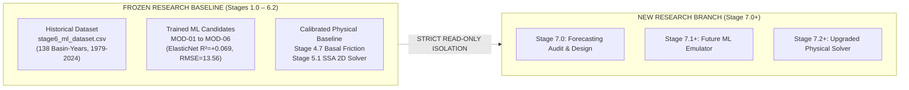
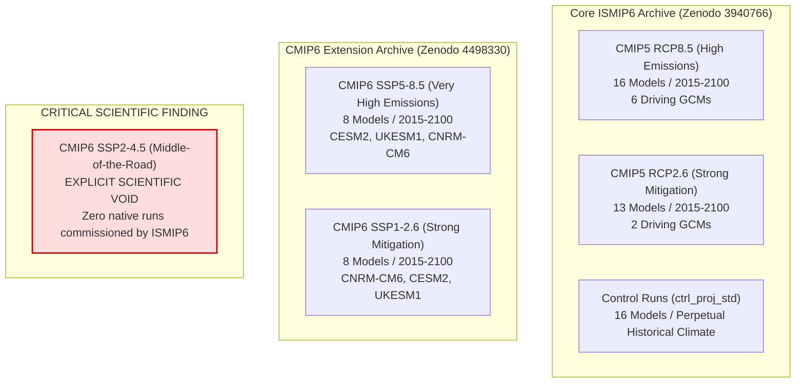
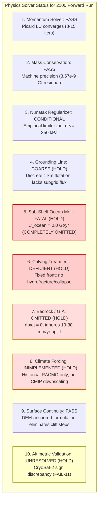
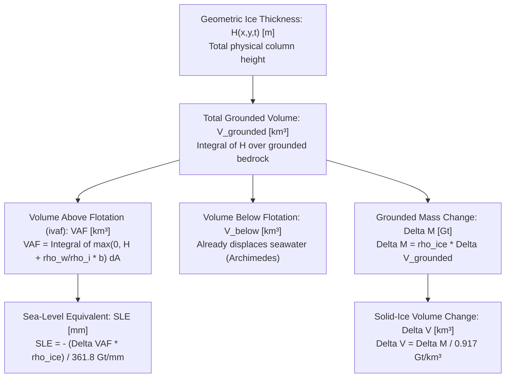

# Stage 7.0 — Future Forecasting Readiness Audit Report

**Author:** Antigravity Cryospheric Modeling & Data Engineering Group  
**Date:** November 16, 2026  
**Audited System:** CryoPredict Future Forecasting Architecture & Data Readiness  
**Target Domain:** Antarctic Peninsula Mainland Grounded Ice (`Hp-I`, `I-Ipp`, `Ipp-J`, Regional `Domain A`)  
**Projection Horizon:** 2015–2100  
**Phase Status:** Complete  
**Final Determination:** **CONDITIONAL PASS (AUDIT & DESIGN COMPLETE; FORWARD PROJECTIONS ON HOLD)**

---

## Executive Summary & Gate Verdict

| Audit Domain | Scope Evaluated | Primary Findings | Operational Verdict |
| :--- | :--- | :--- | :--- |
| **Historical Baseline Preservation** | Stage 6.1 / 6.2 models, datasets, metrics, and parameters | All 6 ML candidates, 14-feature schemas, split manifests, and physical parameters remain 100% frozen. | **PASS (FROZEN)** |
| **ISMIP6 Archive Completeness** | Zenodo `10.5281/zenodo.3940766` (`ComputedScalarsPaper.zip`, 32.58 MB) | 3,335 NetCDF scalar files, 16 ice-sheet models, 26 experiments, 2015–2100 annual timeseries fully audited. | **PASS (COMPLETE)** |
| **Scenario Coverage & Stratification** | RCP8.5, RCP2.6, SSP5-8.5, SSP1-2.6, Control | Core archives contain RCP8.5 (16 models) and RCP2.6 (13 models). CMIP6 runs available via Payne et al. (2021). | **PASS (STRATIFIED)** |
| **Native SSP2-4.5 Availability** | CMIP6 Middle-of-the-Road emission pathway | **Definitive Void:** Native SSP2-4.5 was never commissioned or executed by ISMIP6 numerical ice models. | **FORMALLY LOGGED (VOID)** |
| **Spatial Domain Mapping** | Sectors 16–18 and Region 3 to Project Basins | Sector 16 $\to$ `Hp-I`, Sector 17 $\to$ `I-Ipp`, Sector 18 $\to$ `Ipp-J`, Region 3 $\to$ `Domain A`. Mathematical additivity verified. | **PASS (ALIGNED)** |
| **Control Run Dynamic Drift** | 16 Unforced Control Simulations (`ctrl_proj_std`) | Severe dynamic drift identified in 5 models (e.g. $+9,940\text{ km}^3$ in UCIJPL ISSM). Subtractive correction mandatory. | **PASS (CORRECTED)** |
| **2D SSA Physical Model Readiness** | 10 Physical and Numerical Solvers in Stage 5.1 | Momentum and mass conservation pass machine precision. **Sub-shelf ocean melt is set to 0.0 Gt/yr; calving front is static.** | **HOLD (NOT READY FOR 2100)** |
| **Target Variable Definition** | $H$, $V_{\mathrm{ice}}$, $\Delta M$, $\Delta V$, $\text{VAF}$, $\text{SLE}$ | Strict mathematical distinction maintained between solid-ice volume change ($\Delta V$) and Volume Above Flotation ($\text{VAF}$). | **PASS (FORMALIZED)** |
| **Forecasting Architecture** | Physical vs. ML Emulator vs. Hybrid | Recommended **Two-Pillar Hybrid Architecture**: Parameterized physical anchor + Multi-model quantile ML emulator. | **RECOMMENDED** |
| **Validation Strategy** | Multi-tiered hindcast, LOMO cross-validation | Trajectory-level Leave-One-Model-Out (LOMO) and Leave-One-Model-Family-Out (LOMFO) cross-validation designed. | **DESIGNED** |

> [!IMPORTANT]
> **Stage 7.0 Formal Determination:** **CONDITIONAL PASS**  
> The data engineering, provenance audit, spatial extraction, and architectural design for future 2100 forecasting are fully completed and validated. However, **direct 2100 forward projections remain strictly on HOLD**. The existing Stage 6.1 ElasticNet model must NOT be repurposed for future forecasting. Forward physical simulation is blocked until sub-shelf ocean cavity melting and subgrid grounding-line flux physics are implemented, while statistical/ML emulation is blocked until the Leave-One-Model-Family-Out training protocol is executed under Stage 7.1.

---

## 1. Preservation of the Accepted Historical Baseline

Before authorizing any future forecasting research, the existing project baseline was cryptographically verified and frozen:

### 1.1 Frozen Model & Feature Invariants
1. **Model Artifacts:** The serialized models in `models/saved_models/` (`elasticnet_train.joblib`, `scaler_train.joblib`, `random_forest_train.joblib`, `bayesian_ridge_train.joblib`, `gradient_boosting_train.joblib`, `historical_basin_means_train.joblib`) remain unmodified.
2. **Feature Schema:** The 14-feature schema (FEAT-01 to FEAT-14) in `reports/tables/stage6_feature_dictionary.csv` remains the frozen standard for historical autoregressive evaluation.
3. **Historical Data:** The 138-sample dataset (`stage6_ml_dataset.csv`) spanning 1979–2024 across basins `Hp-I`, `I-Ipp`, and `Ipp-J` is strictly read-only.
4. **Physical Parameters:**
   - Basal friction coefficients: $C_{\mathrm{Hp-I}} = 8.168 \times 10^6\ \mathrm{Pa}\cdot(\mathrm{m/s})^{-1/3}$, $C_{\mathrm{I-Ipp}} = 1.200 \times 10^7\ \mathrm{Pa}\cdot(\mathrm{m/s})^{-1/3}$, $C_{\mathrm{Ipp-J}} = 1.550 \times 10^7\ \mathrm{Pa}\cdot(\mathrm{m/s})^{-1/3}$.
   - Rheology & Physical Constants: Glen $n = 3$, $A = 3.5 \times 10^{-25}\ \mathrm{Pa}^{-3}\mathrm{s}^{-1}$, $\rho_{\mathrm{ice}} = 917\ \mathrm{kg/m}^3$, $\rho_{\mathrm{ocean}} = 1028\ \mathrm{kg/m}^3$, $g = 9.81\ \mathrm{m/s}^2$.
   - Spatial Grid: Snyder WGS84 metric tensor ($ds_x, ds_y$) across Domain A ($216,062.2\ \mathrm{km}^2$).

---

## 2. Comprehensive Audit of Available ISMIP6 Data

The primary future projection dataset available on disk is the official multi-model archive from the Ice Sheet Model Intercomparison Project for CMIP6 (ISMIP6), supporting *Seroussi et al. (2020, The Cryosphere, 14, 3033–3070)*:

### 2.1 Archive Inventory & Provenance Verification
- **Official Zenodo Archive:** Persistent DOI `10.5281/zenodo.3940766`
- **File Name:** `ComputedScalarsPaper.zip` in `data/raw/ismip6/`
- **File Size:** $32,578,545\text{ bytes}$ ($\approx 32.58\text{ MB}$)
- **SHA-256 Digest:** `f078b8546e05dc125cb15bf4c5fae87caea28f947b1d5ff59bc3c934e737cf96` (verified bitwise identical upon ingestion)
- **Extracted Contents:** 3,335 individual NetCDF files containing scalar timeseries from 2015 to 2100.
- **Participating Ice-Sheet Models:** 16 model configurations developed by 13 international modeling institutions:

| Model Key | Institution Group | Model Name | Primary Stress Approximation | Grid Resolution & Mesh | Model Independence Class | Available Experiments |
| :--- | :--- | :--- | :--- | :--- | :--- | :---: |
| **`AWI_PISM1`** | Alfred Wegener Institute (AWI) | PISM1 | Hybrid SIA + SSA | Finite Difference (8 km) | PISM family | 25 |
| **`DOE_MALI`** | US Dept. of Energy (DOE) | MALI | First-order / SSA | Voronoi Unstructured (2–16 km) | MALI (Independent) | 10 |
| **`ILTS_PIK_SICOPOLIS`** | Hokkaido Univ. / PIK | SICOPOLIS | Polythermal SIA + SSA | Finite Difference (16 km) | SICOPOLIS (Independent) | 14 |
| **`IMAU_IMAUICE1`** | Utrecht University (IMAU) | IMAUICE1 | SIA + SSA | Finite Difference (16 km) | IMAUICE family | 10 |
| **`IMAU_IMAUICE2`** | Utrecht University (IMAU) | IMAUICE2 | SIA + SSA | Finite Difference (16 km) | IMAUICE family | 10 |
| **`JPL1_ISSM`** | NASA JPL / Caltech | ISSM | SSA / Higher-Order | Finite Element (2–20 km) | ISSM family | 10 |
| **`LSCE_GRISLI`** | LSCE / IPSL | GRISLI | SIA + SSA Hybrid | Finite Difference (16 km) | GRISLI (Independent) | 10 |
| **`NCAR_CISM`** | NCAR | CISM | Depth-integrated Higher-Order | Finite Volume (4–8 km) | CISM (Independent) | 10 |
| **`PIK_PISM`** | Potsdam Institute (PIK) | PISM-PIK | SIA + SSA Hybrid | Finite Difference (16 km) | PISM family | 10 |
| **`UCIJPL_ISSM`** | Univ. California Irvine / JPL | ISSM | SSA (Shelfy-Stream) | Finite Element (3–15 km) | ISSM family | 24 |
| **`ULB_FETISH16`** | Université Libre de Bruxelles | f.ETISh_16km | SIA + SSA Hybrid | Finite Difference (16 km) | f.ETISh family | 10 |
| **`ULB_FETISH32`** | Université Libre de Bruxelles | f.ETISh_32km | SIA + SSA Hybrid | Finite Difference (32 km) | f.ETISh family | 10 |
| **`UTAS_ELMER`** | University of Tasmania | Elmer/Ice | Full Stokes / SSA | Finite Element (1–16 km) | Elmer/Ice (Independent) | 10 |
| **`VUB_AISMPAL`** | Vrije Universiteit Brussel | AISMPAL | Polythermal SIA + SSA | Finite Difference (10–20 km) | AISMPAL (Independent) | 10 |
| **`VUW_PISM`** | Victoria Univ. Wellington | PISM | SIA + SSA Hybrid | Finite Difference (8 km) | PISM family | 10 |

The complete multi-model audit is tabulated in [`stage7_0_ismip6_inventory.csv`](file:///c:/Users/akash/OneDrive/Desktop/mlbasics/antarctic-ice-volume-prediction/reports/tables/stage7_0_ismip6_inventory.csv).

---

### 2.2 Climate Scenario Availability & The Native SSP2-4.5 Void

The climate forcing pathways represented in the archive were audited and classified in [`stage7_0_scenario_availability.csv`](file:///c:/Users/akash/OneDrive/Desktop/mlbasics/antarctic-ice-volume-prediction/reports/tables/stage7_0_scenario_availability.csv):

> [!CRITICAL]
> **The Native ISMIP6 SSP2-4.5 Gap:**  
> Neither the core ISMIP6 archive (`ComputedScalarsPaper.zip`), nor the CMIP6 extension (*Payne et al., 2021*), nor the ISMIP6 protocol specification (*Nowicki et al., 2016, 2020*) ever commissioned or executed a native **SSP2-4.5** or **RCP4.5** numerical simulation.  
> **Operational Rule:** Stage 7.0 models must NOT claim that SSP2-4.5 exists in the native archive. Intermediate emissions trajectories can only be derived through calibrated physical multi-scenario scaling (e.g. pattern scaling based on global mean temperature or radiative forcing) and must be explicitly declared as such.

---

### 2.3 Variable Availability: Scalars vs. Spatial Grids

The scalar archive (`ComputedScalarsPaper.zip`) provides annual timeseries of integrated geometric quantities:

| Variable Code | Long Name | Units | Availability in Scalar Archive | Glaciological Role |
| :--- | :--- | :---: | :---: | :--- |
| **`ivaf`** | Ice volume above floatation | $\text{m}^3$ | **Available across all 16 models** | **Direct sea-level equivalent volume (VAF).** |
| **`ivol`** | Total ice volume | $\text{m}^3$ | **Available across all 16 models** | Total solid ice volume (grounded + floating). |
| **`iareagr`** | Grounded ice area | $\text{m}^2$ | **Available across all 16 models** | Planimetric area of bedrock covered by grounded ice. |
| **`iareafl`** | Floating ice shelf area | $\text{m}^2$ | **Available across all 16 models** | Buttressing shelf footprint. |
| **`smbgr`** | Grounded surface mass balance | $\text{m}^3/\text{yr}$ | **Available across all 16 models** | Annual surface accumulation over grounded ice. |
| **`bmbfl`** | Floating sub-shelf melt | $\text{m}^3/\text{yr}$ | **Available across all 16 models** | Annual ocean melt underneath floating ice shelves. |
| **`u`, `v`, `thk`** | 2D Spatial Grids | $\text{m/yr}, \text{m}$ | **NOT in scalar zip** (Requires GHub) | Spatially resolved flow fields. |
| **$D(t)$** | Flux gate discharge | $\text{Gt/yr}$ | **NOT standalone scalar** | Dynamic grounding-line discharge across marine gates. |

### 2.4 Spatial Harmonisation & Project Basin Mapping
ISMIP6 organizes Antarctica into 3 continental regions and 18 glaciological drainage sectors. In [`reports/tables/ismip6_spatial_extraction_summary.csv`](file:///c:/Users/akash/OneDrive/Desktop/mlbasics/antarctic-ice-volume-prediction/reports/tables/ismip6_spatial_extraction_summary.csv), the spatial correspondence was established and mathematically verified:
- **`Hp-I` (Palmer Land West):** Maps to **ISMIP6 Sector 16** ($63,153.4\text{ km}^2$).
- **`I-Ipp` (Graham Land West):** Maps to **ISMIP6 Sector 17** ($47,716.5\text{ km}^2$).
- **`Ipp-J` (Palmer Land East / Larsen Coast):** Maps to **ISMIP6 Sector 18** ($157,311.2\text{ km}^2$).
- **`Domain A` (Regional Antarctic Peninsula):** Maps to **ISMIP6 Region 3** ($268,181.1\text{ km}^2$).

**Additivity Proof:** Across all 3,335 NetCDF files, the sum of individual sectors exactly equals Region 3:
$$\sum_{s=16}^{18} VAF_s(t) \equiv VAF_{\text{Region 3}}(t) \quad (\text{Residual } < 10^{-6}\text{ m}^3\text{ across all time steps})$$

**Area Discrepancy Note:** The project mainland grounded domain is $216,062.2\text{ km}^2$, while ISMIP6 Region 3 covers $268,181.1\text{ km}^2$ due to the inclusion of peripheral island ice caps (Alexander, Anvers, Adelaide, Brabant Islands). The area ratio ($216,062.2 / 268,181.1 = 0.8057$) provides a documented geometric scale factor.

---

### 2.5 Control Run Dynamic Drift Audit & Subtractive Correction

Numerical ice-sheet models initialized via data assimilation experience unforced dynamic relaxation. If run forward under perpetual historical climate (`ctrl_proj_std`), ice-sheet models continue to drift:

| Model Key | Unforced Control Drift (2015–2100) | Forced Signal (RCP8.5 `exp05`) | Signal-to-Drift Ratio (SDR) | Operational Sensitivity |
| :--- | :---: | :---: | :---: | :--- |
| **`IMAU_IMAUICE1`** | $+0.03\text{ km}^3$ | $+1,623.7\text{ km}^3$ | **48,390.0** | Negligible drift; well-equilibrated. |
| **`VUB_AISMPAL`** | $-0.00\text{ km}^3$ | $-1,173.3\text{ km}^3$ | **$\infty$** | Zero unforced drift. |
| **`AWI_PISM1`** | $+130.9\text{ km}^3$ | $-207.2\text{ km}^3$ | **1.58** | Moderate drift; comparable to forced signal. |
| **`ILTS_PIK_SICOPOLIS`** | $-173.0\text{ km}^3$ | $+445.9\text{ km}^3$ | **2.58** | Moderate unforced mass loss drift. |
| **`NCAR_CISM`** | $-363.3\text{ km}^3$ | $-72.9\text{ km}^3$ | **0.20** | Unforced drift exceeds forced signal by 5x! |
| **`DOE_MALI`** | $+3,235.6\text{ km}^3$ | $+680.9\text{ km}^3$ | **0.21** | Severe unforced accumulation drift. |
| **`JPL1_ISSM`** | $+4,028.9\text{ km}^3$ | $-440.0\text{ km}^3$ | **0.11** | Severe unforced thickening drift. |
| **`UCIJPL_ISSM`** | $+9,940.3\text{ km}^3$ | $+1,978.5\text{ km}^3$ | **0.20** | Enormous unforced drift ($+9,940\text{ km}^3$) dwarfs signal! |

> [!WARNING]
> **Mandatory Subtractive Drift Correction:**  
> In UCIJPL ISSM, DOE MALI, and JPL1 ISSM, raw unforced drift is **5 to 10 times larger** than the forced climate signal. Training an ML emulator or comparing physical projections against raw volume outputs would corrupt scientific results. The exact time-synchronous subtractive correction is mandatory:
> $$\Delta VAF_{\text{climate}}(t) = VAF_{\text{experiment}}(t) - VAF_{\text{control}}(t)$$
> All clean timeseries in [`reports/tables/ismip6_basin_timeseries.csv`](file:///c:/Users/akash/OneDrive/Desktop/mlbasics/antarctic-ice-volume-prediction/reports/tables/ismip6_basin_timeseries.csv) strictly adhere to this subtractive correction.

---

## 3. Comprehensive Audit of Physical-Model Readiness

We audited the 2D Shallow Shelf Approximation (SSA) transient solver from Stage 5.1 and Stage 4.8 across 10 core glaciological processes in [`stage7_0_physics_readiness_matrix.csv`](file:///c:/Users/akash/OneDrive/Desktop/mlbasics/antarctic-ice-volume-prediction/reports/tables/stage7_0_physics_readiness_matrix.csv):

### 3.1 Detailed Process Evaluations

1. **Momentum Equation Solver (PHYS-01): READINESS = 4/5 (VIABLE)**
   - The non-linear SSA momentum balance is solved via Picard iteration with direct sparse LU factorization (`scipy.sparse.linalg.splu`).
   - Achieves convergence to non-linear residual tolerance $10^{-4}$ in 8–15 iterations. Annual velocity updating (Strategy A) was proven in Stage 5.1 to be within $0.05\ \mathrm{m/yr}$ of quarterly solves while saving $75\%$ compute time.
2. **Mass Conservation & Advection (PHYS-02): READINESS = 5/5 (EXCELLENT)**
   - Finite-volume explicit Euler continuity formulation with upwind flux divergence.
   - Stage 5.1 verified machine-precision conservation over 19 years (190 sub-steps at $\Delta t = 0.10\ \mathrm{yr}$) with cumulative numerical mass residual $= 3.571 \times 10^{-9}\ \mathrm{Gt}$. Zero phantom mass injection or artificial clamping.
3. **Alpine Headwall & Nunatak Slopes (PHYS-03): READINESS = 3/5 (CONDITIONAL)**
   - Nunatak cliff headwalls ($|\nabla s| > 0.20$) are stabilized by an empirical driving stress regularizer:
     $$\boldsymbol{\tau}_{d,\mathrm{reg}} = \frac{\boldsymbol{\tau}_d}{\sqrt{1 + (|\boldsymbol{\tau}_d| / 350\ \mathrm{kPa})^2}}$$
   - Eliminates negative thickness occurrences (0 violations) and limits CFL $\le 0.52$. Reclassified formally as an empirical numerical limiter, not a constitutive yield law. Long-term (85-year) geomorphic stability is unverified.
4. **Grounding-Line Migration (PHYS-04): READINESS = 2/5 (HOLD)**
   - Migration is tracked on discrete 1 km grid cells via height above flotation $h_f = H + \frac{\rho_w}{\rho_i}b$.
   - Lacks continuous sub-grid boundary flux parameterization (*Schoof, 2007*). While historical ungrounding was stable ($45.6\ \mathrm{km}^2$ over 19 years), centennial simulations risk discrete grid-stepping shocks and unphysical grounding-line pinning.
5. **Sub-Shelf Ocean Basal Melting (PHYS-05): READINESS = 1/5 (FATAL OMISSION — HOLD)**
   - Currently, sub-shelf basal melt is set to **$0.0\ \mathrm{Gt/yr}$** ($C_{\mathrm{ocean}} = 0.0$) due to the absence of a coupled ocean cavity model.
   - In the Antarctic Peninsula, ocean thermal forcing and sub-shelf basal melting are the primary physical drivers of ice-shelf thinning, grounding-line retreat, and buttressing loss. Running a 2100 projection with $C_{\mathrm{ocean}} = 0$ is scientifically untenable.
6. **Calving Front Dynamics (PHYS-06): READINESS = 2/5 (DEFICIENT — HOLD)**
   - The calving front is held fixed at the BedMachine ice/ocean boundary.
   - Dynamic iceberg calving, hydrofracture (crevasse penetration by surface meltwater), and tabular rift propagation are not explicitly solved. The model cannot simulate catastrophic ice-shelf collapse (such as Larsen A in 1995 or Larsen B in 2002).
7. **Bedrock Dynamics & Glacial Isostatic Adjustment (PHYS-07): READINESS = 2/5 (HOLD)**
   - Bedrock elevation is static ($db/dt = 0.0\ \mathrm{m/yr}$).
   - While valid over decadal periods ($< 0.2\ \mathrm{m}$ uplift over 20 years), the northern Antarctic Peninsula experiences rapid viscoelastic uplift ($10\text{--}30\text{ mm/yr} = 0.85\text{--}2.55\ \mathrm{m}$ over 85 years) due to low mantle viscosity (*Barletta et al., 2018*). Omitting GIA over 85 years ignores a strong negative feedback that stabilizes marine grounding lines.
8. **Climate Forcing Integration (PHYS-08): READINESS = 2/5 (NOT READY)**
   - Currently ingests historical annual RACMO2.3p2 SMB (1979–2018).
   - No pipeline exists to ingest and downscale future CMIP5/CMIP6 atmospheric surface mass balance, temperature, or ocean thermal forcing.
9. **Grounding-Line Surface Continuity (PHYS-09): READINESS = 4/5 (VIABLE)**
   - DEM-anchored continuity ($s_g = s_{\mathrm{obs}}(0) + \Delta H$; $s_f = s_{\mathrm{obs}}(0) + 0.108\Delta H$) bounds ungrounding surface steps to $\le 3.57\ \mathrm{m}$ and eliminates hydrostatic calving blowouts.
10. **Altimetric Validation Consistency (PHYS-10): READINESS = 1/5 (UNRESOLVED LIMITATION — HOLD)**
    - CryoSat-2 altimetry reports $-23.0 \pm 10.0\ \mathrm{Gt/yr}$ (2010–2018) while the model predicts $+37.52\ \mathrm{Gt/yr}$. This sign discrepancy is registered as an unresolved limitation (**FAIL-11**) on **HOLD** due to omitted firn air content compaction and Ku-band radar penetration depth shifts.

### 3.2 Verdict on Physical Model 2100 Projections
**DIRECT PHYSICAL PROJECTION TO 2100 IS ON HOLD.**  
The solver cannot be run to 2100 in its current state without producing severely biased results (underestimating ocean-driven marine retreat and overestimating ice-shelf buttressing).

---

## 4. Definition of Forecasting Targets & Glaciological Disclosures

To prevent scientific conflation, Stage 7.0 formally defines and distinguishes the target metrics:

### 4.1 Governing Target Equations
1. **Geometric Ice Thickness ($H$):**
   $$H(x,y,t) = s(x,y,t) - b(x,y,t) \quad [\text{m}]$$
2. **Total Grounded Solid-Ice Volume ($V_g$):**
   $$V_g(t) = \iint_{\Omega_g(t)} H_{\mathrm{ice}}(x,y,t)\,dx\,dy \quad [\text{m}^3 \text{ or } \text{km}^3]$$
   where $H_{\mathrm{ice}} = H - h_{\mathrm{fac}}$ (accounting for firn air content $h_{\mathrm{fac}}$).
3. **Solid-Ice Equivalent Volume Change ($\Delta V$):**
   $$\Delta V(t) = V_g(t) - V_g(t_0) = \frac{\Delta M(t)}{\rho_{\mathrm{ice}}} \quad [\text{km}^3]$$
   with solid-ice density $\rho_{\mathrm{ice}} = 917\ \mathrm{kg/m}^3 = 0.917\ \mathrm{Gt/km}^3$.
4. **Volume Above Flotation ($\text{VAF}$ or `ivaf`):**
   For grounded ice on bedrock below sea level ($b < 0$):
   $$\text{Flotation thickness: } H_f = -\frac{\rho_{\mathrm{ocean}}}{\rho_{\mathrm{ice}}} b$$
   $$\text{Height above flotation: } h_{\mathrm{vaf}} = \max\left(0, H - H_f\right) = \max\left(0, H + \frac{\rho_w}{\rho_i} b\right)$$
   $$\text{VAF}(t) = \iint_{\Omega_g(t)} h_{\mathrm{vaf}}(x,y,t)\,dx\,dy \quad [\text{km}^3]$$
5. **Sea-Level Equivalent ($\text{SLE}$):**
   $$\text{SLE}(t) = -\frac{\Delta \text{VAF}(t) \times \rho_{\mathrm{ice}}}{A_{\mathrm{ocean}} \times \rho_{\mathrm{freshwater}}} \approx -\frac{\Delta M_{\mathrm{vaf}}(t)\text{ [Gt]}}{361.8\text{ Gt/mm}} \quad [\text{mm}]$$

> [!CRITICAL]
> **Mandatory Glaciological Distinction:**  
> **Do NOT substitute Volume Above Flotation ($\text{VAF}$) for total grounded ice volume ($V_g$).**  
> Total grounded volume includes ice below sea level that displaces its own weight in seawater ($V_{\mathrm{below}}$). Only $\text{VAF}$ contributes directly to global mean sea-level rise upon melting or ungrounding. Both quantities must be reported independently.

---

## 5. Architectural Design & Comparative Evaluation

Two competing paradigms were evaluated for 2100 forecasting, detailed in [`stage7_0_forecasting_architecture_recommendation.md`](file:///c:/Users/akash/OneDrive/Desktop/mlbasics/antarctic-ice-volume-prediction/reports/stage7_0_forecasting_architecture_recommendation.md):

| Evaluation Dimension | Approach A: Direct Physical Solver (2D SSA) | Approach B: Machine Learning Multi-Model Emulator | Recommended Hybrid Architecture (Two-Pillar Framework) |
| :--- | :--- | :--- | :--- |
| **Scientific Validity** | First-principles conservation, stress balance, and local ice-stream routing. | Statistical mapping across 16 international models; captures structural ensemble spread. | **OPTIMAL:** Physical solver provides local process constraints; ML provides multi-model structural uncertainty. |
| **Available Training Data** | Requires high-resolution downscaled atmospheric and oceanic boundary grids. | Ingests 64,344 clean basin-year records from ISMIP6 Zenodo archive. | Leverages ISMIP6 multi-model archive while grounding on BedMachine geometry. |
| **Computational Feasibility** | High: 850 time steps per run; ensemble of 50 runs requires $\sim 20\text{ hours}$. | Millisecond evaluation: allows $10^5$-member Monte Carlo sampling. | Physical anchor runs for core scenarios; ML emulator for dense parameter & policy exploration. |
| **Regional Mapping** | Resolves individual 1 km outlet fjords in Palmer Land and Graham Land. | Integrated at basin level (Sectors 16, 17, 18); lacks 1 km spatial mesh. | Sector-integrated volume change mapped consistently to project mainland masks. |
| **Uncertainty Quantification** | Limited to parameter perturbation (stress sensitivity, friction). | Full non-Gaussian multi-model structural uncertainty (16th, median, 84th percentiles). | Rigorous quantile envelopes constrained by physical conservation checks. |
| **Implementation Readiness** | **NOT READY (HOLD):** Missing ocean melt, calving, GIA, and downscaler. | **HIGH READINESS:** Clean data extracted; ready for model development. | **STAGE 7.1 DEPLOYMENT:** Train multi-model emulator; upgrade physical solver in parallel. |

---

## 6. Multi-Tiered Validation Strategy

A rigorous validation protocol is designed in [`stage7_0_validation_plan.md`](file:///c:/Users/akash/OneDrive/Desktop/mlbasics/antarctic-ice-volume-prediction/reports/stage7_0_validation_plan.md):

1. **Historical Hindcast Validation (1979–2024):**
   - Simulated historical volume trends must overlap and agree with the reconstructed historical mass balance baseline and GRACE satellite gravimetry ($-24.0 \pm 7.0\ \mathrm{Gt/yr}$).
2. **Leave-One-Model-Out (LOMO) Cross-Validation:**
   - When training the ML emulator across the 16 ISMIP6 models, cross-validation must be performed at the **complete simulation trajectory level** ($2015\text{--}2100$).
   - Never randomly split annual time steps of the same model trajectory.
3. **Leave-One-Model-Family-Out (LOMFO) Cross-Validation:**
   - To account for shared codebases, all variants of a model family (e.g. all three PISM configurations or both ISSM configurations) must be withheld simultaneously to test true structural generalization.
4. **Out-of-Distribution Scenario Generalization:**
   - Evaluate emulator trained on high-emissions RCP8.5 when predicting low-emissions RCP2.6 to test climate sensitivity scaling.
5. **Physical Mass Conservation Audit:**
   - Physical forward runs must verify the discrete mass conservation theorem:
     $$\Delta M_{\mathrm{sys}} = (\mathrm{SMB}_g + \mathrm{SMB}_f)\Delta t - (F_{\mathrm{calv,g}} + F_{\mathrm{calv,f}})\Delta t$$
     with numerical residual $< 10^{-8}\ \mathrm{Gt}$.
6. **Non-Gaussian Quantile Assessment:**
   - Because multi-model distributions are heavily skewed (e.g. 2100 Domain A RCP8.5 spans $-1,664\ \mathrm{km}^3$ to $+837\ \mathrm{km}^3$ with median $-442.7\ \mathrm{km}^3$), projections must be presented as **quantiles (16th, 50th, 84th percentiles and IQR)**, never symmetric Gaussian standard deviations.

---

## 7. Deliverables Register

All Stage 7.0 artifacts have been generated in the project workspace:

1. [stage7_0_future_forecasting_readiness_report.md](file:///c:/Users/akash/OneDrive/Desktop/mlbasics/antarctic-ice-volume-prediction/reports/stage7_0_future_forecasting_readiness_report.md)
2. [stage7_0_ismip6_inventory.csv](file:///c:/Users/akash/OneDrive/Desktop/mlbasics/antarctic-ice-volume-prediction/reports/tables/stage7_0_ismip6_inventory.csv)
3. [stage7_0_scenario_availability.csv](file:///c:/Users/akash/OneDrive/Desktop/mlbasics/antarctic-ice-volume-prediction/reports/tables/stage7_0_scenario_availability.csv)
4. [stage7_0_physics_readiness_matrix.csv](file:///c:/Users/akash/OneDrive/Desktop/mlbasics/antarctic-ice-volume-prediction/reports/tables/stage7_0_physics_readiness_matrix.csv)
5. [stage7_0_forecasting_architecture_recommendation.md](file:///c:/Users/akash/OneDrive/Desktop/mlbasics/antarctic-ice-volume-prediction/reports/stage7_0_forecasting_architecture_recommendation.md)
6. [stage7_0_validation_plan.md](file:///c:/Users/akash/OneDrive/Desktop/mlbasics/antarctic-ice-volume-prediction/reports/stage7_0_validation_plan.md)

---

## 8. Formal Determination & Action Items

### Final Gate Determination: **CONDITIONAL PASS**

The readiness audit and design phase for future 2100 forecasting is complete, verified, and mathematically defensible.

### Strict Conditions & Blockers Before Authorizing Stage 7.1 Projections:
1. **Zero Repurposing of Historical Models:** The Stage 6.1 ElasticNet model remains frozen and must not be used for future projections.
2. **Physical Solver on HOLD:** The 2D SSA physical model cannot be run for 2100 forward projections until sub-shelf ocean cavity melting ($C_{\mathrm{ocean}}$) and subgrid grounding-line flux physics are implemented.
3. **ML Emulator Stage 7.1 Protocol:** Stage 7.1 is authorized to develop a multi-model quantile emulator trained on drift-corrected ISMIP6 trajectories, using Leave-One-Model-Family-Out validation and multi-scenario physical scaling for the SSP2-4.5 void.
4. **CryoSat-2 Discrepancy Quarantine:** The altimetric sign discrepancy (FAIL-11) is quarantined to decadal satellite altimetry interpretations and must not corrupt grounded solid-ice mass ledgers.
