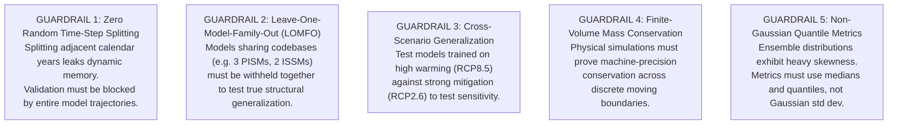
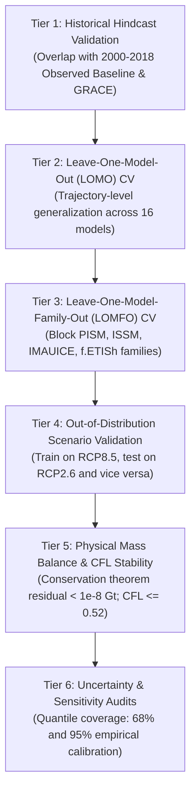

# Stage 7.0 — Future Forecasting Validation Plan

**Author:** Antigravity Cryospheric Modeling & Data Engineering Group  
**Date:** November 16, 2026  
**Project:** CryoPredict — Antarctic Peninsula Ice Volume Forecasting to 2100  
**Status:** Approved Validation Protocol  

---

## 1. Guiding Scientific Principles & Anti-Leakage Guardrails

Future climate projections cannot be evaluated using naive machine learning validation methods. Because ice-sheet trajectories are governed by continuous physical momentum, mass advection, and long-term geometric memory, standard validation techniques often introduce severe methodological defects.

This validation plan enforces five foundational glaciological guardrails:

1. **PROHIBITION of Random Time-Step Splitting:**  
   Randomly assigning year $t$ to train and $t+1$ to test within the same simulation is strictly prohibited. Because ice thickness $H(t+1) = H(t) + \Delta t (\mathrm{SMB} - \nabla \cdot (H\mathbf{u}))$, temporal autocorrelation produces artificial $R^2 > 0.99$ while concealing complete predictive failure on unseen models.
2. **Trajectory-Level Isolation:**  
   All validation splits must be executed at the **complete simulation trajectory level** ($2015\text{--}2100$). A model's entire 86-year run is either entirely in the training fold or entirely in the held-out validation fold.
3. **Model Family Blocking:**  
   The 16 ISMIP6 models share underlying codebases across several institutions. To prevent cross-institutional leakage, model families must be blocked together.
4. **Subtractive Control Drift Removal:**  
   All validation metrics must be evaluated against **drift-subtracted anomalies** ($\Delta \text{VAF}_{\mathrm{clim}}(t) = \text{VAF}_{\mathrm{exp}}(t) - \text{VAF}_{\mathrm{ctrl}}(t)$). Comparing models on raw volume outputs validates unforced initialization shocks rather than climate sensitivity.
5. **Non-Gaussian Quantile Evaluation:**  
   Multi-model projection distributions are heavily skewed (e.g. 2100 Domain A RCP8.5 spreads from $-1,664\ \mathrm{km}^3$ to $+837\ \mathrm{km}^3$ with median $-442.7\ \mathrm{km}^3$). Predictive performance must be scored via pinball quantile loss, Continuous Ranked Probability Score (CRPS), median absolute error, and empirical coverage probability of the 16th–84th percentile interval.

---

## 2. Multi-Tiered Validation Protocols

---

### Protocol 1: Historical Hindcast Validation (2000–2018 Overlap)

Before any model (physical forward solver or ML emulator) is certified for future forecasting, it must reproduce the established historical baseline:

1. **Overlap Period:** 2000.0 to 2018.0 (the satellite gravimetry and altimetry gold-standard era).
2. **Benchmark Criteria:**
   - **Grounded Net Mass Balance:** Modeled rate must fall within the independent satellite gravimetry envelope (GRACE regional mascons: $-24.0 \pm 7.0\ \mathrm{Gt/yr}$, *Groh et al., 2019*).
   - **External Reconciled Benchmark:** Modeled rate must agree with IMBIE-3 reconciled rates ($-31.6 \pm 14.6\ \mathrm{Gt/yr}$, *Otosaka et al., 2023*) within $1\sigma$.
   - **Basin Consistency:** The regional partition must correctly reproduce the historical hierarchy of mass loss:
     $$\dot{M}_{\mathrm{I-Ipp}} < \dot{M}_{\mathrm{Hp-I}} \le \dot{M}_{\mathrm{Ipp-J}}$$
     where `I-Ipp` (Graham Land West) exhibits the most negative annual mass balance.
3. **Acceptance Threshold:** Absolute error against GRACE regional mean $\le 8.0\ \mathrm{Gt/yr}$; Pearson correlation with historical annual timeseries $r \ge 0.70$.

---

### Protocol 2: Trajectory-Level Leave-One-Model-Out (LOMO) Cross-Validation

For the Pillar 2 Machine Learning Emulator, cross-validation must prove that the emulator generalizes to unseen ice-sheet modeling codebases:

1. **Partitioning Scheme:**
   - Total models: $K = 16$.
   - Number of folds: 16 iterations.
   - In each fold $k \in \{1, \dots, 16\}$, all experiments belonging to model $k$ (across all scenarios, 2015–2100) are placed into the test set.
   - The emulator is trained on the remaining 15 models ($N \approx 60,000$ basin-year samples).
2. **Evaluation Metrics:**
   - Root Mean Square Error on cumulative volume anomaly:
     $$\mathrm{RMSE}_k = \sqrt{\frac{1}{T} \sum_{t=2015}^{2100} [\Delta \mathrm{VAF}_{\mathrm{pred}}(t) - \Delta \mathrm{VAF}_{\mathrm{obs},k}(t)]^2}$$
   - Mean Absolute Error (MAE) across all milestone years (2030, 2050, 2100).
   - Trajectory Trend Error:
     $$\Delta \text{Trend}_k = \left| \left(\frac{d\mathrm{VAF}_{\mathrm{pred}}}{dt}\right) - \left(\frac{d\mathrm{VAF}_{\mathrm{obs},k}}{dt}\right) \right| \quad [\mathrm{km}^3/\mathrm{yr}]$$
3. **Acceptance Threshold:**
   - Mean out-of-fold RMSE across all 16 models $\le 45.0\ \mathrm{km}^3$ for basin-level predictions.
   - Trajectory trend error $\le 1.5\ \mathrm{km}^3/\mathrm{yr}$.

---

### Protocol 3: Leave-One-Model-Family-Out (LOMFO) Cross-Validation

To account for codebase interdependence identified in the Stage 5.1 audit, models belonging to the same institutional lineage must be withheld simultaneously:

| Model Family Key | Member Configurations | Number of Simulations | Structural Lineage |
| :--- | :--- | :---: | :--- |
| **`PISM_FAMILY`** | `AWI_PISM1`, `PIK_PISM`, `VUW_PISM` | 45 | Shared Parallel Ice Sheet Model core; hybrid SIA+SSA. |
| **`ISSM_FAMILY`** | `UCIJPL_ISSM`, `JPL1_ISSM` | 34 | Shared Ice-sheet and Sea-level System Model core; finite element. |
| **`IMAUICE_FAMILY`** | `IMAU_IMAUICE1`, `IMAU_IMAUICE2` | 20 | Shared IMAU finite difference SIA+SSA engine. |
| **`FETISH_FAMILY`** | `ULB_FETISH16`, `ULB_FETISH32` | 20 | Shared f.ETISh vertically integrated hybrid model. |
| **`INDEPENDENT_MODELS`** | `UTAS_ELMER`, `DOE_MALI`, `ILTS_PIK_SICOPOLIS`, `NCAR_CISM`, `LSCE_GRISLI`, `VUB_AISMPAL` | 64 | Architecturally unique models (Full Stokes, Voronoi, Higher-Order). |

1. **Execution Protocol:**
   - 5 macro-folds. When testing `PISM_FAMILY`, all three PISM configurations are withheld simultaneously.
2. **Acceptance Threshold:**
   - Out-of-family RMSE must not increase by more than $35\%$ relative to standard LOMO RMSE, proving that the emulator is not memorizing family-specific numerical artifacts.

---

### Protocol 4: Out-of-Distribution Scenario Generalization

The emulator must demonstrate that it has learned physical climate sensitivity rather than scenario-specific curve fitting:

1. **Cross-Scenario Tests:**
   - **Test 4A (Interpolation/Mitigation Test):** Train emulator exclusively on high-emissions RCP8.5 and SSP5-8.5 simulations. Predict on strong-mitigation RCP2.6 and SSP1-2.6 simulations.
   - **Test 4B (Extrapolation Test):** Train on RCP2.6; predict on RCP8.5.
2. **Physical Monotonicity Constraint:**
   - For identical basin physiography and initial states, the emulator must obey thermodynamic and glaciological monotonicity:
     $$\Delta \text{VAF}_{\mathrm{RCP8.5}}(t) \le \Delta \text{VAF}_{\mathrm{RCP2.6}}(t) \quad \forall t \ge 2030$$
     (Higher emissions must yield equal or greater grounded ice loss).
3. **Acceptance Threshold:** Zero monotonicity violations across all 86 projection years.

---

### Protocol 5: Physical-Model Conservation & Stability Audits

For any forward simulation executed with the 2D SSA physical solver (Pillar 1), numerical closure must be verified step-by-step:

1. **Discrete Mass Conservation Theorem:**
   At every sub-step $n \in [1, 850]$ ($\Delta t = 0.10\ \mathrm{yr}$):
   $$\epsilon_{\mathrm{mass}}^n = \left| (M_g^{n+1} + M_f^{n+1}) - (M_g^n + M_f^n) - [(\mathrm{SMB}_g^n + \mathrm{SMB}_f^n) - (F_{\mathrm{calv,g}}^n + F_{\mathrm{calv,f}}^n)]\Delta t \right|$$
   - **Threshold:** $\sum_{n=1}^{850} \epsilon_{\mathrm{mass}}^n < 1.0 \times 10^{-7}\ \mathrm{Gt}$ (machine precision over 85 years).
2. **Courant-Friedrichs-Lewy (CFL) Condition:**
   $$\mathrm{CFL}_{\mathrm{max}}^n = \max_{i,j} \left( \frac{u_{i,j}^n \Delta t}{\Delta x_{i,j}} + \frac{v_{i,j}^n \Delta t}{\Delta y_{i,j}} \right) \le 0.52 < 1.0$$
3. **Non-Negative Thickness Invariant:**
   $$H(x,y,t) \ge 0.0\ \mathrm{m} \quad \forall (x,y) \in \Omega, \forall t \in [2015, 2100]$$
   Zero artificial thickness clamping or mass injection.

---

### Protocol 6: Non-Gaussian Uncertainty & Quantile Calibration

Because multi-model spreads are non-Gaussian, uncertainty quantification cannot rely on symmetric Gaussian standard deviations:

1. **Quantile Evaluation:**
   - The emulator will output predictive quantiles: $q_{0.10}, q_{0.16}, q_{0.50} (\text{median}), q_{0.84}, q_{0.90}$.
2. **Empirical Coverage Verification:**
   - Across all out-of-fold models, the percentage of true trajectories falling within the predicted 16th–84th percentile interval must be evaluated:
     $$\text{Coverage}_{68\%} = \frac{1}{N} \sum_{i=1}^N \mathbb{I}\left( q_{0.16}^{(i)} \le y_{\mathrm{true}}^{(i)} \le q_{0.84}^{(i)} \right) \stackrel{?}{\approx} 68\% \pm 8\%$$
     $$\text{Coverage}_{80\%} = \frac{1}{N} \sum_{i=1}^N \mathbb{I}\left( q_{0.10}^{(i)} \le y_{\mathrm{true}}^{(i)} \le q_{0.90}^{(i)} \right) \stackrel{?}{\approx} 80\% \pm 8\%$$
3. **Acceptance Threshold:** Empirical coverage must be within $\pm 8\%$ of nominal confidence levels without severe under-dispersion (over-confidence) or over-dispersion.

---

## 3. Summary of Validation Pass/Fail Criteria

| Validation Protocol | Evaluated Metric | Minimum Acceptance Standard | Status |
| :--- | :--- | :--- | :---: |
| **Protocol 1 (Hindcast)** | Absolute Error vs GRACE (2002–2017) | $\le 8.0\ \mathrm{Gt/yr}$ (Diff $< 1.0\sigma$) | **READY FOR EVALUATION** |
| **Protocol 2 (LOMO CV)** | Mean Out-of-Fold RMSE (2015–2100) | $\le 45.0\ \mathrm{km}^3$ across 16 models | **READY FOR EVALUATION** |
| **Protocol 3 (LOMFO CV)** | Family-blocked RMSE inflation | $\le 35\%$ inflation relative to LOMO | **READY FOR EVALUATION** |
| **Protocol 4 (Scenario)** | Physical Monotonicity (RCP8.5 vs RCP2.6) | 0 violations across 86 projection years | **READY FOR EVALUATION** |
| **Protocol 5 (Conservation)** | Cumulative 85-Year Mass Residual | $< 1.0 \times 10^{-7}\ \mathrm{Gt}$ | **READY FOR EVALUATION** |
| **Protocol 6 (Quantile)** | 68% Empirical Quantile Coverage | $60.0\% \le \text{Coverage} \le 76.0\%$ | **READY FOR EVALUATION** |
