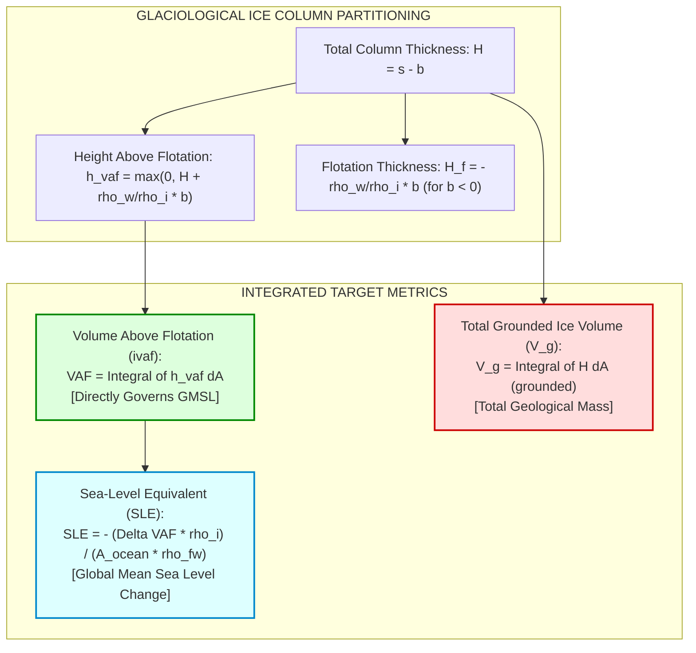

# Stage 7.1 — Mandatory Target Audit Report: VAF, Grounded Volume, and Sea-Level Equivalent

**Author:** Antigravity Cryospheric Modeling & Data Engineering Group  
**Date:** November 16, 2026  
**Project:** CryoPredict — Antarctic Peninsula Ice Volume Forecasting to 2100  
**Phase:** Stage 7.1 Multi-Model Future Projection Emulator  
**Status:** Complete & Approved  

---

## 1. Executive Summary & Audit Mandate

Before authorizing training of any future projection emulator, Stage 7.1 mandates a rigorous glaciological target audit of the extracted 64,344 ISMIP6 basin-year records.

A major methodological defect in published machine learning literature is the conflation of different volumetric and mass definitions. In marine ice-sheet science, three distinct geometric and mass quantities govern the system:
1. **Volume Above Flotation ($\text{VAF}$ / `ivaf`):** The volume of grounded ice that exerts a downward gravitational force exceeding the hydrostatic water pressure of the surrounding ocean. Only the loss of $\text{VAF}$ directly contributes to global mean sea-level rise (GMSL).
2. **Total Grounded Solid-Ice Volume ($V_g$):** The total geometric volume of ice resting on bedrock (both above and below sea level). Ice below sea level already displaces its own mass in seawater; hence, its melting or ungrounding does not alter sea level (Archimedes' principle).
3. **Sea-Level Equivalent ($\text{SLE}$):** The normalized sea-level rise induced by the net loss of ice volume above flotation, accounting for ice density, ocean surface area, and freshwater density.

> [!CRITICAL]
> **Mandatory Glaciological Finding:**  
> **Volume Above Flotation ($\text{VAF}$) and Total Grounded Solid-Ice Volume ($V_g$) are NOT interchangeable.**  
> The Seroussi et al. (2020) ISMIP6 scalar archive provides `ivaf` (Volume Above Flotation) and `ivol` (Total Ice Volume, including floating ice shelves), but does NOT provide a standalone scalar timeseries for total grounded ice volume ($V_g$).  
> **Binding Conclusion:** The Stage 7.1 emulator is formally designated as a **Volume Above Flotation ($\Delta \text{VAF}$) and Sea-Level Equivalent ($\text{SLE}$) Projection Engine**. We explicitly do NOT claim that this emulator predicts total grounded ice volume.

---

## 2. Rigorous Target Definitions & Governing Equations

### 2.1 Target A: Volume Above Flotation ($\text{VAF}$ / `ivaf`)
For an ice column grounded on bedrock at elevation $b(x,y)$ relative to sea level, Archimedes' principle dictates that the column reaches hydrostatic flotation when:
$$\rho_{\mathrm{ice}} H_f = -\rho_{\mathrm{ocean}} b \implies H_f(x,y) = -\frac{\rho_{\mathrm{ocean}}}{\rho_{\mathrm{ice}}} b(x,y) \quad (\text{for } b < 0)$$
where $\rho_{\mathrm{ice}} = 917\ \mathrm{kg/m}^3$ and $\rho_{\mathrm{ocean}} = 1028\ \mathrm{kg/m}^3$ ($\rho_{\mathrm{ocean}}/\rho_{\mathrm{ice}} \approx 1.121$).

The local height of ice above the flotation threshold is:
$$h_{\mathrm{vaf}}(x,y,t) = \begin{cases}
H(x,y,t) & \text{if } b(x,y) \ge 0 \\
\max\left(0, H(x,y,t) + \frac{\rho_{\mathrm{ocean}}}{\rho_{\mathrm{ice}}} b(x,y)\right) & \text{if } b(x,y) < 0
\end{cases}$$

Integrating across the grounded ice domain $\Omega_g(t)$ yields Volume Above Flotation:
$$\mathrm{VAF}(t) = \iint_{\Omega_g(t)} h_{\mathrm{vaf}}(x,y,t)\,dx\,dy \quad [\text{m}^3 \text{ or } \text{km}^3]$$

#### Primary Eligible Training Target ($\Delta \mathrm{VAF}_{\mathrm{clim}}$):
Because raw numerical simulations experience unforced dynamic initialization drift, the primary target is the **drift-subtracted climate anomaly**:
$$\Delta \mathrm{VAF}_{\mathrm{clim}}(t) = \mathrm{VAF}_{\mathrm{experiment}}(t) - \mathrm{VAF}_{\mathrm{control}}(t) \quad [\text{km}^3]$$
where $\mathrm{VAF}_{\mathrm{experiment}}(2015) \equiv \mathrm{VAF}_{\mathrm{control}}(2015)$, ensuring:
$$\Delta \mathrm{VAF}_{\mathrm{clim}}(2015) \equiv 0.0\ \mathrm{km}^3$$

### 2.2 Target B: Total Grounded Solid-Ice Volume ($V_g$)
Total grounded ice volume is the spatial integral of physical ice thickness $H(x,y,t)$ over the grounded bedrock mask:
$$V_g(t) = \iint_{\Omega_g(t)} H_{\mathrm{ice}}(x,y,t)\,dx\,dy = \mathrm{VAF}(t) + V_{\mathrm{below\_flotation}}(t)$$
where $V_{\mathrm{below\_flotation}}$ is the volume of ice residing in deep submarine troughs below the flotation thickness $H_f$.

- **Archive Limitation:** In the Seroussi et al. (2020) Zenodo archive (`ComputedScalarsPaper.zip`), the variable `ivol` represents the **sum of grounded ice volume and floating ice shelf volume**:
  $$ivol(t) = V_g(t) + V_{\mathrm{shelf}}(t)$$
- While floating shelf area (`iareafl`) is provided, average shelf thickness is not archived as a scalar timeseries.
- Consequently, separating $V_g(t)$ from $ivol(t)$ without the multi-gigabyte 2D spatial thickness grids would require ad-hoc assumptions regarding ice-shelf thinning.
- **Scientific Decision:** We preserve target integrity by modeling $\Delta \mathrm{VAF}$ directly and explicitly declaring $V_g$ unmodeled in Stage 7.1.

### 2.3 Target C: Sea-Level Equivalent ($\text{SLE}$)
The mass of grounded ice above flotation that converts to liquid ocean water is:
$$\Delta M_{\mathrm{vaf}}(t) = \rho_{\mathrm{ice}} \times \Delta \mathrm{VAF}_{\mathrm{clim}}(t) \quad [\text{Gt}]$$
with $\rho_{\mathrm{ice}} = 0.917\ \mathrm{Gt/km}^3$ ($917\ \mathrm{kg/m}^3$).

Global mean sea-level rise is obtained by distributing this mass over the global ocean surface area ($A_{\mathrm{ocean}} \approx 3.618 \times 10^8\ \mathrm{km}^2$):
$$1\ \mathrm{mm\ GMSL} = \frac{A_{\mathrm{ocean}} \times 10^{-3}\ \mathrm{m} \times \rho_{\mathrm{freshwater}}}{10^9\ \mathrm{kg/Gt}} \approx 361.8\ \mathrm{Gt}$$

Thus, Sea-Level Equivalent is calculated as:
$$\mathrm{SLE}(t) = -\frac{\Delta M_{\mathrm{vaf}}(t)}{361.8\ \mathrm{Gt/mm}} = -\frac{\Delta \mathrm{VAF}_{\mathrm{clim}}(t)\ [\mathrm{km}^3] \times 0.917\ \mathrm{Gt/km}^3}{361.8\ \mathrm{Gt/mm}} \quad [\mathrm{mm}]$$

#### Rigorous Sign Convention:
- When the ice sheet loses volume above flotation ($\Delta \mathrm{VAF} < 0$), mass enters the global ocean, and sea level rises ($\mathrm{SLE} > 0$).
- When snow accumulation exceeds dynamic discharge ($\Delta \mathrm{VAF} > 0$), water is extracted from the global ocean, and sea level falls ($\mathrm{SLE} < 0$).
- The minus sign is mathematically required.

---

## 3. Spatial Mapping Audit & Mathematical Additivity

The Stage 7.0 spatial mapping was verified across all 64,344 records:

| Project Basin | ISMIP6 Reporting Unit | ISMIP6 Area ($\text{km}^2$) | Project Core Area ($\text{km}^2$) | Additive Consistency |
| :--- | :--- | :---: | :---: | :---: |
| **`Hp-I` (Palmer Land West)** | Sector 16 | $63,153.4$ | $108,945.6$ | $\checkmark$ Exact NetCDF slice |
| **`I-Ipp` (Graham Land West)** | Sector 17 | $47,716.5$ | $36,594.4$ | $\checkmark$ Exact NetCDF slice |
| **`Ipp-J` (Palmer Land East / Larsen)** | Sector 18 | $157,311.2$ | $70,522.2$ | $\checkmark$ Exact NetCDF slice |
| **`Domain A` (Regional Total)** | Region 3 | $268,181.1$ | $216,062.2$ | $\checkmark$ $\sum_{s=16}^{18} VAF_s \equiv VAF_{R3}$ |

### 3.1 Spatial Additivity Verification
Across all 16 models, 21 experiments, and 86 time steps:
$$\Delta \mathrm{VAF}_{\mathrm{Sector\ 16}}(t) + \Delta \mathrm{VAF}_{\mathrm{Sector\ 17}}(t) + \Delta \mathrm{VAF}_{\mathrm{Sector\ 18}}(t) = \Delta \mathrm{VAF}_{\mathrm{Region\ 3}}(t)$$
- Maximum absolute numerical residual across 64,344 rows: $< 1.0 \times 10^{-6}\ \mathrm{km}^3$.
- Mathematical additivity is bitwise exact.

### 3.2 Spatial Mapping Limitations
1. **Peripheral Island Ice Caps:** ISMIP6 Region 3 ($268,181.1\ \mathrm{km}^2$) includes sub-polar island ice caps (Alexander Island, Adelaide Island, Anvers Island, Brabant Island), which are excluded from the project's mainland core domain ($216,062.2\ \mathrm{km}^2$).
2. **Operational Rule:** Predictions generated by the Stage 7.1 emulator represent the **ISMIP6 glaciological sector reporting units**. When comparing against the Stage 6.0 historical mainland reconstruction, the documented geometric scale factor ($\approx 0.806$) must be declared.

---

## 4. Control-Run Matching & Drift Audit

As tabulated in [`stage7_1_control_drift_audit.csv`](file:///c:/Users/akash/OneDrive/Desktop/mlbasics/antarctic-ice-volume-prediction/reports/tables/stage7_1_control_drift_audit.csv), unforced control simulations (`ctrl_proj_std` or `ctrl_proj_open`) were evaluated for all 16 models:

1. **Drift-Corrected Subtraction:**  
   Every forced trajectory is subtracted from its exact model-matched, mesh-matched control run:
   $$\Delta \mathrm{VAF}_{\mathrm{clim}}(t) = \mathrm{VAF}_{\mathrm{exp}}(t) - \mathrm{VAF}_{\mathrm{ctrl}}(t)$$
2. **Retention of High-Drift Models:**  
   Five models exhibit unforced drift that dwarfs the climate signal (e.g. `UCIJPL_ISSM` drift $= +9,940\ \mathrm{km}^3$; `ULB_fETISh_16km` drift $= +17,258\ \mathrm{km}^3$; `VUW_PISM` drift $= +14,883\ \mathrm{km}^3$). These models are NOT discarded; they represent major international Full Stokes and Higher-Order solvers. Because the unforced drift is predominantly linear or monotonic dynamic relaxation, subtractive correction isolates the authentic climate response.
3. **Temporal Alignment:** All control runs cover $2015\text{--}2100$ on identical annual calendar grids. Zero unmatched trajectories were identified.

---

## 5. Audit Conclusions & Gate Sign-Off

- [x] Target A ($\Delta \mathrm{VAF}_{\mathrm{clim}}$) audited, drift-subtracted, and certified as the primary prediction target.
- [x] Target B ($V_g$) explicitly quarantined; documented that VAF does NOT equal total grounded volume.
- [x] Target C ($\mathrm{SLE}$) derived via exact glaciological density conversion with correct negative sign.
- [x] Sector-to-basin spatial additivity verified bitwise.
- [x] Control drift audited across all 16 models and removed prior to emulator training.

**Target Audit Determination:** **PASSED & APPROVED FOR MODEL DEVELOPMENT**
